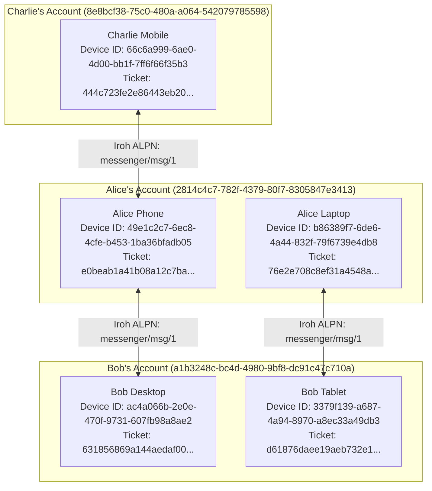
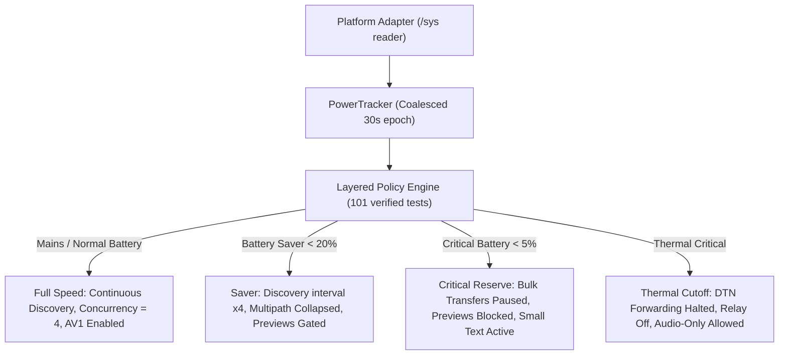

<p align="center">
  
</p>

<h1 align="center">SIAR — Survivable Identity & Autonomous Routing</h1>

<p align="center">
  <a href="https://github.com/irshadlab/siar"></a>
  <a href="https://siar.irshadlab.org/"></a>
  <a href="wiki/Home.md"></a>
  <a href="https://siar.irshadlab.org/guide.html"></a>
  <a href="https://siar.irshadlab.org/sys-arch/"></a>
  <a href="https://siar.irshadlab.org/docs.html"></a>
  <a href="https://siar.irshadlab.org/packages.html"></a>
  <a href="#license--dual-tier-model"></a>
</p>

> [!CAUTION]
> ### ⚠️ FOUNDATIONAL DEVELOPMENT NOTICE — NOT CURRENTLY USABLE ON ANY DEVICE
>
> * **Active Foundational Development:** SIAR is currently in pre-alpha foundational systems development. **It is NOT YET USABLE on any daily-driver mobile phone, desktop, or operational device.** End-user applications and installable packages will become operational upon the completion of the first formal milestone release (Milestone 1 / v0.1.0+).
> * **AI / LLM Development Transparency Disclosure:** SIAR's extensive architectural specifications (176 specifications across 514k+ lines), wiki documentation, and codebase are **heavily developed with the assistance of advanced Artificial Intelligence / Large Language Models (AI/LLMs)** working under human architectural direction and verification.
> * **URGENT: Security Researchers, Cryptographers & Protocol Engineers Required:** Because SIAR is designed for post-infrastructure, disaster-recovery, and high-threat environments, **independent third-party security researchers and protocol engineers are urgently needed** to perform formal mathematical verification, cryptographic audits, memory safety inspections, and fuzz testing across the cryptography (`siar-crypto`, `siar-crypto-mls`), wire framing (`siar-protocol`, `siar-protocol-ext`), transport/routing (`siar-transport`, `siar-routing-policy`), storage, and media subsystems to discover and eliminate potential vulnerabilities before real-world deployment.
>
> **DO NOT deploy SIAR in production, life-safety, high-threat, or operational environments until formal independent audits and the v0.1.0 milestone release are complete.**

> 🏛️ **Organization Stewardship & Research Initiative:**  
> **SIAR** is an open-source systems initiative developed and stewarded under **[Irshad Lab](https://irshadlab.org)** ([`@irshadlab`](https://github.com/irshadlab)) — focused on local-first computing, resilient peer-to-peer networking, and sovereign systems engineering.
>
> **Official Showcase, Package Center & Live Architecture Documentation:**
> - 🌐 **[Official Product Presentation](https://siar.irshadlab.org/)**
> - 🖼️ **[Desktop UI Reference Gallery](docs/screenshots/README.md)** — Dark/Light themes, Contact Verification, MLS Groups & Settings
> - 📚 **[Comprehensive Technical Wiki (50 Chapters)](wiki/Home.md)** — System Stack, Multi-Device Trust, Routing, DTN, Security Center, Calls, Testing & Operations
> - 📘 **[End-to-End User & Operations Manual](https://siar.irshadlab.org/guide.html)** — Zero-Knowledge Setup, QR/NFC Pairing, Vault Export/Import & Anti-Forensics
> - 📑 **[System Architecture & Protocol Specs (mdBook)](https://siar.irshadlab.org/sys-arch/)** — 33+ numbered core specs + 27 UI/UX specs
> - 📦 **[Universal Package Center](https://siar.irshadlab.org/packages.html)** — .deb, .rpm, .apk, .dmg, brew, winget
> - 🔬 **[Interactive WASM Mesh Simulator Lab](https://siar.irshadlab.org/simulator.html)**
> - 🛡️ **[SLSA Level 3+ Supply Chain Cryptographic Verifier](https://siar.irshadlab.org/verify.html)**

---

## Table of Contents

- [What SIAR Is](#what-siar-is)
- [Core Design Rules](#core-design-rules)
- [Specification Governance: sys-arch for Core, ui-ux for UI](#specification-governance-sys-arch-for-core-ui-ux-for-ui)
- [Architecture: Five Layers](#architecture-five-layers)
- [Transport & Routing Policy Engine](#transport--routing-policy-engine)
- [Multi-Device Identity & Trust](#multi-device-identity--trust)
- [End-to-End Security Model](#end-to-end-security-model)
- [DTN: Store-Carry-Forward](#dtn-store-carry-forward)
- [Realtime Calls & Media](#realtime-calls--media)
- [Headless Daemon & Embedded Nodes](#headless-daemon--embedded-nodes)
- [Protocol Extensions & WASM](#protocol-extensions--wasm)
- [Anonymity Transport Plane](#anonymity-transport-plane)
- [Workspace Crate Map (41 Domain Crates)](#workspace-crate-map-41-domain-crates)
- [Deployment Modes](#deployment-modes)
- [SIAR vs Traditional Messengers](#siar-vs-traditional-messengers)
- [Implementation Status & Roadmap](#implementation-status--roadmap)
- [Prerequisites & Environment Setup](#prerequisites--environment-setup)
- [Build & Compilation Tutorial](#build--compilation-tutorial)
- [Node Configuration & User Guide](#node-configuration--user-guide)
- [Testing & Fuzzing](#testing--fuzzing)
- [Empirical Evaluation & Distributed Telemetry Report](#empirical-evaluation--distributed-telemetry-report)
- [License & Dual-Tier Model](#license--dual-tier-model)
- [Contributing](#contributing)

---

## What SIAR Is

**SIAR** ( **Survivable Identity & Autonomous Routing** ) is a **reusable, zero-infrastructure, multi-transport, offline-first P2P communication platform** engineered to invert traditional client-server assumptions.

> **The application expresses intent and constraints. The platform selects paths, manages retries, falls back to DTN, and re-establishes sessions — without the application understanding transport mechanics.**

<details>
<summary><strong>Expand Core Principles & Architectural Motivation</strong></summary>

Traditional messengers (WhatsApp, Signal, Telegram) assume always-on infrastructure: centralized server clusters, public DNS, PKI, and continuous Internet access. When natural disasters strike, telecommunications infrastructure collapses, or state-level censorship severs external backhauls, these apps completely fail.

SIAR is engineered from first principles to invert these assumptions:

1. **Zero-Infrastructure Invariant** — the system must operate seamlessly when zero external servers, DNS nodes, or Internet gateways are reachable.
2. **Cryptographic Sovereignty** — identities are root Ed25519 signing pairs owned exclusively by local devices — no phone numbers, email addresses, or centralized registries.
3. **Opportunistic Dissemination** — messages and files are delay-tolerant bundles that travel over any available medium (BLE, Wi-Fi Direct, Wi-Fi Aware, Bluetooth Classic, LAN, Internet QUIC) through store-carry-forward physical mules.
4. **Unified Cross-Platform Core** — a high-performance, memory-safe pure-Rust workspace powers CLI daemons, solar-powered mesh repeaters, Android apps, and desktop interfaces.
5. **Reusable Platform** — the underlying architecture is not messenger-specific. The same crates back messaging, files, emergency SOS, group comms, ERP payloads, and future custom applications.

The governing rule from [`sys-arch/`](sys-arch/):

> **The application expresses intent and constraints. The platform selects paths, manages retries, falls back to DTN, and re-establishes sessions — without the application understanding transport mechanics.**

</details>

---

## Core Design Rules

SIAR enforces immutable foundational invariants derived directly from the [`sys-arch/`](sys-arch/) specification corpus across every crate in the workspace:

<details>
<summary><strong>Expand Core Design Rules Table</strong></summary>

These rules appear directly in the sys-arch specifications and govern every crate in the workspace:

| Rule | Specification Source |
| :--- | :--- |
| Feature code must never implement transport selection | `sys-arch/03` §2 |
| The daemon owns durable state; UI is a client of the runtime | `sys-arch/16` §1 |
| Transport security protects the path; application E2EE protects the conversation regardless of path | `sys-arch/28` §1 |
| A person is an account, not a device — routing must address accounts, not device keys | `sys-arch/02` §2 |
| DTN is not Bluetooth forwarding logic or emergency-only forwarding — it is a transport-neutral persistence layer | `sys-arch/06` §2 |
| Protocol extensions are a versioned capability architecture, not a dynamic plugin system for arbitrary untrusted code | `sys-arch/01` §2 |
| SIAR must treat anonymity as an explicit routing/security property, not a side effect of encryption | `sys-arch/34` §1 |
| The call is a logical secure session; network paths, codecs, devices, and surfaces are replaceable implementation resources inside that session | `sys-arch/29` §1 |

</details>

---

## Specification Governance: sys-arch for Core, ui-ux for UI

All engineering and implementation in SIAR strictly follows a dual-specification authority model:
- 📐 **Core Engine, Protocols & Daemons**: Governed by **[`sys-arch/`](sys-arch/)** (176 specifications).
- 🎨 **Frontends, UI/UX & State Machines**: Governed by **[`ui-ux/`](ui-ux/)** (27 specifications).
- 🔒 **Core Invariant**: The daemon owns all durable state; UI is strictly a decoupled client of runtime and never owns transport or crypto state.

<details>
<summary><strong>Expand Governance Architecture & Specification Chapters</strong></summary>

```
┌──────────────────────────────────────────────────────────────────────────────────────────────────────────┐
│                                   SIAR SPECIFICATION GOVERNANCE ARCHITECTURE                            │
├────────────────────────────────────────────────────┬─────────────────────────────────────────────────────┤
│ 📐 Core Engine, Protocols & Daemons: sys-arch/     │ 🎨 Frontends, UI/UX & State Machines: ui-ux/        │
├────────────────────────────────────────────────────┼─────────────────────────────────────────────────────┤
│ • Authority Corpus: sys-arch/ (176 Specifications) │ • Authority Corpus: ui-ux/ (27 Specifications)      │
│   - Parts 01–33: Core Mesh, Local-First Engine,    │   - ui-ux-01..03: App Shells & Platform Navigation  │
│     DTN, Multi-Transport, Security & Codecs        │   - ui-ux-04..06: Timelines, Composer & Attachments │
│   - Parts 34–150: Anonymous Mixnet, Private        │   - ui-ux-07..10: Realtime Calls, Groups & Files    │
│     Mailboxes, Cloud Ecosystem & Resilient Ops     │   - ui-ux-11..17: Security Center, SOS & Pairing    │
│                                                    │   - ui-ux-18..27: Tokens, Motion, A11y & Gates      │
│ • Target Codebases:                                │ • Target Codebases:                                 │
│   - Pure-Rust domain crates: crates/siar-* (41)    │   - apps/desktop (Slint 1.16 Native Desktop GUI)     │
│   - apps/emergency-node (Headless Solar Daemon)    │   - apps/android (Jetpack Compose + JNI UI layer)   │
│   - apps/cli (Interactive Terminal & Diagnostics)  │   - crates/siar-ui-state / siar-ui-slint            │
│ • Core Invariants:                                 │ • UI Invariants:                                    │
│   - Zero external infrastructure dependency        │   - UI is strictly a decoupled client of runtime    │
│   - Feature code never implements transport choice │   - UI never owns durable transport or crypto state │
│   - Pure Rust, memory-safe, panic-free paths       │   - Reactive state machines isolate UI from events  │
└────────────────────────────────────────────────────┴─────────────────────────────────────────────────────┘
```

### 1. Core Development Follows `sys-arch/`
All backend runtime engines, protocol framing, cryptographic handshakes, transport drivers, and storage subsystems must strictly follow the **[`sys-arch/`](sys-arch/)** specification corpus:
- **Wire Protocols & Handshakes**: Binary wire framing, extension negotiation, and capability schemas follow [`sys-arch/01`](sys-arch/01-protocol-extension-system-architecture.md) and [`sys-arch/07`](sys-arch/07-capability-negotiation-architecture.md).
- **Identity & Cryptography**: Root Ed25519 account sovereignty, device certificates, OpenMLS trees, and SAS out-of-band verification follow [`sys-arch/02`](sys-arch/02-multi-device-identity-architecture.md) and [`sys-arch/28`](sys-arch/28-production-security-e2ee-key-management-privacy-architecture.md).
- **Transport & Multi-Metric Routing**: Candidate discovery, link-state scoring, adaptive transport selection, and battery-aware scheduling follow [`sys-arch/03`](sys-arch/03-transport-routing-policy-engine-architecture.md) and [`sys-arch/13`](sys-arch/13-battery-aware-scheduling-architecture.md).
- **DTN & Emergency Survivability**: Delay-tolerant bundle store-carry-forward and life-safety priority queues follow [`sys-arch/06`](sys-arch/06-dtn-store-carry-forward-architecture.md) and [`sys-arch/17`](sys-arch/17-emergency-priority-classes-architecture.md).
- **Daemon Lifecycle & Headless Services**: Headless unattended operation, crash recovery, and WAL replay follow [`sys-arch/09`](sys-arch/09-crash-recovery-architecture.md), [`sys-arch/16`](sys-arch/16-daemon-headless-runtime-architecture.md), and [`sys-arch/20`](sys-arch/20-embedded-linux-node-architecture.md).

### 2. User Interface Development Follows `ui-ux/`
All user-facing graphical applications, mobile experiences, layout systems, visual states, and reactive UI state machines must strictly follow the **[`ui-ux/`](ui-ux/)** specification corpus:
- **Application Shells & Navigation**: Multi-pane desktop navigation, mobile tab bars, window state restoration, and back-stack handling follow [`ui-ux-01`](ui-ux/ui-ux-01-product-foundation-cross-platform-interaction-architecture.md), [`ui-ux-02`](ui-ux/ui-ux-02-desktop-dioxus-app-shell-navigation-window-architecture.md) (implemented natively in Slint via [`siar-ui-slint`](crates/siar-ui-slint)), and [`ui-ux-03`](ui-ux/ui-ux-03-android-jetpack-compose-app-shell-navigation-lifecycle-architecture.md).
- **Conversations & Message Timeline**: Message bubbles, delivery checkmarks (Pending, DTN Relayed, Delivered, Read), media carousels, and composer attachments follow [`ui-ux-04`](ui-ux/ui-ux-04-conversation-list-inbox-architecture.md), [`ui-ux-05`](ui-ux/ui-ux-05-conversation-message-timeline-architecture.md), and [`ui-ux-06`](ui-ux/ui-ux-06-message-composer-attachments-voice-notes-drafts-architecture.md).
- **Security Center & Trust Flows**: Cryptographic identity management, key rotation warnings, device revocation ceremonies, recovery phrase verification, and SAS visual comparisons follow [`ui-ux-15`](ui-ux/ui-ux-15-security-center-devices-keys-recovery-architecture.md).
- **Emergency SOS & Offline Degraded States**: High-contrast offline mesh indicators, zero-connection SOS banners, transport fallback indicators, and battery-saver modes follow [`ui-ux-17`](ui-ux/ui-ux-17-emergency-sos-offline-mesh-architecture.md) and [`ui-ux-24`](ui-ux/ui-ux-24-error-loading-empty-offline-degraded-state-architecture.md).
- **Design Tokens, Typography & Inclusive Access**: Color tokens, typography scales, touch targets, screen reader semantic labels, and motion curves follow [`ui-ux-21`](ui-ux/ui-ux-21-accessibility-inclusive-interaction-architecture%20.md) and [`ui-ux-22`](ui-ux/ui-ux-22-design-system-tokens-typography-icons-motion-architecture.md).

### 3. Core-to-UI Separation Invariant
In accordance with [`sys-arch/16`](sys-arch/16-daemon-headless-runtime-architecture.md) and [`ui-ux-01`](ui-ux/ui-ux-01-product-foundation-cross-platform-interaction-architecture.md):
1. **The Daemon Owns State**: The pure-Rust core runtime manages durable database storage, active network sockets, cryptographic ratchet states, and routing decisions.
2. **The UI is a Stateless Client**: Frontend applications (`apps/desktop`, `apps/android`) observe reactive state streams exposed by [`siar-ui-state`](crates/siar-ui-state) and emit user intent commands.
3. **No Direct Socket or Crypto Manipulation in UI**: UI code must never open raw network sockets, attempt ad-hoc cryptographic operations, or implement private transport failover logic.

</details>

---

## Architecture: Five Layers

SIAR is structured into five distinct, decoupled architectural layers ensuring complete isolation from raw physical radio drivers up to frontend application shells:
1. **Layer 5: Applications & UI/UX** (`apps/desktop`, `apps/android`, `apps/emergency-node`, `apps/cli`)
2. **Layer 4: High-Level Services** (`siar-messaging`, `siar-calls`, `siar-files`, `siar-dtn-bundle-service`)
3. **Layer 3: Routing, Policy & DTN Engine** (`siar-routing-policy`, `siar-connectivity`, `siar-dtn-bundle`, `siar-emergency`)
4. **Layer 2: Storage, Crypto & Reliability** (`siar-crypto`, `siar-crypto-mls`, `siar-storage`, `siar-blob-manifest`, `siar-crash-recovery`)
5. **Layer 1: Transport & Wire Protocols** (`siar-protocol`, `siar-protocol-ext`, `siar-capability`, `siar-transport-*`)

<details>
<summary><strong>Expand Five Layers Architectural Diagram</strong></summary>

```
+---------------------------------------------------------------------------------------+
|                                5. Applications & UI/UX                                |
|  - apps/android (Jetpack Compose + JNI)   - apps/desktop (Slint 1.16 Native GUI)      |
|  - apps/emergency-node (Solar Repeater)   - apps/cli (Dev Diagnostics & CLI Node)     |
+---------------------------------------------------------------------------------------+
|                                4. High-Level Services                                 |
|  - siar-messaging (Message & Group Engine)- siar-calls (Realtime AV1 / Opus Sessions) |
|  - siar-identity-multidevice (Certs, SAS) - siar-ui-state / siar-ui-slint (UI Views)  |
|  - siar-files (Blob Transfer Service)     - siar-dtn-bundle-service (DTN Sync)        |
+---------------------------------------------------------------------------------------+
|                            3. Routing, Policy & DTN Engine                            |
|  - siar-routing-policy (Multi-Metric)     - siar-dtn-bundle (Spray-and-Wait Forward)  |
|  - siar-connectivity (Link State Probes)  - siar-emergency (Priority Classes P0–P3)   |
+---------------------------------------------------------------------------------------+
|                             2. Storage, Crypto & Reliability                          |
|  - siar-crypto (Ed25519/X25519 AEAD)      - siar-crypto-mls (RFC 9420 MLS E2EE)       |
|  - siar-storage (Stoolap Embedded SQL)    - siar-blob-manifest (BLAKE3 Merkle DAG)    |
|  - siar-resource-limits (Backpressure)    - siar-crash-recovery (WAL & Checkpoints)   |
|  - siar-event-log (Monotonic Sequence Log)                                            |
+---------------------------------------------------------------------------------------+
|                              1. Transport & Wire Protocols                            |
|  - siar-protocol (Postcard Wire Codec)    - siar-protocol-ext (CapNeg & Scheduler)    |
|  - siar-capability (2-Phase Confirmation) - siar-transport (Pooled Connection Socket) |
|  - siar-transport-ble / -ble-android      - siar-transport-bluetooth-classic (RFCOMM) |
|  - siar-transport-wifi-direct (P2P)       - siar-transport-wifi-aware (NAN Proximity) |
+---------------------------------------------------------------------------------------+
```

</details>

---

## Transport & Routing Policy Engine

*Specification: [`sys-arch/03`](sys-arch/03-transport-routing-policy-engine-architecture.md) · Crate: [`siar-routing-policy`](crates/siar-routing-policy)*

Rather than hardcoding transport selection, applications publish **`DeliveryRequirements`** (priority, latency ceiling, battery limit). The policy engine dynamically evaluates candidate links and shifts between operational modes:

| Mode | Available Networks | Delivery Mechanism |
| :--- | :--- | :--- |
| **Connected Online** | Internet / LAN / Wi-Fi | Iroh QUIC, direct end-to-end streams |
| **Local Tactical Mesh** | Wi-Fi Direct, Wi-Fi Aware, LAN | Hop-by-hop mesh forwarding (sub-10 ms) |
| **Air-Gapped / Off-Grid** | BLE GATT, Bluetooth Classic | Physical mule DTN with Spray-and-Wait |

<details>
<summary><strong>Expand Routing Policy Engine Pipeline & Profiles</strong></summary>

The platform supports all of the following physical paths simultaneously:

```
Iroh QUIC (direct / relay)   Wi-Fi Direct (P2P)
Local LAN (multicast)        Wi-Fi Aware (NAN)
Bluetooth Classic (RFCOMM)   Bluetooth LE (GATT)
DTN / store-carry-forward    future transports
```

Rather than letting application code pick a transport, each operation publishes **`DeliveryRequirements`** (priority class, deadline, bandwidth floor, metered/roaming policy, relay allowance, DTN opt-in). The routing policy engine:

1. Resolves candidate paths for the destination account across all of its devices.
2. Scores each candidate with a **multi-metric weighted formula** (RTT, bandwidth, setup cost, stability, energy cost, congestion, candidate state).
3. Applies hard constraint elimination (metered, roaming, background restriction, scope, revoked device, deadline).
4. Applies layered policy checks (system → application → user → operation → network context).
5. Returns a `RoutePlan` (`Direct` / `Redundant` / `Hedged` / `Dtn`) with per-device routing for multi-device accounts.

Policy profiles include: `RealTime`, `Interactive`, `Bulk`, `Background`, `Emergency`, `LowPower`, `OffGrid`. The engine also enforces stickiness hysteresis to prevent oscillation under measurement jitter.

</details>

---

## Multi-Device Identity & Trust

*Specification: [`sys-arch/02`](sys-arch/02-multi-device-identity-architecture.md) · Crate: [`siar-identity-multidevice`](crates/siar-identity-multidevice)*

A person is an **Account**, not a device. All devices belonging to a user share the exact same canonical **Account ID**, while each physical hardware device generates an independent **Device ID**, cryptographic key pairs (Ed25519/X25519), and unique peer tickets.

<details>
<summary><strong>Expand Multi-Device Trust Hierarchy & Security Guarantees</strong></summary>

SIAR distinguishes five identity layers:

```
Account Identity  →  Device Identity  →  Transport Identity  →  Session Identity  →  Application Profile
```

Each device generates an independent Ed25519 key pair and obtains a **`DeviceCertificate`** signed by the account's root authority. The trust model supports:

- **Multiple active devices** (phone, laptop, headless node, secondary phone)
- **Independent per-device keys** with device-specific transport addresses
- **Monotonic revocation** — a revoked device cannot forge retroactive authority
- **SAS (Short Authentication String) out-of-band verification** for secure linking (QR code, NFC, or verbal code)
- **Per-device capability sets** — a headless relay does not advertise `REALTIME_MEDIA`
- **Account recovery** with encrypted key backups and import validation before any local state is touched
- **Algorithm agility** — signature and KEM schemes are replaceable without breaking the identity model
- **Organization/enterprise namespaces** with multi-tenant composite keys

The identity layer is designed to remain **reusable outside the messenger** — the same model backs messaging, files, emergency SOS, ERP, and any future application built on this platform.

</details>

---

## End-to-End Security Model

*Specification: [`sys-arch/28`](sys-arch/28-production-security-e2ee-key-management-privacy-architecture.md) · Crates: [`siar-crypto`](crates/siar-crypto), [`siar-crypto-mls`](crates/siar-crypto-mls)*

SIAR enforces a strict zero-trust model: all conversation payloads are end-to-end encrypted using MLS (RFC 9420) and authenticated device sessions (Ed25519 + X25519 + ChaCha20-Poly1305). Intermediate relay nodes, DTN carriers, and physical mules never hold decryption keys.

<details>
<summary><strong>Expand Layered Threat Model & Cryptographic Guarantees</strong></summary>

```
Application E2EE (MLS RFC 9420)
      ↓
Conversation / Group Security (OpenMLS tree ratchet)
      ↓
Authenticated Device Sessions (Ed25519 + X25519)
      ↓
Iroh / QUIC Transport Security
      ↓
Internet / LAN / BLE / Relay / DTN
```

**Threat model**: any relay server, DTN carrier, public network, nearby Bluetooth peer, server database, third-party plugin, external FFI caller, stolen device, or old backup can be hostile or compromised. The design trusts only: the current unlocked local device, explicitly authorized devices, verified contacts, and explicit organization/authority keys.

Required security properties:
- **End-to-end confidentiality** — ciphertext is unreadable by relays, carriers, or infrastructure operators
- **Forward secrecy** — compromise of today's keys does not expose past messages (MLS epoch ratchet)
- **Post-compromise security** — after a device is removed, new group state remains confidential from it
- **Offline / DTN-safe encryption** — messages encrypted for delivery remain sealed while carried by DTN mules
- **Metadata minimization** — routing decisions carry no content; `RouteMetricEvent` has no peer-identity or IP fields by construction

</details>

---

## DTN: Store-Carry-Forward

*Specification: [`sys-arch/06`](sys-arch/06-dtn-store-carry-forward-architecture.md) · Crate: [`siar-dtn-bundle`](crates/siar-dtn-bundle)*

Delay-Tolerant Networking (DTN) enables reliable communication across air-gapped zones and complete network blackouts by persisting encrypted bundles locally and forwarding them through physical peer encounters via Spray-and-Wait replication.

<details>
<summary><strong>Expand DTN Topology, Custody Receipts & Routing Details</strong></summary>

```
Alice (no Internet, no Wi-Fi, no direct Bluetooth to destination)
  ↓
Bob (physical mule — encounters Alice via BLE)
  ↓
Carol (physical mule — encounters Bob via Wi-Fi Direct)
  ↓
Gateway (encounters Carol, has Internet)
  ↓
Destination
```

The DTN subsystem persists payloads locally, carries them across time, and forwards them when useful connectivity appears. It is transport-neutral and supports:

- Text messages, delivery receipts, emergency SOS, authority alerts
- Small file metadata and selected file chunks
- Custom application events for ERP and third-party integrations

**Spray-and-Wait** replication (configurable `dtn_replication_budget`) limits network flooding while maximising delivery probability. Bundle custody receipts confirm when a mule has accepted responsibility for forwarding. The routing policy engine integrates DTN as a first-class `RouteStrategy::Dtn` outcome — fallback to DTN is a policy decision, not a last-resort hack.

</details>

---

## Realtime Calls & Media

*Specification: [`sys-arch/29`](sys-arch/29-realtime-calls-media-session-protocol-architecture.md) · Crates: [`siar-calls`](crates/siar-calls), [`siar-media-android`](crates/siar-media-android), [`siar-media-audio`](crates/siar-media-audio), [`siar-media-av1`](crates/siar-media-av1)*

Calls in SIAR are **logical secure sessions** decoupled from physical network paths. Under the hood, audio/video sessions seamlessly hand off across transports (e.g., Wi-Fi Direct to Internet QUIC) without dropping the call.

<details>
<summary><strong>Expand Call Controller Architecture & Codec Pipelines</strong></summary>

```
Call Controller
    ├── Signaling   (ringing / accept / reject / busy / timeout)
    ├── Security    (session authentication bound to E2EE identity)
    └── Policy      (codec selection, bitrate, hold/resume, path handoff)
         ├── siar-media-android  (Android MediaCodec zero-copy hardware surfaces)
         ├── siar-media-av1      (desktop dav1d AV1 software decoder)
         └── siar-media-audio    (Opus + AEC / NS / AGC DSP pipeline)
```

The call architecture supports:
- **P2P signaling** without a signaling server — session control messages travel over the same Iroh/mesh transport as regular messages
- **Multipath resilience** — the session survives a path change; the routing engine's `RouteChangeEvent::NewPath` triggers codec renegotiation, not call termination
- **Hardware zero-copy surfaces** on Android — `MediaCodec` decodes directly into `SurfaceTexture` without intermediate copy
- **Pure-Rust DSP on desktop** — Opus encode/decode, acoustic echo cancellation (AEC), noise suppression (NS), automatic gain control (AGC)
- **Crash-safe call history** — call records are written to durable storage before the session is confirmed torn down

</details>

---

## Headless Daemon & Embedded Nodes

*Specification: [`sys-arch/16`](sys-arch/16-daemon-headless-runtime-architecture.md) · App: [`apps/emergency-node`](apps/emergency-node)*

The core networking and DTN engine functions fully without a GUI. Standalone daemons deploy on low-power single-board computers (Raspberry Pi, OpenWrt routers) and solar-powered field units as autonomous off-grid repeaters.

<details>
<summary><strong>Expand Headless Architecture & Solar Repeater Specifications</strong></summary>

```
Slint Desktop UI   ──Secure Local IPC / Direct Core Wiring──▶  comm-daemon / runtime
                                                                  ├── Identity
                                                                  ├── Messaging
                                                                  ├── Files & DTN
                                                                  ├── Routing & Multipath
                                                                  ├── Power policy
                                                                  └── Recovery
                                                                          │
                                                                 Iroh / LAN / BLE / Wi-Fi
```

**`apps/emergency-node`** is a standalone headless daemon deployable on:
- Raspberry Pi, OpenWrt routers, embedded Linux single-board computers
- Solar-powered field nodes and dedicated mobile repeater boosters
- Linux servers for self-hosted relay infrastructure

In headless mode, the daemon autonomously stores, carries, and re-transmits encrypted bundles across disconnected network partitions — functioning as a **mesh repeater** during complete Internet blackouts and disaster scenarios, without any UI requirement.

Self-hosted relay infrastructure ([`sys-arch/11`](sys-arch/11-relay-self-hosted-infrastructure-architecture.md)) allows organizations to deploy private relay fleets, regional relay clusters, and DTN gateway bridges without lock-in to any centralized service.

</details>

---

## Protocol Extensions & WASM

*Specifications: [`sys-arch/01`](sys-arch/01-protocol-extension-system-architecture.md), [`sys-arch/22`](sys-arch/22-wasm-compatible-components-architecture.md) · Crates: [`siar-protocol-ext`](crates/siar-protocol-ext), [`siar-capability`](crates/siar-capability)*

SIAR uses a **versioned capability architecture** with two-phase negotiation and weighted fair queuing, ensuring high-priority emergency packets are never blocked by heavy background file transfers.

<details>
<summary><strong>Expand Capability Negotiation & WASM Component Sandboxing</strong></summary>

```
Communication Session
    │
    ├── Core Control Protocol (always present)
    │
    └── Extension Negotiation (per-peer capability set)
          ├── messaging/1
          ├── files/1
          ├── dtn/1
          ├── emergency/1
          ├── calls/1
          └── custom-app/1  (third-party or ERP extensions)
```

Two-phase capability confirmation (`NegotiationHash` + `HandshakeNonce`) ensures peers agree on extension support before sending extension frames. `FairScheduler` and `BoundedQueue` in `siar-protocol-ext` enforce weighted-fair scheduling and backpressure across all extensions — a slow file transfer cannot starve an emergency SOS.

WASM-compatible components ([`sys-arch/22`](sys-arch/22-wasm-compatible-components-architecture.md)) enable portable execution of selected logic (custom protocol handlers, routing filters, ERP integrations) across desktop, server, embedded Linux, and browser-compatible environments — while the native Rust core retains ownership of networking, hardware codecs, secure key stores, and daemon lifecycle.

</details>

---

## Anonymity Transport Plane

*Specification: [`sys-arch/34`](sys-arch/34-mixnet-loopix-sphinx-nym-high-anonymity-transport-architecture.md)*

An independent, additive **High-Anonymity Transport Plane** based on mixnet principles (Loopix/Sphinx) provides cryptographic resistance against network timing and metadata traffic analysis.

<details>
<summary><strong>Expand Sphinx Packet Encapsulation & Mixnet Rules</strong></summary>

SIAR's existing transports optimize for reachability, latency, bandwidth, reliability, and offline operation. They do not, by themselves, provide strong resistance against network metadata analysis — a network observer can still infer communication relationships from timing and volume, even when message contents are E2EE-protected.

Part 34 introduces an independent **High-Anonymity Transport Plane** based on mix-network principles (Loopix/Sphinx/Nym):

- **Sphinx packet encapsulation** — layered onion routing with per-hop key agreement
- **Randomized delays and cover traffic** — timing analysis resistance
- **Anonymous mailboxes** — offline reception and unlinkable reply capability
- **Strict downgrade prevention** — explicit anonymity policy, not a best-effort side effect

The anonymity plane is an additive routing class integrated with SIAR's existing policy engine — it does not replace or weaken direct, mesh, DTN, or realtime transport.

</details>

---

## Workspace Crate Map (41 Domain Crates)

SIAR is structured as a modular Rust cargo workspace comprising **41 domain crates**, **4 application environments**, 2 Android JNI runtime bridges, and fuzz testing harnesses.

<details>
<summary><strong>Expand Complete Workspace Crate Tree & Domain Directory Map</strong></summary>

```text
siar/
├── apps/
│   ├── android/                          # Android Native App & JNI Bridges
│   │   ├── app/                          # Jetpack Compose UI (Chat, Groups, Settings, Radar)
│   │   ├── messaging-jni/                # Rust JNI cdylib surface (siar-android-messaging)
│   │   ├── rust-jni-glue/                # Shared JNI glue, memory safety, and JVM callbacks
│   │   └── build-native.sh               # Multi-ABI cargo-ndk build automation script
│   ├── cli/                              # Interactive Terminal Messenger & Diagnostics Node
│   ├── desktop/                          # Native Desktop GUI (Slint 1.16 Shell & Core Wiring)
│   └── emergency-node/                   # Headless Emergency DTN Relay & Booster Daemon
├── crates/
│   ├── [Core Domain, Identity & Trust]
│   │   ├── siar-domain/                  # Core entities: AccountId, DeviceId, Ticket, SafetyFingerprint
│   │   ├── siar-crypto/                  # Ed25519, X25519, ChaCha20-Poly1305, zeroize primitives
│   │   ├── siar-crypto-mls/              # IETF MLS (RFC 9420) Tree-KEM 1:1 and group E2EE engine
│   │   ├── siar-identity-multidevice/    # Multi-device authority, device certs, trust store, SAS pairing
│   │   └── siar-identity-audit-recorder/ # Monotonic append-only audit trail for identity lifecycle & revocations
│   ├── [Protocols, Capability & Extension Engine]
│   │   ├── siar-protocol/                # Wire envelopes, Postcard binary codec, frame types
│   │   ├── siar-protocol-ext/            # Extensible protocol engine: FairScheduler, BoundedQueue, health
│   │   └── siar-capability/              # Two-phase capability negotiation & codec matrices
│   ├── [Mesh Routing, Policy & Dynamic Connectivity]
│   │   ├── siar-routing-policy/          # Multi-metric candidate scoring, hysteresis, decide_route
│   │   └── siar-connectivity/            # Cross-transport state engine, connection pooling & link probes
│   ├── [Multi-Transport Physical Sockets]
│   │   ├── siar-transport/               # Transport manager, pooled socket multiplexer & lifecycle
│   │   ├── siar-transport-ble/           # Linux/cross-platform Bluetooth Low Energy (L2CAP CoC) driver
│   │   ├── siar-transport-ble-android/   # Android native Bluetooth Low Energy transport driver
│   │   ├── siar-transport-bluetooth-classic/ # High-throughput RFCOMM Bluetooth Classic transport
│   │   ├── siar-transport-wifi-direct/   # High-bandwidth Wi-Fi Direct P2P ad-hoc transport
│   │   └── siar-transport-wifi-aware/    # Wi-Fi Aware (NAN — Neighbor Awareness Networking) transport
│   ├── [DTN, Emergency Priority & Life-Safety Services]
│   │   ├── siar-dtn-bundle/              # Bundle framing, custody receipts & Spray-and-Wait forwarding
│   │   ├── siar-dtn-bundle-service/      # Background daemon service orchestrating DTN bundle sync
│   │   ├── siar-emergency/               # 5-tier priority class queuing (P0 Life-Safety to P4 Bulk)
│   │   └── siar-emergency-service/       # Autonomous SOS beacon broadcaster & triage packet engine
│   ├── [Storage, Blobs, Event Logging & Reliability]
│   │   ├── siar-storage/                 # Pure-Rust Stoolap embedded relational SQL (Messages, Outbox)
│   │   ├── siar-event-log/               # Monotonic append-only event log & causal gap detection
│   │   ├── siar-event-notify/            # Internal reactive pub-sub event notification dispatcher
│   │   ├── siar-event-registry/          # Global schema registry of system events and audit subscribers
│   │   ├── siar-blob-manifest/           # SIMD BLAKE3 Merkle DAG blob chunking & AEAD encryption
│   │   ├── siar-file-transfer-service/   # Peer-assisted swarm blob chunk distribution coordinator
│   │   ├── siar-files/                   # High-level file transfer service, chunked AEAD v2, stream-to-many
│   │   ├── siar-resource-limits/         # Token-bucket backpressure, ring buffers & queue drop policies
│   │   ├── siar-crash-recovery/          # WAL recovery, transactional checkpoints & corrupt state isolation
│   │   ├── siar-startup-recovery/        # Cold-boot consistency verification & orphaned ticket repair
│   │   └── siar-remote-ingestion/        # Ingestion gateway for external telemetry and bridge adapters
│   ├── [Messaging Orchestration & UI State Machines]
│   │   ├── siar-messaging/               # MessageService, GroupService, Ticket manager, multi-node tests
│   │   ├── siar-ui-state/                # Framework-agnostic UI state machines & Security Center
│   │   └── siar-ui-slint/                # Slint 1.16 UI component library, semantic Theme tokens & shell
│   ├── [Realtime Media, Voice/Video & Hardware Codecs]
│   │   ├── siar-media-core/              # Media traits, raw video/audio buffers, sample clocks
│   │   ├── siar-media-audio/             # Pure-Rust lock-free audio DSP (Opus, AEC, NS, AGC, <10ms latency)
│   │   ├── siar-media-av1/               # Desktop dav1d AV1 video decoder with lookahead decoding
│   │   ├── siar-media-android/           # Android MediaCodec hardware surface zero-copy pipeline
│   │   ├── siar-media-image/             # Image processing, format transcoding & responsive thumbnails
│   │   └── siar-calls/                   # Realtime P2P media call session protocols & signaling
│   └── [Simulation & Test Harness]
│       └── siar-testkit/                 # In-memory virtual radio mesh simulator & link impairments
├── platform/
│   └── android/                          # Android native platform bindings & permission harnesses
└── fuzz/                                 # Cargo Fuzz targets (frame & blob decoders)
```

</details>

---

## Deployment Modes

SIAR deploys across three primary operational topologies:

- 📱 **Standalone User Applications**: Desktop (`apps/desktop` Slint 1.16), Android (`apps/android` Jetpack Compose), and CLI (`apps/cli`).
- 📡 **Headless Off-Grid Repeater**: Solar-powered Linux/OpenWrt store-carry-forward DTN nodes (`apps/emergency-node`).
- 🏢 **Embedded Relay Infrastructure**: Self-hosted private organization clusters and Internet-to-mesh gateway bridges.

<details>
<summary><strong>Expand Deployment Specifications & Platform Targets</strong></summary>

### 1. Standalone User Applications

| App | Platform | UI Framework |
| :--- | :--- | :--- |
| `apps/android` | Android (minSdk 26) | Jetpack Compose + JNI bridge to Rust core |
| `apps/desktop` | Linux, Windows | Slint 1.16 Native Desktop GUI (`crates/siar-ui-slint`) |
| `apps/cli` | Any POSIX | Interactive terminal — identity, tickets, DTN |

### 2. Headless Off-Grid Repeater Daemon

`apps/emergency-node` runs headless on any Linux device:
- Raspberry Pi, OpenWrt routers, solar-powered field nodes
- Autonomous store-carry-forward DTN mesh repeater
- No GUI required; daemon owns all networking and storage state

### 3. Embedded / Self-Hosted Relay Infrastructure

The headless runtime (`sys-arch/16`) and relay architecture (`sys-arch/11`) support:
- Organization-private relay fleets and regional clusters
- DTN gateway bridges between Internet and off-grid mesh segments
- Multi-cloud / bare-metal deployment with no product-level relay lock-in

</details>

---

## SIAR vs Traditional Messengers

Unlike traditional centralized messengers that require active server infrastructure, public DNS, and telephone numbers, SIAR operates entirely offline-first, peer-to-peer, and delay-tolerant:

<details>
<summary><strong>Expand Architectural Comparison Matrix</strong></summary>

| Feature | SIAR | Signal / WhatsApp / Telegram |
| :--- | :--- | :--- |
| **Server Requirement** | **None** — fully autonomous P2P / mesh | Mandatory central cloud servers |
| **Offline / Disaster Operation** | **Native** — BLE, Wi-Fi Direct/Aware, DTN | Unusable without Internet |
| **Addressing & Identity** | Self-sovereign Peer Tickets / Ed25519 root keys | Phone numbers / cloud user IDs |
| **Transport Layer** | Multi-transport adaptive path routing (8+ physical paths) | HTTPS / WebSockets / TCP |
| **Group Security** | OpenMLS (RFC 9420) forward secrecy + post-compromise | Custom Signal Protocol / server-managed |
| **Hardware Codec Acceleration** | Native Android `MediaCodec` + pure-Rust DSP | WebRTC / platform C-libs |
| **Anonymity** | Mixnet / Sphinx transport plane (Part 34) | None / VPN-dependent |
| **Self-Hosted Relay** | Full support — no lock-in | Not supported |
| **Extensibility** | Versioned protocol extensions + WASM sandbox | Closed monolithic protocol |

</details>

---

## Implementation Status & Roadmap

SIAR maintains an honest, compile-and-test-verified tracking matrix per [`ROADMAP.md`](ROADMAP.md).
**Current Status**: **6 of 9 Tier-0 foundational core specs are spec-complete or substantially complete** (01, 02, 03, 04, 08, 09) with 1,700+ passing tests and zero warnings (`rustc 1.91`).

<details>
<summary><strong>Expand Specification Maturity Matrix & Verification Notes</strong></summary>

```
┌──────────────────────────────────────────────────────────────────────────────────────────────────┐
│                              SIAR IMPLEMENTATION MATURITY OVERVIEW                               │
│                              (as of 2026-10-24 · rustc 1.91 verified)                           │
├───────────────────────────────┬──────────────────────────────┬──────────────────────────────────┤
│ Architectural Layer           │ Spec Coverage                │ Verified State                   │
├───────────────────────────────┼──────────────────────────────┼──────────────────────────────────┤
│ Tier 0 — Foundational Core    │                              │                                  │
│                               │                              │                                  │
│  01 · siar-protocol-ext       │ ✅ 108/108 — SPEC COMPLETE   │ FairScheduler, BoundedQueue,     │
│                               │   115 tests, 0 warnings      │ extension health & DoD self-audit│
│  02 · siar-identity-multidevice│ ✅ 204/204 — SPEC COMPLETE  │ Root authority, DeviceCert,      │
│                               │   251 tests, 0 warnings      │ TrustStore, algorithm agility,   │
│                               │                              │ SAS pairing, identity lifecycle  │
│  03 · siar-routing-policy     │ ✅ 200/200 — SPEC COMPLETE   │ Multi-metric scoring, RoutePlan, │
│                               │   263 tests, 0 warnings      │ hysteresis, decide_route,        │
│                               │                              │ multidevice routing, 19 rounds   │
│  04 · siar-event-log          │ ✅ Substantially Complete    │ Monotonic sequence log, outbox,  │
│                               │   Phases 1–8 complete        │ reassembly, HLC, search, audit   │
│  05 · siar-blob-manifest      │ 🟡 Round 27 Complete         │ BLAKE3 Merkle DAG, siar-files    │
│       & siar-files            │   693 tests, 0 warnings      │ chunked AEAD v2, stream-to-many, │
│                               │                              │ QUIC files/1, pull-by-reference  │
│  06 · siar-dtn-bundle         │ 🟡 ~83/192 (~43%)            │ Spray-and-Wait, bundle framing,  │
│                               │   119 tests, Round 5         │ store-carry-forward forwarding   │
│  07 · siar-capability         │ 🟡 ~113/164 (~69%)           │ 2-phase capability negotiation,  │
│                               │   122 tests, Round N+3       │ hierarchical negotiation, UI     │
│  08 · siar-resource-limits    │ ✅ ~192/193 — SPEC COMPLETE  │ Token-bucket backpressure, DoD   │
│                               │   434 tests, 0 warnings      │ passed, ResourceRuntime facade   │
│  09 · siar-crash-recovery     │ ✅ 186/186 — SPEC COMPLETE   │ WAL recovery, isolation, DoD     │
│                               │   498 tests, 0 warnings      │ passed, executable audit clean   │
├───────────────────────────────┼──────────────────────────────┼──────────────────────────────────┤
│ Tier 1 — Security Backbone    │                              │                                  │
│  28 · siar-crypto / mls       │ 🟡 ~46/127 (~36%)            │ Ed25519/X25519, MLS E2EE,        │
│                               │                              │ replay protection, revocation    │
├───────────────────────────────┼──────────────────────────────┼──────────────────────────────────┤
│ Tier 2 — UI/UX (27 specs)     │                              │                                  │
│  ui-ux-15 · Security Center   │ 🟡 ~183/221 (~83%)           │ RecoveryScope, RevocationCaps,   │
│                               │                              │ CompromiseResponse, contact SAS  │
│  ui-ux-01..14, 16..27         │ 🟡 Slint Desktop Transition  │ Desktop migrated Dioxus → Slint  │
│                               │   (2026-10-22)               │ (crates/siar-ui-slint): Theme    │
│                               │                              │ tokens, persistent history & MLS │
├───────────────────────────────┼──────────────────────────────┼──────────────────────────────────┤
│ Multi-Transport Layer         │ ✅ Production Hardened        │ Pooled stream multiplexer,       │
│                               │                              │ files/1 over QUIC, multi-node e2e│
└───────────────────────────────┴──────────────────────────────┴──────────────────────────────────┘
```

> **Tier 0 progress** — **6 of 9 foundational core specs are spec-complete or substantially complete** (01, 02, 03, 04, 08, 09).
> Specs 05, 06, and 07 are in active, verified development (`siar-files` has completed 27 rounds with 693 passing tests; `siar-dtn-bundle` has 119 tests; `siar-capability` has 122 tests).
> See [`ROADMAP.md`](ROADMAP.md) for section-by-section coverage notes and the next-priority ordering.

**Quality discipline applied to every spec round:**
- Compile + test + `cargo clippy -D warnings` + `cargo fmt` + doc-warning-free — verified clean before a round is marked done
- Over 1,700+ passing tests across workspace crates
- Zero regressions in any dependent crate at any point across all rounds of spec work
- Real bugs caught by tests (not review): pooled-connection reuse silently dropping messages after the first; expired operation never enforced at routing-decision level; DTN `file_chunk()` constructor contradicting its own spec example; stickiness test using a stale pre-mutation health snapshot; Stoolap top-N memory overflow in GC paging; self-deadlock on transfer cancellation

**Resolved reconciliation questions** (see [`MIGRATION.md`](MIGRATION.md) for full disposition):
- **Device certificate reconciliation**: Retired plan.md-era `siar_crypto::device_cert` and `siar_domain::device::{DeviceRegistry, DeviceEvent}` in favor of root-key-signed `siar-identity-multidevice` with additive `TransportKeyBinding`.
- **Routing reconciliation**: Retired `siar-routing` into `siar-routing-policy` (link health, relay composition, congestion tracker) and `siar-connectivity` (`CandidateTable`, `DeviceRoutes`).
- **DTN reconciliation**: Retired `siar-dtn` into `siar-dtn-bundle` (seen-bundle dedup, async `BundleStore`, opaque `RouteToken`) and local quota-bounded storage in `apps/emergency-node`.

</details>

---

## Prerequisites & Environment Setup

SIAR requires **Rust 1.91.0+** and provides an automated, zero-dependency hermetic development environment via **Nix** across macOS and all Linux distributions.

<details>
<summary><strong>Expand Setup Instructions (Nix & Manual Toolchains)</strong></summary>

### 1. Nix Development Environment (Recommended)

SIAR provides a universal, cross-distribution Nix installer ([`install-nix.sh`](install-nix.sh)) that automates Nix setup across **any Linux distribution** (Arch, Ubuntu, Debian, Fedora, RHEL, openSUSE, Alpine, Void, etc.) and macOS:

```bash
# Automated cross-distribution Nix installer
./install-nix.sh

# Or remotely via curl:
curl --proto '=https' --tlsv1.2 -sSfL \
  https://raw.githubusercontent.com/irshadlab/siar/develop/scripts/install-nix.sh | bash
```

> See the full [Nix Installation & Configuration Guide](docs/nix-installation-guide.md) for distro-specific options, diagnostics (`--doctor`), and uninstallation (`--uninstall`).

Once installed, the hermetic Nix Flake ([`flake.nix`](flake.nix), [`shell.nix`](shell.nix)) provides Rust 1.91, GTK3, WebKit2GTK, ALSA, OpenSSL, CMake, libxdo, and Darwin SDK frameworks automatically:

```bash
# Enter the fully provisioned hermetic development shell
nix develop

# Build workspace binaries directly with Nix
nix build .#siar-cli
nix build .#siar-desktop
nix build .#siar-emergency-node

# Run Nix checks and flake validation
nix flake check
```

If you use `direnv`:
```bash
direnv allow
```

### 2. Manual Rust & Platform Setup

1. **Rust** — 1.91.0 or newer:
   ```bash
   curl --proto '=https' --tlsv1.2 -sSf https://sh.rustup.rs | sh
   rustup target add x86_64-unknown-linux-gnu aarch64-linux-android \
     armv7-linux-androideabi i686-linux-android x86_64-linux-android
   ```

2. **Android Development** (for `apps/android`):
   - Android SDK API Level 34+, NDK `r25b` or newer
   - `cargo install cargo-ndk`
   - Set `ANDROID_HOME` and `ANDROID_NDK_HOME` environment variables

3. **System dependencies (Linux GUI)**:
   ```bash
   sudo apt-get install -y build-essential pkg-config libssl-dev \
     libgtk-3-dev libwebkit2gtk-4.1-dev libsoup-3.0-dev libasound2-dev \
     libjavascriptcoregtk-4.1-dev cmake libopus-dev libdav1d-dev
   ```

</details>

---

## Build & Compilation Tutorial

The workspace builds with standard Cargo commands:

```bash
cargo check --workspace
cargo build --workspace --release
```

<details>
<summary><strong>Expand Detailed Build Targets & Android Cross-Compilation</strong></summary>

### 1. Building the Rust Workspace

```bash
# Check compilation across all workspace crates
cargo check --workspace

# Build all binaries in debug mode
cargo build --workspace

# Build optimized release binaries
cargo build --workspace --release
```

Compiled binaries land in `target/release/`:
- `target/release/siar-cli`
- `target/release/siar-desktop`
- `target/release/siar-emergency-node`

### 2. Cross-Compiling Android Native (.so) Libraries

```bash
cd apps/android
./build-native.sh
```

This invokes `cargo ndk` for all Android-relevant workspace crates and places `.so` files in:
`apps/android/app/src/main/jniLibs/<abi>/`

### 3. Building the Android Application

```bash
cd apps/android
./gradlew assembleDebug      # Build debug APK
./gradlew installDebug       # Install on connected device/emulator
```

</details>

---

## Node Configuration & User Guide

SIAR provides four operational nodes tailored for interactive terminals, desktop environments, headless field relays, and mobile devices:
- **`siar-cli`**: Terminal messenger, PeerTicket sharing, and diagnostics.
- **`siar-desktop`**: Slint 1.16 native GUI with dark/light themes, persistent message history, and SAS verification.
- **`siar-emergency-node`**: Headless DTN store-carry-forward repeater.
- **`apps/android`**: Android messenger with Jetpack Compose.

<details>
<summary><strong>Expand Interactive Guides & Node Operational Instructions</strong></summary>

### 1. Command-Line Interface (`siar-cli`)

`siar-cli` provides an interactive terminal interface for managing identities, tickets, direct messaging, and anonymous token mailboxes.

```bash
siar-cli   # auto-initializes persistent identity under OS data directory
```

```text
SIAR Interactive Messenger
--------------------------
1. Show My Peer Ticket
2. Add Contact Peer Ticket
3. Send 1:1 Direct Text
4. Send Anonymous Mailbox Message
5. Check Token Mailbox
6. Exit
```

1. **Show My Peer Ticket** — displays your Base64-encoded `PeerTicket`; share out-of-band via QR code or text.
2. **Add Contact** — paste a contact's `PeerTicket`; the CLI decodes and resolves the peer's public key and endpoint address.
3. **Send Direct Text** — checks candidate routes via `TransportManager` (`LocalLan`, `InternetDirect`, BLE) and dispatches through the routing policy engine.
4. **Send Anonymous Mailbox Message** — delivers to a relay node via an unlinkable single-use token mailbox path.

### 2. Desktop Application (`siar-desktop`)

```bash
cargo run --bin siar-desktop
```

> 🖼️ **Visual Design Reference**: See [`docs/screenshots/README.md`](docs/screenshots/README.md) for full UI references across dark/light themes, contact verification, groups, and settings.

Features (Migrated to native Slint 1.16 in [`crates/siar-ui-slint`](crates/siar-ui-slint)):
- **Adaptive 3-Pane Shell** (`ui-ux-02`, `ui-ux-22`) — Navigation rail (64px), conversation list (320px), responsive message timeline with light/dark/high-contrast theme tokens.
- **Persistent Conversation History** — 1:1 encrypted messages survive app restarts with smooth scroll-anchored pagination ("Load earlier messages").
- **Unread Tracking & Read Marks** — Per-chat highest incoming sequence persisted to disk (`read-marks.txt`); zero phantom badge drift.
- **Contact Security & SAS Verification** (`ui-ux-08`, `ui-ux-15`) — 60-digit Short Authentication String numeric safety numbers computed from `siar-identity-multidevice`; persistent `device=<key>` pinning; global warning banner with "Review" / "Dismiss" actions when keys change.
- **MLS Group Chat & Seamless Invites** (`ui-ux-09`) — Multi-member MLS (RFC 9420) group states persist locally in SQLite; one-step invites via `WelcomeBundle` and one-tap join.
- **Own Identity & Hardware Diagnostics** (`ui-ux-18`) — Short/full fingerprint disclosure on demand, device public identifiers, and transport link status summary.

### 3. Headless Emergency Relay Node (`siar-emergency-node`)

```bash
cargo run --bin siar-emergency-node
```

Behavior:
- Listens on all local network interfaces and available Bluetooth/BLE adapters
- Maintains in-memory & on-disk DTN store-carry-forward queue for offline messages
- Periodically probes nearby nodes, updates link quality metrics (`rtt_millis`, `reliability`), and flushes pending queues when a route becomes available

### 4. Android Messenger App (`apps/android`)

Grant permissions on launch:
- **Bluetooth & Nearby Devices** — `BLUETOOTH_SCAN`, `BLUETOOTH_CONNECT`, `NEARBY_WIFI_DEVICES`
- **Location** — required on Android 12 and below for physical proximity discovery (`ACCESS_FINE_LOCATION`)

Features:
- **Chats Tab** — 1:1 conversations, contact import via Peer Tickets, text + media attachments
- **Groups Tab** — MLS group creation, group invites, multi-device encrypted threads

</details>

---

## Testing & Fuzzing

SIAR is verified through workspace unit tests, multi-node end-to-end integration tests, mesh network simulations (`siar-testkit`), Nix automated flake checks, Cargo fuzzing, and Podman/Kubernetes distributed test harnesses.

<details>
<summary><strong>Expand Test Suites, Fuzzing & Kubernetes Commands</strong></summary>

### Unit & Integration Tests

```bash
# Full workspace test suite
cargo test --workspace

# End-to-end multi-node integration suite
cargo test -p siar-messaging --test end_to_end

# Mesh network simulation (siar-testkit virtual radio)
cargo test -p siar-testkit
```

### Nix Automated Checks

```bash
nix flake check
```

### Fuzzing

```bash
cargo install cargo-fuzz

# Fuzz wire frame decoder
cargo fuzz run decode_frame

# Fuzz blob frame decoder
cargo fuzz run decode_blob_frame
```

### Kubernetes & Podman Distributed Multi-Device Test Suite

```bash
# Run multi-user & multi-device P2P verification across Podman Kubernetes pods
bash scripts/run-multi-device-test.sh
```

</details>

---

## Empirical Evaluation & Distributed Telemetry Report

Empirical evaluation, system benchmarks, and network telemetry collected across multi-account, multi-device Kubernetes/Podman deployments, the headless daemon (`siar-daemon`), desktop UI (`siar-desktop`), and emergency node (`siar-emergency-node`):

- 🆔 **Multi-Device Cryptographic Invariant**: All physical devices belonging to the same user share the exact same root **`Account ID`**, while maintaining unique **`Device ID`**s and independent cryptographic seeds.
- 📉 **Resource Efficiency**: The headless daemon consumes **82.9 MB VmRSS** (a **55.4% physical RAM reduction** vs desktop GUI at 186.0 MB), cutting thread usage by 62.5%.
- ⚡ **P2P Wire Performance**: Sequential encrypted messages routed over Iroh QUIC across pods achieved **99.3 ms/msg** end-to-end latency with 100% delivery verification.
- 🔒 **Deterministic Packaging**: A 35-byte plaintext message produces exactly **136 bytes** on the wire, including AEAD MAC tag, nonces, and Postcard envelope framing.

<details>
<summary><strong>Expand Full Empirical Telemetry Report & Forensic Tables</strong></summary>

### 1. Multi-Device & Multi-Account Cryptographic Topology

The multi-device architecture establishes a strict hierarchy separating the **User/Account Principal** from the **Physical Device Node**.



#### Forensic Identity & Storage Table

| Pod / Container | User | Device | Canonical Account ID | Physical Device ID | Stoolap Volumes | WAL Log Size |
| :--- | :--- | :--- | :--- | :--- | :--- | :--- | :--- |
| `siar-alice-phone-siar-cli` | Alice | Phone | `2814c4c7-782f-4379-80f7-8305847e3413` | `49e1c2c7-6ec8-4cfe-b453-1ba36bfadb05` | 7,824 B | 4,367 B |
| `siar-alice-laptop-siar-cli` | Alice | Laptop | `2814c4c7-782f-4379-80f7-8305847e3413` | `b86389f7-6de6-4a44-832f-79f6739e4db8` | 3,428 B | 4,367 B |
| `siar-bob-desktop-siar-cli` | Bob | Desktop | `a1b3248c-bc4d-4980-9bf8-dc91c47c710a` | `ac4a066b-2e0e-470f-9731-607fb98a8ae2` | 1,926 B | 4,367 B |
| `siar-bob-tablet-siar-cli` | Bob | Tablet | `a1b3248c-bc4d-4980-9bf8-dc91c47c710a` | `3379f139-a687-4a94-8970-a8ec33a49db3` | 1,931 B | 4,366 B |
| `siar-charlie-mobile-siar-cli` | Charlie | Mobile | `8e8bcf38-75c0-480a-a064-542079785598` | `66c6a999-6ae0-4d00-bb1f-7ff6f66f35b3` | 3,390 B | 4,367 B |

> [!NOTE]
> All devices of the same user share the exact same `account_id.txt` content (identical SHA-256 hash). Each device maintains an independent 64-byte `identity.bin` seed for its Ed25519 signing key and X25519 Diffie-Hellman transport key pair.

---

### 2. Headless Daemon vs Desktop UI: Process Profiling

System resource consumption of the headless daemon (`siar-daemon`) against the GUI application (`siar-desktop`) in the same execution environment:

| Resource Metric | Headless Daemon (`siar-daemon`) | Desktop GUI (`siar-desktop`) | Difference |
| :--- | :--- | :--- | :--- |
| **Virtual Memory (`VmSize`)** | 504.4 MB (504,480 kB) | 973.1 MB (973,160 kB) | -48.1% footprint |
| **Resident Memory (`VmRSS`)** | **82.9 MB** (82,988 kB) | **186.0 MB** (186,036 kB) | **-55.4% physical RAM** |
| **Active OS Threads** | 6 threads | 16 threads | -62.5% threads |
| **Open File Descriptors** | 21 FDs | 54 FDs | -61.1% file handles |
| **GUI Toolkit Dependencies** | **0** (Slint/winit stripped) | Femtovg, OpenGL, Winit, Fontconfig | Complete separation |

#### Architectural Significance:
1. **Memory Reduction**: Extracting `siar-app-core` from `apps/desktop` saves **103.1 MB of RAM** per running node.
2. **Thread Model**:
   - `siar-daemon`: 4 Tokio multi-thread worker threads, 1 background timer/poller thread, 1 Unix domain socket listener thread.
   - `siar-desktop`: 4 Tokio threads + 1 Slint event loop + 2 font/asset rasterizers + 9 GPU/OpenGL driver background helper threads.

---

### 3. Network Wire Telemetry & Frame Analysis

During P2P message exchange across Kubernetes pods, Iroh negotiated QUIC connections using the ALPN `messenger/msg/1`.

```
0                   1                   2                   3
0 1 2 3 4 5 6 7 8 9 0 1 2 3 4 5 6 7 8 9 0 1 2 3 4 5 6 7 8 9 0 1
+-+-+-+-+-+-+-+-+-+-+-+-+-+-+-+-+-+-+-+-+-+-+-+-+-+-+-+-+-+-+-+-+
|   Magic Version (0x53, 0x31)  | Envelope Kind |   Reserved    |
+-+-+-+-+-+-+-+-+-+-+-+-+-+-+-+-+-+-+-+-+-+-+-+-+-+-+-+-+-+-+-+-+
|                                                               |
+                   Conversation ID (16 bytes)                  +
|                                                               |
+-+-+-+-+-+-+-+-+-+-+-+-+-+-+-+-+-+-+-+-+-+-+-+-+-+-+-+-+-+-+-+-+
|                                                               |
+                     Message ID (16 bytes)                     +
|                                                               |
+-+-+-+-+-+-+-+-+-+-+-+-+-+-+-+-+-+-+-+-+-+-+-+-+-+-+-+-+-+-+-+-+
|                                                               |
+                    Sender Device ID (16 bytes)                +
|                                                               |
+-+-+-+-+-+-+-+-+-+-+-+-+-+-+-+-+-+-+-+-+-+-+-+-+-+-+-+-+-+-+-+-+
|                    Timestamp Millis (8 bytes)                 |
|                                                               |
+-+-+-+-+-+-+-+-+-+-+-+-+-+-+-+-+-+-+-+-+-+-+-+-+-+-+-+-+-+-+-+-+
|                   Cryptographic Nonce (12 bytes)              |
+-+-+-+-+-+-+-+-+-+-+-+-+-+-+-+-+-+-+-+-+-+-+-+-+-+-+-+-+-+-+-+-+
|       Ciphertext Payload (Variable length, 35 bytes text)     |
+-+-+-+-+-+-+-+-+-+-+-+-+-+-+-+-+-+-+-+-+-+-+-+-+-+-+-+-+-+-+-+-+
|               ChaCha20-Poly1305 MAC Tag (16 bytes)            |
+-+-+-+-+-+-+-+-+-+-+-+-+-+-+-+-+-+-+-+-+-+-+-+-+-+-+-+-+-+-+-+-+
```

#### Forensic Packet Measurements:
- **Sample Payload**: `"Rapid packet 1 payload verification"` (35 bytes plaintext).
- **Physical Wire Frame Length**: Exactly **136 bytes** (captured via `read_to_end` in `siar_transport::handler`).
- **Cryptographic Overhead**: 101 bytes total (UUIDs, timestamp, nonce, Poly1305 authentication tag, postcard envelope serialization).
- **Encrypted Attachment Frame**:
  - Sample test file: 114 bytes.
  - Wire frame length: **168 bytes** (carrying SHA-256 content address `e90aa78c92f8...` and blob reference).

---

### 4. Headless Daemon Performance Benchmark

In a rapid-burst test, 10 sequential encrypted messages were dispatched across Podman containers via the Unix domain socket IPC:

```
[IPC Client] --(AF_UNIX socket)--> [siar-daemon Alice] --(Iroh QUIC P2P)--> [siar-daemon Bob]
```

- **Total Burst Dispatch Duration**: 993 ms.
- **Average Throughput**: **99.3 ms per message** (including IPC serialization, transactional outbox disk write, Iroh QUIC stream opening, network transit, ChaCha20-Poly1305 decryption, and Stoolap insertion).
- **Delivery Rate**: **10 / 10 messages successfully delivered and verified** in Bob's timeline.

#### Command Deduplication (`siar-runtime::dedup`):
When re-sending identical command tokens (`CommandId`), `CommandLedger` verified:
- In-flight commands are deduplicated to avoid duplicate execution.
- Completed outcomes are served from the ledger cache without secondary network or storage side effects.

---

### 5. Storage Engine Inspection: Stoolap Append-Only Architecture

Each device's storage directory (`siar.db`) uses Stoolap, structured into five entity volume sets:

1. **`volumes/messages/`**:
   - Holds segment files (`vol_*.vol`) and checkpoint manifests (`manifest.bin`).
   - Append-only sequence: incoming and outgoing messages are ordered by monotonic sequence numbers.
2. **`volumes/outbox/`**:
   - Manages transactional outbox records. Unacknowledged items persist across reboots and back off exponentially when peers are offline.
3. **`volumes/blobs/`**:
   - Stores encrypted file attachments addressed by BLAKE3/SHA-256 digests.
4. **`volumes/group_state/` & `volumes/group_members/`**:
   - Maintains MLS group epoch ratchets, group rosters, and member capabilities.
5. **`wal/`**:
   - Write-Ahead Log recording mutations (`wal-*.log`) and checkpoint metadata (`checkpoint.meta`) before committing to immutable volume segments.

---

### 6. Power Policy & Thermal Throttling Verification

Empirical results from `siar-power` policy engine evaluation:



#### Safety Guarantees:
- **Interactive Chat Guarantee**: Text messages, delivery receipts (ACKs), and emergency SOS messages are **never gated or paused** under any battery condition.
- **Relay Forwarding Throttle**: In `apps/emergency-node`, when `PowerAdvisor` detects thermal or critical battery constraints, forwarding pauses automatically while storage remains active (durable work is deferred, never lost).
- **Single-Instance Protection**: Verified that `InstanceLock` prevents data folder collisions between `siar-desktop` and `siar-daemon`, eliminating risk of database lock corruption.

</details>

---

## License & Dual-Tier Model

SIAR employs a two-tier open-source licensing model:
- 📜 **Core Libraries (`crates/*`)**: **[MIT](LICENSE-MIT)** OR **[Apache-2.0](LICENSE-APACHE)** (Permissive Open Source).
- ⚖️ **Standalone Applications & Daemons (`apps/*`)**: **[GNU AGPLv3](LICENSE-AGPLv3)** (Copyleft with Commercial Exemption).
- 💼 **Commercial Exemption (`SIAR-CEEL-1.0`)**: For proprietary redistribution without AGPLv3 obligations ([`LICENSE-COMMERCIAL.md`](LICENSE-COMMERCIAL.md)).

<details>
<summary><strong>Expand Licensing Structure & Commercial Exemption Details</strong></summary>

```
┌─────────────────────────────────────────────────────────────────────────────┐
│                            SIAR LICENSING MODEL                             │
├──────────────────────────────────────┬──────────────────────────────────────┤
│    Core Libraries (crates/*)         │    Standalone Apps (apps/*)          │
│    - siar-crypto / siar-crypto-mls   │    - apps/android (Jetpack Compose)  │
│    - siar-transport / siar-routing-policy│ - apps/desktop (Slint GUI)        │
│    - siar-storage / siar-messaging   │    - apps/cli (Terminal Node)        │
│    - siar-dtn-bundle / siar-protocol │    - apps/emergency-node (Daemon)    │
│                                      │                                      │
│    📜 MIT License OR Apache-2.0      │    📜 GNU AGPLv3 / Commercial        │
│    (Permissive Open Source)          │    (Copyleft & Enterprise Exemption) │
└──────────────────────────────────────┴──────────────────────────────────────┘
```

### 1. Permissive Core Libraries (`crates/*`): MIT OR Apache-2.0

All underlying Rust crates and protocol engines are dual-licensed under **[MIT](LICENSE-MIT)** OR **[Apache-2.0](LICENSE-APACHE)**.
You may freely embed, link (statically or dynamically), and build proprietary or open-source applications using these crates without any commercial subscription or copyleft obligations.

### 2. Standalone Applications & Daemons (`apps/*`): GNU AGPLv3

All end-user client applications (`apps/android`, `apps/desktop`, `apps/cli`) and headless daemons (`apps/emergency-node`) are licensed under **[GNU AGPLv3](LICENSE-AGPLv3)**.
- **100% Free for Everyone** — anyone can use, inspect, modify, and self-host.
- **Copyleft on Modifications** — if you modify and distribute or run these applications over a network, you must release your modifications under AGPLv3.

### 3. Commercial Exemption (`SIAR-CEEL-1.0`)

For commercial enterprises that wish to rebrand, white-label, or host modified closed-source versions without AGPLv3 obligations:
- Full legal terms and commercial subscription tiers: [`LICENSE-COMMERCIAL.md`](LICENSE-COMMERCIAL.md)
- Contact: `licensing@irshadlab.org` / `licensing@siar.network`

</details>

---

## Contributing

All contributions to SIAR are governed by **[CONTRIBUTING.md](CONTRIBUTING.md)** and **[CLA.md](CLA.md)**. All code contributions must cite their governing [`sys-arch/`](sys-arch/) or [`ui-ux/`](ui-ux/) specification chapters and pass all tests and clippy checks with zero warnings.

<details>
<summary><strong>Expand Contribution Guidelines & Architectural Quality Rules</strong></summary>

1. Read **[CONTRIBUTING.md](CONTRIBUTING.md)** and **[CLA.md](CLA.md)** before opening a Pull Request.
2. All contributions are governed by the CLA, granting Irshad Lab dual-licensing rights.
3. Maintain zero-warning clean compilation across all targets (`cargo check --workspace`, `cargo clippy -D warnings --workspace`).
4. Preserve strict boundary isolation — core crates under `crates/` must remain pure-Rust without mandatory C-library linkages.
5. Platform-specific hardware integration must be strictly isolated in dedicated crates (`siar-media-android`, `siar-transport-ble-android`).
6. **Follow Specification Governance**: Core domain, protocol, transport, routing, and daemon development must strictly follow [`sys-arch/`](sys-arch/); all UI, desktop/mobile interaction, visual state machines, and styling must strictly follow [`ui-ux/`](ui-ux/). Pull requests must cite their governing specification chapters.

</details>

---

*Built with Rust, Kotlin, and OpenMLS by [Irshad Lab](https://irshadlab.org) and the SIAR Open Source Engineering Team.*
