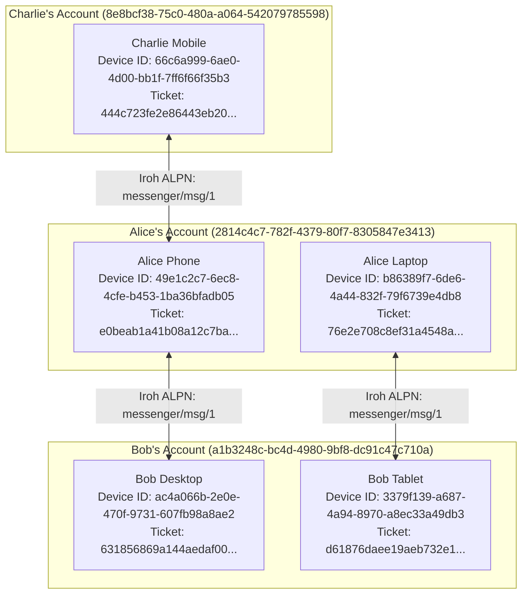
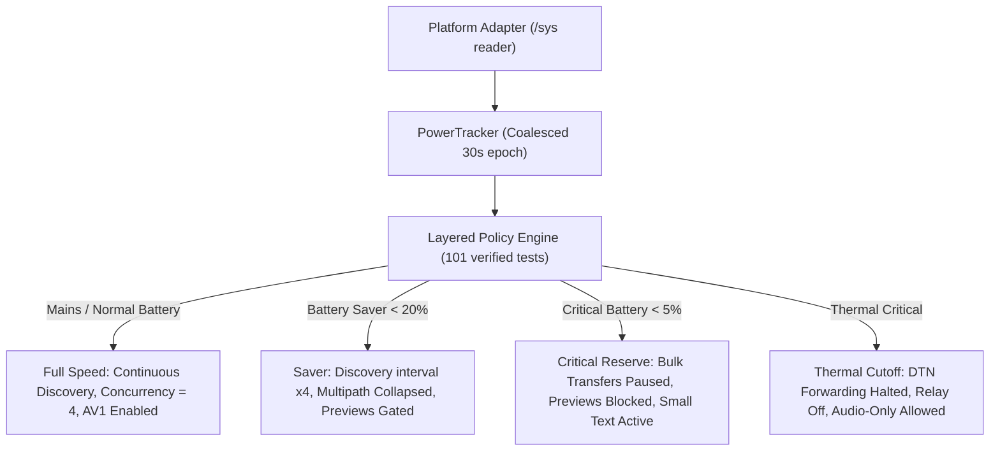

<p align="center">
  
</p>

<h1 align="center">SIAR — Survivable Identity & Autonomous Routing</h1>

<p align="center">
  <a href="https://github.com/irshadlab/siar"></a>
  <a href="https://siar.irshadlab.org/"></a>
  <a href="wiki/Home.md"></a>
  <a href="https://siar.irshadlab.org/guide.html"></a>
  <a href="https://siar.irshadlab.org/sys-arch/"></a>
  <a href="https://siar.irshadlab.org/docs.html"></a>
  <a href="https://siar.irshadlab.org/packages.html"></a>
  <a href="#license--dual-tier-model"></a>
</p>

> [!NOTE]
> ### 🚀 OPERATIONAL STATUS: CORE P2P PLATFORM & DAEMON RUNTIME OPERATIONAL
>
> * **Verified Working Core:** The core P2P messaging engine (`iroh` QUIC ALPN `messenger/msg/1`), multi-device identity synchronization (`siar-identity-multidevice`), headless daemon runtime (`siar-daemon`), and CLI client (`siar`) are **fully functional and empirically verified**. Live end-to-end P2P encryption, mutual ECDH ticket pairing, and multi-device account invariants have been validated under distributed Kubernetes workloads up to 500 users / 1,100 devices.
> * **Consumer UI & Mobile In-Progress:** The desktop GUI (`apps/desktop` with Slint) and Android client (`apps/android`) are in active development. Consumer-grade app-store distribution and automated mobile push gateways are forthcoming.
> * **AI / LLM Development Transparency Disclosure:** SIAR's extensive architectural specifications (176 specifications across 514k+ lines), wiki documentation, and codebase are **heavily developed with the assistance of Artificial Intelligence / Large Language Models (AI/LLMs)** working under human architectural direction.
> * **Cryptographic Audit Notice:** Because SIAR is designed for post-infrastructure and disaster-recovery environments, **independent third-party security audits and formal verifications are actively sought** before advising deployment in life-critical or high-threat threat models.

> 🏛️ **Organization Stewardship & Research Initiative:
> **SIAR** is an open-source systems initiative developed and stewarded under **[Irshad Lab](https://irshadlab.org)** ([`@irshadlab`](https://github.com/irshadlab)) by Irshad Ali — focused on local-first computing, resilient peer-to-peer networking, and sovereign systems engineering.
> 
> Currently I'm (Irshad Ali) only one working on SIAR.**
> 
> **Official Showcase, Package Center & Live Architecture Documentation:**
> - 🌐 **[Official Product Presentation](https://siar.irshadlab.org/)**
> - 🖼️ **[Desktop UI Reference Gallery](docs/screenshots/README.md)** — Dark/Light themes, Contact Verification, MLS Groups & Settings
> - 📚 **[Comprehensive Technical Wiki (50 Chapters)](wiki/Home.md)** — System Stack, Multi-Device Trust, Routing, DTN, Security Center, Calls, Testing & Operations
> - 📘 **[End-to-End User & Operations Manual](https://siar.irshadlab.org/guide.html)** — Zero-Knowledge Setup, QR/NFC Pairing, Vault Export/Import & Anti-Forensics
> - 📑 **[System Architecture & Protocol Specs (mdBook)](https://siar.irshadlab.org/sys-arch/)** — 33+ numbered core specs + 27 UI/UX specs
> - 🔬 **[Interactive WASM Mesh Simulator Lab](https://siar.irshadlab.org/simulator.html)**
> - 🛡️ **[SLSA Level 3+ Supply Chain Cryptographic Verifier](https://siar.irshadlab.org/verify.html)**

---

## Table of Contents

- [What SIAR Is](#what-siar-is)
- [Core Design Rules](#core-design-rules)
- [Specification Governance: sys-arch for Core, ui-ux for UI](#specification-governance-sys-arch-for-core-ui-ux-for-ui)
- [Architecture: Five Layers](#architecture-five-layers)
- [Transport & Routing Policy Engine](#transport--routing-policy-engine)
- [Multi-Device Identity & Trust](#multi-device-identity--trust)
- [End-to-End Security & Ingress Abuse Resistance](#end-to-end-security--ingress-abuse-resistance)
- [DTN: Store-Carry-Forward](#dtn-store-carry-forward)
- [Realtime Calls & Media](#realtime-calls--media)
- [Daemon-Centric Runtime & State Synchronization](#daemon-centric-runtime--state-synchronization)
- [Protocol Extensions & WASM](#protocol-extensions--wasm)
- [Anonymity Transport Plane & Relay Mailboxes](#anonymity-transport-plane--relay-mailboxes)
- [Workspace Crate Map (50 Domain Crates & 6 Applications)](#workspace-crate-map-50-domain-crates--6-applications)
- [Deployment Modes](#deployment-modes)
- [SIAR vs P2P Networks & Traditional Messengers](#siar-vs-p2p-networks--traditional-messengers)
- [Honest Transparency: Active Development, Known Limits & Where SIAR Fails / Is NOT Suitable](#honest-transparency-active-development-known-limits--where-siar-fails--is-not-suitable)
- [Implementation Status & Roadmap](#implementation-status--roadmap)
  - [Strategic Phased Roadmap: Technical Hardening (2026) → Nym Mixnet (2027+)](#strategic-phased-roadmap-technical-hardening-2026--nym-mixnet-2027)
- [Prerequisites & Environment Setup](#prerequisites--environment-setup)
- [Build & Repository Automation (xtask)](#build--repository-automation-xtask)
- [Node Configuration & Operational Guide](#node-configuration--operational-guide)
- [Testing, Fuzzing & E2E Verification](#testing-fuzzing--e2e-verification)
- [Empirical Evaluation & Distributed Telemetry Report](#empirical-evaluation--distributed-telemetry-report)
- [License & Dual-Tier Model](#license--dual-tier-model)
- [Contributing](#contributing)
- [Special Thanks & Open-Source Appreciation](#special-thanks--open-source-appreciation)

---

## What SIAR Is

**SIAR** ( **Survivable Identity & Autonomous Routing** ) is a **reusable, zero-infrastructure, multi-transport, offline-first P2P communication platform** engineered to invert traditional client-server assumptions.

> **The application expresses intent and constraints. The platform selects paths, manages retries, falls back to DTN, and re-establishes sessions — without the application understanding transport mechanics.**

<details>
<summary><strong>Expand Core Principles & Architectural Motivation</strong></summary>

Traditional messengers (WhatsApp, Signal, Telegram) assume always-on infrastructure: centralized server clusters, public DNS, PKI, and continuous Internet access. When natural disasters strike, telecommunications infrastructure collapses, or state-level censorship severs external backhauls, these apps completely fail.

SIAR is engineered from first principles to invert these assumptions:

1. **Zero-Infrastructure Invariant** — the system must operate seamlessly when zero external servers, DNS nodes, or Internet gateways are reachable.
2. **Cryptographic Sovereignty** — identities are root Ed25519 signing pairs owned exclusively by local devices — no phone numbers, email addresses, or centralized registries.
3. **Opportunistic Dissemination** — messages and files are delay-tolerant bundles that travel over any available medium (BLE, Wi-Fi Direct, Wi-Fi Aware, Bluetooth Classic, LAN, Internet QUIC) through store-carry-forward physical mules.
4. **Unified Cross-Platform Core** — a high-performance, memory-safe pure-Rust workspace powers CLI daemons, solar-powered mesh repeaters, Android apps, and desktop interfaces.
5. **Reusable Platform** — the underlying architecture is not messenger-specific. The same crates back messaging, files, emergency SOS, group comms, ERP payloads, and future custom applications.

The governing rule from [`sys-arch/`](sys-arch/):

> **The application expresses intent and constraints. The platform selects paths, manages retries, falls back to DTN, and re-establishes sessions — without the application understanding transport mechanics.**

</details>

---

## Core Design Rules

SIAR enforces immutable foundational invariants derived directly from the [`sys-arch/`](sys-arch/) specification corpus across every crate in the workspace:

<details>
<summary><strong>Expand Core Design Rules Table</strong></summary>

These rules appear directly in the sys-arch specifications and govern every crate in the workspace:

| Rule | Specification Source |
| :--- | :--- |
| Feature code must never implement transport selection | `sys-arch/03` §2 |
| The daemon owns durable state; UI is a client of the runtime | `sys-arch/16` §1 |
| Transport security protects the path; application E2EE protects the conversation regardless of path | `sys-arch/28` §1 |
| A person is an account, not a device — routing must address accounts, not device keys | `sys-arch/02` §2 |
| DTN is not Bluetooth forwarding logic or emergency-only forwarding — it is a transport-neutral persistence layer | `sys-arch/06` §2 |
| Protocol extensions are a versioned capability architecture, not a dynamic plugin system for arbitrary untrusted code | `sys-arch/01` §2 |
| SIAR must treat anonymity as an explicit routing/security property, not a side effect of encryption | `sys-arch/34` §1 |
| The call is a logical secure session; network paths, codecs, devices, and surfaces are replaceable implementation resources inside that session | `sys-arch/29` §1 |

</details>

---

## Specification Governance: sys-arch for Core, ui-ux for UI

All engineering and implementation in SIAR strictly follows a dual-specification authority model:
- 📐 **Core Engine, Protocols & Daemons**: Governed by **[`sys-arch/`](sys-arch/)** (176 specifications).
- 🎨 **Frontends, UI/UX & State Machines**: Governed by **[`ui-ux/`](ui-ux/)** (27 specifications).
- 🔒 **Core Invariant**: The daemon owns all durable state; UI is strictly a decoupled client of runtime and never owns transport or crypto state.

<details>
<summary><strong>Expand Governance Architecture & Specification Chapters</strong></summary>

```
┌──────────────────────────────────────────────────────────────────────────────────────────────────────────┐
│                                   SIAR SPECIFICATION GOVERNANCE ARCHITECTURE                            │
├────────────────────────────────────────────────────┬─────────────────────────────────────────────────────┤
│ 📐 Core Engine, Protocols & Daemons: sys-arch/     │ 🎨 Frontends, UI/UX & State Machines: ui-ux/        │
├────────────────────────────────────────────────────┼─────────────────────────────────────────────────────┤
│ • Authority Corpus: sys-arch/ (176 Specifications) │ • Authority Corpus: ui-ux/ (27 Specifications)      │
│   - Parts 01–33: Core Mesh, Local-First Engine,    │   - ui-ux-01..03: App Shells & Platform Navigation  │
│     DTN, Multi-Transport, Security & Codecs        │   - ui-ux-04..06: Timelines, Composer & Attachments │
│   - Parts 34–150: Anonymous Mixnet, Private        │   - ui-ux-07..10: Realtime Calls, Groups & Files    │
│     Mailboxes, Cloud Ecosystem & Resilient Ops     │   - ui-ux-11..17: Security Center, SOS & Pairing    │
│                                                    │   - ui-ux-18..27: Tokens, Motion, A11y & Gates      │
│ • Target Codebases:                                │ • Target Codebases:                                 │
│   - Pure-Rust domain crates: crates/siar-* (41)    │   - apps/desktop (Slint 1.16 Native Desktop GUI)     │
│   - apps/emergency-node (Headless Solar Daemon)    │   - apps/android (Jetpack Compose + JNI UI layer)   │
│   - apps/cli (Interactive Terminal & Diagnostics)  │   - crates/siar-ui-state / siar-ui-slint            │
│ • Core Invariants:                                 │ • UI Invariants:                                    │
│   - Zero external infrastructure dependency        │   - UI is strictly a decoupled client of runtime    │
│   - Feature code never implements transport choice │   - UI never owns durable transport or crypto state │
│   - Pure Rust, memory-safe, panic-free paths       │   - Reactive state machines isolate UI from events  │
└────────────────────────────────────────────────────┴─────────────────────────────────────────────────────┘
```

### 1. Core Development Follows `sys-arch/`
All backend runtime engines, protocol framing, cryptographic handshakes, transport drivers, and storage subsystems must strictly follow the **[`sys-arch/`](sys-arch/)** specification corpus:
- **Wire Protocols & Handshakes**: Binary wire framing, extension negotiation, and capability schemas follow [`sys-arch/01`](sys-arch/01-protocol-extension-system-architecture.md) and [`sys-arch/07`](sys-arch/07-capability-negotiation-architecture.md).
- **Identity & Cryptography**: Root Ed25519 account sovereignty, device certificates, OpenMLS trees, and SAS out-of-band verification follow [`sys-arch/02`](sys-arch/02-multi-device-identity-architecture.md) and [`sys-arch/28`](sys-arch/28-production-security-e2ee-key-management-privacy-architecture.md).
- **Transport & Multi-Metric Routing**: Candidate discovery, link-state scoring, adaptive transport selection, and battery-aware scheduling follow [`sys-arch/03`](sys-arch/03-transport-routing-policy-engine-architecture.md) and [`sys-arch/13`](sys-arch/13-battery-aware-scheduling-architecture.md).
- **DTN & Emergency Survivability**: Delay-tolerant bundle store-carry-forward and life-safety priority queues follow [`sys-arch/06`](sys-arch/06-dtn-store-carry-forward-architecture.md) and [`sys-arch/17`](sys-arch/17-emergency-priority-classes-architecture.md).
- **Daemon Lifecycle & Headless Services**: Headless unattended operation, crash recovery, and WAL replay follow [`sys-arch/09`](sys-arch/09-crash-recovery-architecture.md), [`sys-arch/16`](sys-arch/16-daemon-headless-runtime-architecture.md), and [`sys-arch/20`](sys-arch/20-embedded-linux-node-architecture.md).

### 2. User Interface Development Follows `ui-ux/`
All user-facing graphical applications, mobile experiences, layout systems, visual states, and reactive UI state machines must strictly follow the **[`ui-ux/`](ui-ux/)** specification corpus:
- **Application Shells & Navigation**: Multi-pane desktop navigation, mobile tab bars, window state restoration, and back-stack handling follow [`ui-ux-01`](ui-ux/ui-ux-01-product-foundation-cross-platform-interaction-architecture.md), [`ui-ux-02`](ui-ux/ui-ux-02-desktop-dioxus-app-shell-navigation-window-architecture.md) (implemented natively in Slint via [`siar-ui-slint`](crates/siar-ui-slint)), and [`ui-ux-03`](ui-ux/ui-ux-03-android-jetpack-compose-app-shell-navigation-lifecycle-architecture.md).
- **Conversations & Message Timeline**: Message bubbles, delivery checkmarks (Pending, DTN Relayed, Delivered, Read), media carousels, and composer attachments follow [`ui-ux-04`](ui-ux/ui-ux-04-conversation-list-inbox-architecture.md), [`ui-ux-05`](ui-ux/ui-ux-05-conversation-message-timeline-architecture.md), and [`ui-ux-06`](ui-ux/ui-ux-06-message-composer-attachments-voice-notes-drafts-architecture.md).
- **Security Center & Trust Flows**: Cryptographic identity management, key rotation warnings, device revocation ceremonies, recovery phrase verification, and SAS visual comparisons follow [`ui-ux-15`](ui-ux/ui-ux-15-security-center-devices-keys-recovery-architecture.md).
- **Emergency SOS & Offline Degraded States**: High-contrast offline mesh indicators, zero-connection SOS banners, transport fallback indicators, and battery-saver modes follow [`ui-ux-17`](ui-ux/ui-ux-17-emergency-sos-offline-mesh-architecture.md) and [`ui-ux-24`](ui-ux/ui-ux-24-error-loading-empty-offline-degraded-state-architecture.md).
- **Design Tokens, Typography & Inclusive Access**: Color tokens, typography scales, touch targets, screen reader semantic labels, and motion curves follow [`ui-ux-21`](ui-ux/ui-ux-21-accessibility-inclusive-interaction-architecture%20.md) and [`ui-ux-22`](ui-ux/ui-ux-22-design-system-tokens-typography-icons-motion-architecture.md).

### 3. Core-to-UI Separation Invariant
In accordance with [`sys-arch/16`](sys-arch/16-daemon-headless-runtime-architecture.md) and [`ui-ux-01`](ui-ux/ui-ux-01-product-foundation-cross-platform-interaction-architecture.md):
1. **The Daemon Owns State**: The pure-Rust core runtime manages durable database storage, active network sockets, cryptographic ratchet states, and routing decisions.
2. **The UI is a Stateless Client**: Frontend applications (`apps/desktop`, `apps/android`) observe reactive state streams exposed by [`siar-ui-state`](crates/siar-ui-state) and emit user intent commands.
3. **No Direct Socket or Crypto Manipulation in UI**: UI code must never open raw network sockets, attempt ad-hoc cryptographic operations, or implement private transport failover logic.

</details>

---

## Architecture: Five Layers

SIAR is structured into five distinct, decoupled architectural layers ensuring complete isolation from raw physical radio drivers up to frontend application shells:
1. **Layer 5: Applications & UI/UX** (`apps/desktop`, `apps/android`, `apps/daemon`, `apps/emergency-node`, `apps/cli`, `apps/root-ceremony`)
2. **Layer 4: High-Level Services & Decoupled App Core** (`siar-app-core`, `siar-ui-model`, `siar-ui-state`, `siar-ui-slint`, `siar-ui-sync`, `siar-admin`, `siar-messaging`, `siar-calls`, `siar-files`, `siar-dtn-bundle-service`)
3. **Layer 3: Routing, Policy, Power & DTN Engine** (`siar-routing-policy`, `siar-power`, `siar-connectivity`, `siar-dtn-bundle`, `siar-emergency`, `siar-emergency-service`)
4. **Layer 2: Storage, Crypto, Runtime & Reliability** (`siar-crypto`, `siar-crypto-mls`, `siar-crypto-advanced`, `siar-abuse`, `siar-storage`, `siar-runtime`, `siar-backup`, `siar-blob-manifest`, `siar-resource-limits`, `siar-crash-recovery`, `siar-event-log`)
5. **Layer 1: Transport & Wire Protocols** (`siar-protocol`, `siar-protocol-ext`, `siar-capability`, `siar-transport`, `siar-transport-*`)

<details>
<summary><strong>Expand Five Layers Architectural Diagram</strong></summary>

```
+---------------------------------------------------------------------------------------+
|                                5. Applications & UI/UX                                |
|  - apps/android (Jetpack Compose + JNI)   - apps/desktop (Slint 1.16 Native GUI Shell)|
|  - apps/daemon (Headless Core Daemon)     - apps/emergency-node (Solar Repeater Node) |
|  - apps/cli (siar Daemon CLI Client)      - apps/root-ceremony (siar-root FROST DKG)  |
+---------------------------------------------------------------------------------------+
|                       4. High-Level Services & Decoupled App Core                     |
|  - siar-app-core (Decoupled Core Facade)  - siar-ui-model (Renderer-Free StateHub)    |
|  - siar-ui-state (FSM State Machines)     - siar-ui-slint (Slint 1.16 View Library)   |
|  - siar-ui-sync (Snapshot+Delta Sync)     - siar-admin (Authenticated Remote Admin)   |
|  - siar-messaging (Message & Group Engine)- siar-calls (Realtime AV1 / Opus Sessions) |
|  - siar-identity-multidevice (Certs, SAS) - siar-files (Blob Transfer Service)        |
|  - siar-dtn-bundle-service (DTN Sync)     - siar-file-transfer-service (Swarm Blobs)  |
+---------------------------------------------------------------------------------------+
|                       3. Routing, Policy, Power & DTN Engine                          |
|  - siar-routing-policy (Multi-Metric)     - siar-power (Battery & Thermal Throttle)   |
|  - siar-connectivity (Link State Probes)  - siar-dtn-bundle (Spray-and-Wait Forward)  |
|  - siar-emergency (Priority Classes P0–P4)- siar-emergency-service (SOS Beacons)      |
+---------------------------------------------------------------------------------------+
|                      2. Storage, Crypto, Runtime & Reliability                        |
|  - siar-crypto (Ed25519/X25519 AEAD)      - siar-crypto-mls (RFC 9420 & 1:1 Pairwise) |
|  - siar-crypto-advanced (FROST, ML-DSA)   - siar-abuse (Ingress Gate & Quotas)        |
|  - siar-storage (Stoolap Relational SQL)  - siar-runtime (Supervisor, IPC & Audit Log)|
|  - siar-backup (Argon2id Encrypted Backup)- siar-blob-manifest (BLAKE3 Merkle DAG)    |
|  - siar-resource-limits (Backpressure)    - siar-crash-recovery (WAL & Checkpoints)   |
|  - siar-event-log (Monotonic Sequence Log)- siar-startup-recovery (Consistency Fix)   |
+---------------------------------------------------------------------------------------+
|                              1. Transport & Wire Protocols                            |
|  - siar-protocol (Postcard Wire Codec)    - siar-protocol-ext (CapNeg & Scheduler)    |
|  - siar-capability (2-Phase Confirmation) - siar-transport (Pooled Connection Socket) |
|  - siar-transport-ble / -ble-android      - siar-transport-bluetooth-classic (RFCOMM) |
|  - siar-transport-wifi-direct (P2P)       - siar-transport-wifi-aware (NAN Proximity) |
+---------------------------------------------------------------------------------------+
```

</details>

---

## Transport & Routing Policy Engine

*Specification: [`sys-arch/03`](sys-arch/03-transport-routing-policy-engine-architecture.md) · Crate: [`siar-routing-policy`](crates/siar-routing-policy)*

Rather than hardcoding transport selection, applications publish **`DeliveryRequirements`** (priority, latency ceiling, battery limit). The policy engine dynamically evaluates candidate links and shifts between operational modes:

| Mode | Available Networks | Delivery Mechanism |
| :--- | :--- | :--- |
| **Connected Online** | Internet / LAN / Wi-Fi | Iroh QUIC, direct end-to-end streams |
| **Local Tactical Mesh** | Wi-Fi Direct, Wi-Fi Aware, LAN | Hop-by-hop mesh forwarding (sub-10 ms) |
| **Air-Gapped / Off-Grid** | BLE GATT, Bluetooth Classic | Physical mule DTN with Spray-and-Wait |

<details>
<summary><strong>Expand Routing Policy Engine Pipeline & Profiles</strong></summary>

The platform supports all of the following physical paths simultaneously:

```
Iroh QUIC (direct / relay)   Wi-Fi Direct (P2P)
Local LAN (multicast)        Wi-Fi Aware (NAN)
Bluetooth Classic (RFCOMM)   Bluetooth LE (GATT)
DTN / store-carry-forward    future transports
```

Rather than letting application code pick a transport, each operation publishes **`DeliveryRequirements`** (priority class, deadline, bandwidth floor, metered/roaming policy, relay allowance, DTN opt-in). The routing policy engine:

1. Resolves candidate paths for the destination account across all of its devices.
2. Scores each candidate with a **multi-metric weighted formula** (RTT, bandwidth, setup cost, stability, energy cost, congestion, candidate state).
3. Applies hard constraint elimination (metered, roaming, background restriction, scope, revoked device, deadline).
4. Applies layered policy checks (system → application → user → operation → network context).
5. Returns a `RoutePlan` (`Direct` / `Redundant` / `Hedged` / `Dtn`) with per-device routing for multi-device accounts.

Policy profiles include: `RealTime`, `Interactive`, `Bulk`, `Background`, `Emergency`, `LowPower`, `OffGrid`. The engine also enforces stickiness hysteresis to prevent oscillation under measurement jitter.

</details>

---

## Multi-Device Identity & Trust

*Specification: [`sys-arch/02`](sys-arch/02-multi-device-identity-architecture.md) · Crates: [`siar-identity-multidevice`](crates/siar-identity-multidevice), [`siar-crypto-advanced`](crates/siar-crypto-advanced) · App: [`apps/root-ceremony`](apps/root-ceremony)*

A person is an **Account**, not a device. All devices belonging to a user share the exact same canonical **Account ID**, while each physical hardware device generates an independent **Device ID**, cryptographic key pairs (Ed25519/X25519), and unique peer tickets.

<details>
<summary><strong>Expand Multi-Device Trust Hierarchy, Device Linking & FROST Ceremonies</strong></summary>

SIAR distinguishes five identity layers:

```
Account Identity  →  Device Identity  →  Transport Identity  →  Session Identity  →  Application Profile
```

Each device generates an independent Ed25519 key pair and obtains a **`DeviceCertificate`** signed by the account's root authority. The trust model supports:

- **Mutual Device Linking Ceremony**: Fresh devices link to an existing account via one-time pairing codes (`siar link-offer`, `siar link-join`, `siar link-pending`, `siar link-approve`). An 80-bit single-use pairing code (5-minute expiration, 5-failure lockout) securely routes the join request. Approval signs a `DeviceCertificate` with the account root key, persisting linked devices locally (`linked_devices.bin`).
- **FROST Threshold Root Ceremonies** (`siar-root`, RFC 9591): Supports multi-party Distributed Key Generation (DKG) and threshold signing (`dkg1/2/3`, `sign1/2`, `aggregate`, `verify`). An account root authority can be sharded across M-of-N operators/nodes so no single hardware compromise exposes root sovereignty.
- **Multiple active devices** (phone, laptop, headless node, secondary phone).
- **Independent per-device keys** with device-specific transport addresses derived via domain-separated KDF (`DeviceIdentity::derive_secret`).
- **Monotonic revocation** — a revoked device cannot forge retroactive authority.
- **SAS (Short Authentication String) out-of-band verification** for secure peer contact verification (60-digit numeric safety fingerprint, persistent `device=<key>` pinning, key change alerts).
- **Per-device capability sets** — a headless relay or DTN repeater advertises only its valid forwarding capabilities.
- **Account recovery** with encrypted key backups (`siar-backup`) and import validation before any local state is touched.
- **Algorithm agility** — Ed25519, ML-DSA-65 hybrid composite signatures, and FROST threshold schemes are supported without breaking the identity model.

</details>

---

## End-to-End Security & Ingress Abuse Resistance

*Specification: [`sys-arch/28`](sys-arch/28-production-security-e2ee-key-management-privacy-architecture.md) · Crates: [`siar-crypto`](crates/siar-crypto), [`siar-crypto-mls`](crates/siar-crypto-mls), [`siar-abuse`](crates/siar-abuse)*

SIAR enforces a strict zero-trust model: all conversation payloads are end-to-end encrypted using MLS (RFC 9420) and authenticated device sessions (Ed25519 + X25519 + ChaCha20-Poly1305). Intermediate relay nodes, DTN carriers, and physical mules never hold decryption keys.

<details>
<summary><strong>Expand Layered Threat Model, OpenMLS Pairwise & Ingress Abuse Resistance</strong></summary>

```
Application E2EE (OpenMLS RFC 9420 & 1:1 Pairwise Post-Quantum)
      ↓
Conversation / Group Security (OpenMLS tree ratchet, WelcomeBundle v2, CommitBundle)
      ↓
Authenticated Device Sessions (Ed25519 + X25519 / ALPN messenger/msg/1)
      ↓
Ingress Abuse Gate (siar-abuse: cheap-validation-first, rate-limiting & quotas)
      ↓
Iroh / QUIC Transport Security
      ↓
Internet / LAN / BLE / Relay / DTN
```

**Threat model**: any relay server, DTN carrier, public network, nearby Bluetooth peer, server database, third-party plugin, external FFI caller, stolen device, or old backup can be hostile or compromised. The design trusts only: the current unlocked local device, explicitly authorized devices, verified contacts, and explicit organization/authority keys.

Required security properties:
- **1:1 Pairwise OpenMLS with Post-Quantum Protection**: 1:1 direct sessions leverage two-member OpenMLS groups with hybrid post-quantum ciphersuite (`MLS_128_MLKEM768X25519_CHACHA20POLY1305_SHA384_MLDSA44`), alternating commit turns for DTN tolerance, and out-of-order epoch reassembly.
- **Group Security & Roster Sync**: OpenMLS group state persists locally in SQLite (`GroupService::new_persistent`). `WelcomeBundle` v2 distributes member transport addresses across joins, and `CommitBundle` applies atomic roster updates.
- **Ingress Abuse Gate (`siar-abuse::Gate`)**: Protects the core receive loop (`siar-messaging::IngressGuard`) and headless relays (`apps/emergency-node`). Enforces a strict pipeline: cheap structural check → frame length → version check → blocklist filter → rate limiter → duplicate check → cryptographic authorization. Strangers cannot force expensive cryptographic decryptions or memory allocations.
- **End-to-end confidentiality & forward secrecy**: Ciphertext is unreadable by relays, carriers, or infrastructure operators; compromise of today's keys does not expose past messages.
- **Metadata minimization**: Routing decisions carry no content; `RouteMetricEvent` has no peer-identity or IP fields by construction.

</details>

---

## DTN: Store-Carry-Forward

*Specification: [`sys-arch/06`](sys-arch/06-dtn-store-carry-forward-architecture.md) · Crate: [`siar-dtn-bundle`](crates/siar-dtn-bundle)*

Delay-Tolerant Networking (DTN) enables reliable communication across air-gapped zones and complete network blackouts by persisting encrypted bundles locally and forwarding them through physical peer encounters via Spray-and-Wait replication.

<details>
<summary><strong>Expand DTN Topology, Custody Receipts & Routing Details</strong></summary>

```
Alice (no Internet, no Wi-Fi, no direct Bluetooth to destination)
  ↓
Bob (physical mule — encounters Alice via BLE)
  ↓
Carol (physical mule — encounters Bob via Wi-Fi Direct)
  ↓
Gateway (encounters Carol, has Internet)
  ↓
Destination
```

The DTN subsystem persists payloads locally, carries them across time, and forwards them when useful connectivity appears. It is transport-neutral and supports:

- Text messages, delivery receipts, emergency SOS, authority alerts
- Small file metadata and selected file chunks
- Custom application events for ERP and third-party integrations

**Spray-and-Wait** replication (configurable `dtn_replication_budget`) limits network flooding while maximising delivery probability. Bundle custody receipts confirm when a mule has accepted responsibility for forwarding. The routing policy engine integrates DTN as a first-class `RouteStrategy::Dtn` outcome — fallback to DTN is a policy decision, not a last-resort hack.

</details>

---

## Realtime Calls & Media

*Specification: [`sys-arch/29`](sys-arch/29-realtime-calls-media-session-protocol-architecture.md) · Crates: [`siar-calls`](crates/siar-calls), [`siar-media-android`](crates/siar-media-android), [`siar-media-audio`](crates/siar-media-audio), [`siar-media-av1`](crates/siar-media-av1)*

Calls in SIAR are **logical secure sessions** decoupled from physical network paths. Under the hood, audio/video sessions seamlessly hand off across transports (e.g., Wi-Fi Direct to Internet QUIC) without dropping the call.

<details>
<summary><strong>Expand Call Controller Architecture & Codec Pipelines</strong></summary>

```
Call Controller
    ├── Signaling   (ringing / accept / reject / busy / timeout)
    ├── Security    (session authentication bound to E2EE identity)
    └── Policy      (codec selection, bitrate, hold/resume, path handoff)
         ├── siar-media-android  (Android MediaCodec zero-copy hardware surfaces)
         ├── siar-media-av1      (desktop dav1d AV1 software decoder)
         └── siar-media-audio    (Opus + AEC / NS / AGC DSP pipeline)
```

The call architecture supports:
- **P2P signaling** without a signaling server — session control messages travel over the same Iroh/mesh transport as regular messages
- **Multipath resilience** — the session survives a path change; the routing engine's `RouteChangeEvent::NewPath` triggers codec renegotiation, not call termination
- **Hardware zero-copy surfaces** on Android — `MediaCodec` decodes directly into `SurfaceTexture` without intermediate copy
- **Pure-Rust DSP on desktop** — Opus encode/decode, acoustic echo cancellation (AEC), noise suppression (NS), automatic gain control (AGC)
- **Crash-safe call history** — call records are written to durable storage before the session is confirmed torn down

</details>

---

## Daemon-Centric Runtime & State Synchronization

*Specifications: [`sys-arch/16`](sys-arch/16-daemon-headless-runtime-architecture.md), [`sys-arch/20`](sys-arch/20-embedded-linux-node-architecture.md) · Crates: [`siar-runtime`](crates/siar-runtime), [`siar-ui-sync`](crates/siar-ui-sync), [`siar-admin`](crates/siar-admin) · Apps: [`apps/daemon`](apps/daemon), [`apps/emergency-node`](apps/emergency-node)*

SIAR enforces a strict **daemon-centric architecture**: **`siar-daemon` is the sole custodian of durable state** (active network sockets, Iroh QUIC identities, Stoolap relational databases, and OpenMLS ratchet stores). The desktop GUI (`apps/desktop`) and interactive CLI (`apps/cli` `siar`) are decoupled, thin clients communicating over local Unix domain sockets or Windows named pipes.

<details>
<summary><strong>Expand Daemon Architecture, State Sync, Remote Admin & Audit Logging</strong></summary>

```
┌─────────────────────────┐             ┌─────────────────────────┐
│ apps/desktop (Slint GUI)│             │  apps/cli (siar Client) │
└───────────┬─────────────┘             └────────────┬────────────┘
            │ Local IPC (siar-ui-sync)               │ Local IPC
            └────────────────────┬───────────────────┘
                                 ▼
┌─────────────────────────────────────────────────────────────────┐
│           siar-daemon (Headless Core Runtime Engine)            │
│  ├── siar-app-core (Decoupled Services, Messages, Contacts)     │
│  ├── siar-storage (Stoolap SQL volumes, WAL checkpoints)        │
│  ├── siar-crypto-mls (RFC 9420 SQLite MLS Group & 1:1 State)    │
│  ├── siar-routing-policy & siar-transport (Iroh QUIC / Radios)  │
│  ├── siar-power & siar-resource-limits (Duty-cycle, Throttling) │
│  ├── siar-runtime::audit_file (BLAKE3 Monotonic Hash Chain)     │
│  └── roles launcher (Supervised child daemons e.g. emergency)   │
└────────────────────────────────┬────────────────────────────────┘
                                 │
                 ┌───────────────┴───────────────┐
                 ▼                               ▼
     Physical Radio & P2P Mesh       Remote Admin: comm-admin/1
    (LAN, QUIC, BLE, Wi-Fi Direct)   (siar-admin authenticated)
```

Key runtime subsystems and operational guarantees:
- **Domain-Level Reactive Sync (`siar-ui-sync`)**: Exchanges versioned, bounded, and idempotent snapshots and deltas (`SectionKey`: Core, Identity, Conversations, Contacts, Network, Power, Timelines, SecurityEvents, Groups, Invites, Devices, and Attachment Previews). UI crashes or restarts never lose connection state or corrupt the underlying database.
- **Node Enrolment & Provisioning (Part 16 §72–§76)**: Headless nodes bootstrap into an unprovisioned state running only `BootstrapListener`. Nodes enrol via signed `ProvisionPayload` bound to QR challenges (`siar-daemon ctl provision <file> <sig>`). Validated configurations trigger an exit-75 handoff into assigned `NodeRole`s (`relay-gateway`, `dtn-node`, `storage-node`, `organization-node`, `test-node`, `personal-device`).
- **Supervised Role Launcher (`apps/daemon/src/roles.rs`)**: Roles requiring DTN relaying autonomously launch `apps/emergency-node` as a supervised child binary with bounded restart policies and isolated identity files.
- **Remote Administration Plane (`crates/siar-admin`)**: Remote operators manage nodes over Iroh QUIC via ALPN `comm-admin/1` (`siar-daemon admin`). Enforces strict role-based access control (`Viewer < Operator < SecurityAdmin < Owner`) with token-bucket rate limiting. **No remote shell exists, and message content is never accessible over the admin plane.**
- **Live Backup & Staged Restore**: Create consistent encrypted backups (`ctl backup <abs-dir>`) while the daemon is actively serving. Restores (`ctl restore <abs-dir>`) stage into isolated directories and atomically verify integrity upon daemon restart.
- **Durable Hash-Chained Audit Log (`siar-runtime::audit_file`)**: Records all local and remote administrative actions in an append-only BLAKE3 cryptographic hash chain (`chain = blake3(previous_chain || body)`). Single-byte tampering or sequence gaps are immediately caught via `siar-daemon audit-verify <dir>`.

</details>

---

## Protocol Extensions & WASM

*Specifications: [`sys-arch/01`](sys-arch/01-protocol-extension-system-architecture.md), [`sys-arch/22`](sys-arch/22-wasm-compatible-components-architecture.md) · Crates: [`siar-protocol-ext`](crates/siar-protocol-ext), [`siar-capability`](crates/siar-capability)*

SIAR uses a **versioned capability architecture** with two-phase negotiation and weighted fair queuing, ensuring high-priority emergency packets are never blocked by heavy background file transfers.

<details>
<summary><strong>Expand Capability Negotiation & WASM Component Sandboxing</strong></summary>

```
Communication Session
    │
    ├── Core Control Protocol (always present)
    │
    └── Extension Negotiation (per-peer capability set)
          ├── messaging/1
          ├── files/1
          ├── dtn/1
          ├── emergency/1
          ├── calls/1
          └── custom-app/1  (third-party or ERP extensions)
```

Two-phase capability confirmation (`NegotiationHash` + `HandshakeNonce`) ensures peers agree on extension support before sending extension frames. `FairScheduler` and `BoundedQueue` in `siar-protocol-ext` enforce weighted-fair scheduling and backpressure across all extensions — a slow file transfer cannot starve an emergency SOS.

WASM-compatible components ([`sys-arch/22`](sys-arch/22-wasm-compatible-components-architecture.md)) enable portable execution of selected logic (custom protocol handlers, routing filters, ERP integrations) across desktop, server, embedded Linux, and browser-compatible environments — while the native Rust core retains ownership of networking, hardware codecs, secure key stores, and daemon lifecycle.

</details>

---

## Anonymity Transport Plane & Relay Mailboxes

*Specification: [`sys-arch/34`](sys-arch/34-mixnet-loopix-sphinx-nym-high-anonymity-transport-architecture.md) · Crates: [`siar-crypto-advanced`](crates/siar-crypto-advanced), [`siar-messaging`](crates/siar-messaging)*

An independent, additive **High-Anonymity Transport Plane** based on mixnet principles (Loopix/Sphinx) and anonymous relay mailboxes provides cryptographic resistance against network timing and metadata traffic analysis.

<details>
<summary><strong>Expand Sphinx Packet Encapsulation, Anonymous Mailboxes & BBS+ Credentials</strong></summary>

SIAR's physical and direct transports optimize for reachability, latency, bandwidth, reliability, and offline operation. To prevent network observers from correlating peer relationships through traffic timing and packet volume, SIAR provides high-anonymity primitives:

- **Anonymous Single-Use Token Mailboxes**: Allows asynchronous deposit and collection of encrypted bundles at intermediary relays (`apps/emergency-node`) without disclosing sender or recipient identities (`siar send-anon` and `siar check-mailbox-anon`).
- **Scheduled Mailbox Polling**: `siar-daemon` supports scheduled background mailbox polling (`[mailbox] relays = [...]`), power-gated by `siar-power` to defer polls under critical battery or thermal constraints.
- **Anonymous BBS+ Zero-Knowledge Relay Passes (`siar-crypto-advanced::bbs_relay`)**: Employs IETF BBS credentials to prove relay authorization and tier access without revealing user identity or linkable tokens.
- **Sphinx packet encapsulation**: Layered onion routing with per-hop ephemeral key agreement and randomized cover delays.
- **Strict downgrade prevention**: Anonymity is treated as an explicit policy constraint evaluated by `siar-routing-policy`.

</details>

---

## Workspace Crate Map (50 Domain Crates & 6 Applications)

SIAR is structured as a modular Rust cargo workspace comprising **50 domain/infrastructure crates**, **6 standalone application targets**, 2 Android JNI runtime bridges, repo automation (`xtask`), and fuzz testing harnesses:

<details>
<summary><strong>Expand Complete Workspace Crate Tree & Domain Directory Map</strong></summary>

```text
siar/
├── apps/
│   ├── android/                          # Android Native App & JNI Bridges
│   │   ├── app/                          # Jetpack Compose UI (Chat, Groups, Settings, Radar)
│   │   ├── messaging-jni/                # Rust JNI cdylib surface (siar-android-messaging)
│   │   ├── rust-jni-glue/                # Shared JNI glue, memory safety, and JVM callbacks
│   │   └── build-native.sh               # Multi-ABI cargo-ndk build automation script
│   ├── cli/                              # Thin CLI client for siar-daemon (`siar`)
│   ├── daemon/                           # Headless Core Daemon, IPC & Remote Admin (`siar-daemon`)
│   ├── desktop/                          # Native Desktop GUI Shell (`siar-desktop` Slint 1.16)
│   ├── emergency-node/                   # Headless Emergency DTN Relay & Booster Daemon
│   └── root-ceremony/                    # FROST Threshold Root-Key Ceremony CLI (`siar-root`)
├── crates/
│   ├── [Core Domain, Identity & Advanced Cryptography]
│   │   ├── siar-domain/                  # Core entities: AccountId, DeviceId, Ticket, SafetyFingerprint
│   │   ├── siar-crypto/                  # Ed25519, X25519, ChaCha20-Poly1305, zeroize primitives
│   │   ├── siar-crypto-mls/              # IETF MLS (RFC 9420) & 1:1 pairwise post-quantum hybrid engine
│   │   ├── siar-crypto-advanced/         # FROST (RFC 9591), hybrid ML-DSA-65, BLS audit, BBS+ relay passes
│   │   ├── siar-identity-multidevice/    # Multi-device authority, device certs, trust store, SAS pairing
│   │   └── siar-identity-audit-recorder/ # Monotonic append-only audit trail for identity lifecycle & revocations
│   ├── [Protocols, Capability & Abuse Resistance]
│   │   ├── siar-protocol/                # Wire envelopes, Postcard binary codec, frame types
│   │   ├── siar-protocol-ext/            # Extensible protocol engine: FairScheduler, BoundedQueue, health
│   │   ├── siar-capability/              # Two-phase capability negotiation & codec matrices
│   │   └── siar-abuse/                   # Ingress admission gate, token-bucket quotas, stranger spend limits
│   ├── [Mesh Routing, Policy, Power & Dynamic Connectivity]
│   │   ├── siar-routing-policy/          # Multi-metric candidate scoring, hysteresis, decide_route
│   │   ├── siar-power/                   # Part 13: Battery-aware scheduling, sysfs tracker & thermal policy
│   │   └── siar-connectivity/            # Cross-transport state engine, connection pooling & link probes
│   ├── [Multi-Transport Physical Sockets]
│   │   ├── siar-transport/               # Transport manager, pooled socket multiplexer & lifecycle
│   │   ├── siar-transport-ble/           # Linux/cross-platform Bluetooth Low Energy (L2CAP CoC) driver
│   │   ├── siar-transport-ble-android/   # Android native Bluetooth Low Energy transport driver
│   │   ├── siar-transport-bluetooth-classic/ # High-throughput RFCOMM Bluetooth Classic transport
│   │   ├── siar-transport-wifi-direct/   # High-bandwidth Wi-Fi Direct P2P ad-hoc transport
│   │   └── siar-transport-wifi-aware/    # Wi-Fi Aware (NAN — Neighbor Awareness Networking) transport
│   ├── [DTN, Emergency Priority & Life-Safety Services]
│   │   ├── siar-dtn-bundle/              # Bundle framing, custody receipts & Spray-and-Wait forwarding
│   │   ├── siar-dtn-bundle-service/      # Background daemon service orchestrating DTN bundle sync
│   │   ├── siar-emergency/               # 5-tier priority class queuing (P0 Life-Safety to P4 Bulk)
│   │   └── siar-emergency-service/       # Autonomous SOS beacon broadcaster & triage packet engine
│   ├── [Storage, Blobs, Event Logging & Reliability]
│   │   ├── siar-storage/                 # Pure-Rust Stoolap embedded relational SQL (Messages, Outbox)
│   │   ├── siar-runtime/                 # Part 16: Daemon runtime, supervisor, Unix IPC, hash-chained audit
│   │   ├── siar-admin/                   # Part 16: Remote node administration plane (Iroh comm-admin/1)
│   │   ├── siar-backup/                  # Part 33: Argon2id + XChaCha20-Poly1305 backup & InstanceLock
│   │   ├── siar-event-log/               # Monotonic append-only event log & causal gap detection
│   │   ├── siar-event-notify/            # Internal reactive pub-sub event notification dispatcher
│   │   ├── siar-event-registry/          # Global schema registry of system events and audit subscribers
│   │   ├── siar-blob-manifest/           # SIMD BLAKE3 Merkle DAG blob chunking & AEAD encryption
│   │   ├── siar-file-transfer-service/   # Peer-assisted swarm blob chunk distribution coordinator
│   │   ├── siar-files/                   # High-level file transfer service, chunked AEAD v2, stream-to-many
│   │   ├── siar-resource-limits/         # Token-bucket backpressure, ring buffers & queue drop policies
│   │   ├── siar-crash-recovery/          # WAL recovery, transactional checkpoints & corrupt state isolation
│   │   ├── siar-startup-recovery/        # Cold-boot consistency verification & orphaned ticket repair
│   │   └── siar-remote-ingestion/        # Ingestion gateway for external telemetry and bridge adapters
│   ├── [Messaging Orchestration, App Core & UI State Synchronization]
│   │   ├── siar-messaging/               # MessageService, GroupService, Ticket manager, IngressGuard
│   │   ├── siar-app-core/                # Headless application core: drains AppCommands, owns services (0 GUI)
│   │   ├── siar-ui-model/                # Renderer-independent UI state slices (`Slices`) and StateHub
│   │   ├── siar-ui-state/                # Framework-agnostic UI state machines & Security Center
│   │   ├── siar-ui-sync/                 # Domain snapshot+delta sync across IPC (daemon <-> UI client)
│   │   └── siar-ui-slint/                # Slint 1.16 UI component library, semantic Theme tokens & shell
│   ├── [Realtime Media, Voice/Video & Hardware Codecs]
│   │   ├── siar-media-core/              # Media traits, raw video/audio buffers, sample clocks
│   │   ├── siar-media-audio/             # Pure-Rust lock-free audio DSP (Opus, AEC, NS, AGC, <10ms latency)
│   │   ├── siar-media-av1/               # Desktop dav1d AV1 video decoder with lookahead decoding
│   │   ├── siar-media-android/           # Android MediaCodec hardware surface zero-copy pipeline
│   │   ├── siar-media-image/             # Image processing, format transcoding & responsive thumbnails
│   │   └── siar-calls/                   # Realtime P2P media call session protocols & signaling
│   └── [Simulation & Test Harness]
│       └── siar-testkit/                 # In-memory virtual radio mesh simulator & link impairments
├── xtask/                                # Pure-Rust repository automation (CI, smokes, e2e, musl)
├── platform/
│   └── android/                          # Android native platform bindings & permission harnesses
└── fuzz/                                 # Cargo Fuzz targets (frame & blob decoders)
```

</details>

---

## Deployment Modes

SIAR deploys across five primary operational topologies:

- 📱 **Standalone User Applications**: Desktop GUI (`apps/desktop` Slint 1.16), Android (`apps/android` Jetpack Compose), and thin command-line client (`apps/cli` `siar`).
- ⚙️ **Headless Core Daemon**: Background service daemon (`apps/daemon` `siar-daemon run|ctl|admin|unit`) hosting the decoupled core under `siar-runtime` via Unix domain socket / named pipe IPC with 55.4% reduced memory footprint.
- 📡 **Headless Off-Grid Repeater**: Solar-powered Linux/OpenWrt store-carry-forward DTN nodes (`apps/emergency-node`) with battery/thermal awareness and ingress abuse throttling.
- 🔑 **Root Authority & Trust Ceremony Node**: Air-gapped FROST (RFC 9591) threshold key generation and signing node (`apps/root-ceremony` `siar-root`).
- 🏢 **Embedded Relay Infrastructure**: Self-hosted private organization clusters, anonymous token mailboxes, and Internet-to-mesh gateway bridges.

<details>
<summary><strong>Expand Deployment Specifications & Platform Targets</strong></summary>

### 1. Standalone User Applications

| App | Platform | UI Framework | Mode |
| :--- | :--- | :--- | :--- |
| `apps/android` | Android (minSdk 26) | Jetpack Compose + JNI bridge to Rust core | Direct Mobile Core |
| `apps/desktop` | Linux, Windows | Slint 1.16 Native Desktop GUI (`crates/siar-ui-slint`) | Daemon Client (`siar-ui-sync`) |
| `apps/cli` | Any POSIX | Command-line client (`siar`) | Daemon Client (Local IPC) |

### 2. Headless Core Daemon (`siar-daemon`)

`apps/daemon` is the primary runtime host for `crates/siar-app-core` under `siar-runtime` with zero GUI toolkit dependencies:
- Sole owner of durable state (Stoolap SQL database, WAL, MLS ratchets, active sockets).
- Unix domain socket & Windows named pipe IPC for client communication (`siar-ui-sync` and `siar-daemon ctl`).
- Remote node administration over Iroh QUIC via ALPN `comm-admin/1` (`crates/siar-admin`).
- Role-based node execution (`roles.rs`) launching supervised worker children (`apps/emergency-node`).
- Quiesced live backups (`ctl backup`) and staged restart-safe restores (`ctl restore`).
- Append-only BLAKE3 hash-chained audit log with offline verification (`audit-verify`).
- Hardened `systemd --user` unit generator (`siar-daemon unit`) and Windows service runner.

### 3. Headless Off-Grid Repeater Daemon (`siar-emergency-node`)

`apps/emergency-node` runs headless on any field Linux hardware:
- Raspberry Pi, OpenWrt routers, solar-powered field nodes.
- Autonomous store-carry-forward DTN mesh repeater and anonymous token mailbox host.
- Ingress abuse gate (`siar-abuse::Gate`): protects against stranger flooding across DTN bundles and check-ins.
- Battery and thermal throttling awareness via `siar-power`.
- Configurable DTN cache storage quota and seen-ticket capacities.

### 4. Root Authority Ceremony Node (`siar-root`)

`apps/root-ceremony` executes cryptographic authority workflows:
- RFC 9591 FROST threshold key generation (`dkg1`, `dkg2`, `dkg3`) and signing (`sign1`, `sign2`, `aggregate`).
- Produces standard Ed25519 root signatures verifying account certificates and node provisioning payloads.
- Runs air-gapped on secure hardware without network listeners.

### 5. Embedded / Self-Hosted Relay Infrastructure

The headless runtime (`sys-arch/16`) and relay architecture (`sys-arch/11`) support:
- Organization-private relay fleets and regional clusters.
- Asynchronous anonymous mailbox services (`send-anon` / `check-mailbox-anon`).
- DTN gateway bridges between Internet and off-grid mesh segments.
- Multi-cloud / bare-metal deployment with no product-level relay lock-in.

</details>

---

## SIAR vs P2P Networks & Traditional Messengers

Unlike traditional centralized messengers (which mandate servers and phone numbers) or single-transport P2P apps (which break when disconnected or on multiple devices), SIAR is architected as an **autonomous, multi-transport, multi-device communications engine**:

> 📖 **Comprehensive Evaluation Document**: For exhaustive protocol dissections (Signal, WhatsApp, Matrix, Session, SimpleX, Briar, Berty, Nostr, Tox, Cwtch, Quiet, Jami, Meshtastic, Reticulum, Keet), dimensional deep dives, threat models, and field failure analyses, see [`SIAR_SYSTEM_CAPABILITIES_AND_COMPARISON.md`](SIAR_SYSTEM_CAPABILITIES_AND_COMPARISON.md).

<details open>
<summary><strong>Comprehensive P2P & Traditional Architectural Matrix</strong></summary>

| Dimension | **SIAR** | **Briar** | **Berty** | **Tox** | **Keet (Holepunch)** | **BitChat / Bitmessage** | **Signal / WhatsApp** |
| :--- | :--- | :--- | :--- | :--- | :--- | :--- | :--- |
| **Server / Cloud Requirement** | **None** (P2P + autonomous relays) | None (Tor / LAN / Bluetooth) | None (libp2p / BLE mesh) | None (DHT based) | None (Holepunch P2P) | None (P2P broadcast) | **Mandatory** central cloud clusters |
| **Multi-Device Support (Same Account)** | **Native** (Root key + signed device certificates) | ❌ **No** (Strictly 1 device per account) | 🟡 Experimental | ❌ **Poor** (Separate IDs per device) | ✅ Supported (Holepunch pairing) | ❌ **No** | ✅ Server-synced multi-device |
| **Offline Delay-Tolerant (DTN) Mesh** | **Native** (Spray-and-Wait store-carry-forward) | ✅ Native (Bramble protocol) | 🟡 Partial BLE mesh | ❌ **None** (Both peers must be online) | ❌ **None** (Live connection required) | 🟡 PoW flooding (broadcast) | ❌ **Unusable** without Internet backhaul |
| **Transport Layers** | **Multi-Path Adaptive** (Iroh QUIC, BLE, Wi-Fi Direct/Aware) | Tor, Wi-Fi, Bluetooth | BLE, IPFS / libp2p | UDP / TCP DHT | Hypercore / QUIC | TCP Broadcast / BLE | WebSockets / HTTPS / TCP |
| **Cryptographic Primitives** | **OpenMLS (RFC 9420) + PQ Pairwise** (ML-KEM-768 + ML-DSA-44) | Classical Curve25519 / Tor onion | Classical libp2p crypto | Classical NaCl / Curve25519 | Classical Ed25519 / Noise | Proof-of-Work broadcast / RSA/ECC | Custom Signal Protocol (X3DH / PQXDH) |
| **Process Memory Footprint** | **~10–82 MB RSS** (Pure Rust daemon) | ~150–250 MB (JVM/Tor) | ~200–400 MB (Go runtime / IPFS) | ~40–80 MB (C/C++ core) | ~120–250 MB (Pear / Node/C) | ~80–180 MB | ~150–300 MB |
| **Metadata Protection** | **Sphinx Mixnet & Token Relays** (`send-anon`) | Strong (Tor hidden services) | Moderate (libp2p peer IDs) | ❌ **Weak** (IP leaked in public DHT) | Moderate (Encrypted DHT) | Strong (Broadcast anonymity) | Server-mediated (Sealed Sender) |
| **Real-World Consumer Maturity** | 🟡 **Pre-Alpha / Developer-Ready** | 🟢 **Production** (F-Droid, Google Play) | 🔴 **Stalled / Inactive** | 🟢 **Mature** (qTox, aTox) | 🟢 **Beta Production** (Desktop/Mobile) | 🔴 **Niche / Proof-of-Concept** | 🟢 **Mass Production** (Billions of users) |

</details>

---

## Honest Transparency: Active Development, Known Limits & Where SIAR Fails / Is NOT Suitable

> 🔍 **Exhaustive Failure Mode & Technical Reality Reference**: For granular dimensional analyses on process-per-device memory curves, mobile cgroup constraints, background lifecycle bottlenecks, and open architectural reconciliations, see [Section 9 of `SIAR_SYSTEM_CAPABILITIES_AND_COMPARISON.md`](SIAR_SYSTEM_CAPABILITIES_AND_COMPARISON.md#9-honest-technical-reality-implementation-maturity-engineering-limits--real-world-failure-modes).

SIAR is committed to complete technical transparency without marketing exaggerations. While the core P2P protocols and cryptographic state engines are mathematically rigorous and compile-clean, SIAR is in active foundational systems development with specific real-world limitations.

### 1. Where SIAR is in Active Development
- **Desktop UI Shell (`apps/desktop`)**: The desktop GUI was migrated from Dioxus to Slint on October 22, 2026. While the local IPC sync protocol (`siar-ui-sync`) is functional, the user interface remains an early-stage desktop shell rather than a consumer-polished chat client.
- **Mobile Client Ecosystem**: Android (`apps/android`) currently consists of low-level Rust-JNI bindings and CLI wrappers; there is no production Google Play release or native iOS client yet.
- **Three Crate Reconciliations**: As documented in [`MIGRATION.md`](MIGRATION.md), three legacy duplicate subsystem implementations are still being unified:
  1. Two device-certificate models (`siar_crypto::device_cert` vs `siar-identity-multidevice`).
  2. Two routing engines (`siar-routing` vs `siar-routing-policy`).
  3. Two DTN bundle models (`siar-dtn` vs `siar-dtn-bundle`).

### 2. Known Real-World Weaknesses & Engineering Bottlenecks
- **Flat Process-Per-Device Scaling Limits**:
  - Running each device as an independent OS process consumes ~82.9 MB RSS. While negligible for individual personal devices, dense simulated workloads (e.g. 200+ processes in a single un-sharded container) will trigger Linux cgroup OOM limits unless grouped into pooled worker runtimes.
- **Mobile OS Background Execution & Sleep**:
  - Without central push servers (Apple APNs / Google FCM) or dedicated 24/7 self-hosted relay nodes, background mobile processes are suspended by Android and iOS power managers. Direct P2P packets cannot wake up a sleeping phone in a pocket without relay mailboxes or explicit battery exemptions.
- **Manual Out-of-Band Contact Discovery**:
  - There is no central username or phone number directory. Users must exchange tickets out-of-band via raw hexadecimal strings or QR codes. There is no automated social graph discovery.

### 3. Where SIAR is Strictly NOT Suitable Today
> [!WARNING]
> - ❌ **Not for Non-Technical Consumers**: If you are looking for an install-and-forget messaging app for friends and family today, SIAR is not ready. Use Signal or Briar.
> - ❌ **Not for Life-Critical / High-Threat Adversarial Environments**: Until independent third-party cryptographic audits, formal mathematical verification, and external penetration tests are completed, SIAR must **not** be trusted in high-threat, dissident, or life-or-death scenarios.
> - ❌ **Not for Closed Apple iOS Environments**: Pure background P2P mesh (Bluetooth and Wi-Fi Direct promiscuous listening) is blocked by iOS sandbox rules without enterprise or specialized entitlements.

---

## Implementation Status & Roadmap

SIAR maintains an honest, compile-and-test-verified tracking matrix per [`ROADMAP.md`](ROADMAP.md).
**Current Status**: **6 of 9 Tier-0 foundational core specs are spec-complete or substantially complete** (01, 02, 03, 04, 08, 09), with **Part 13 (Battery/Thermal Policy)** and **Part 16 (Daemon Runtime, Node Provisioning, Remote Admin & Durable Audit Log)** complete, **Part 28 Ingress Abuse Gate (`siar-abuse`)** and **OpenMLS 1:1 Post-Quantum Pairwise Sessions** landed, **FROST / PQ Composite / BLS / BBS+ Advanced Cryptography (`siar-crypto-advanced`, `siar-root`)** complete, **Part 33 (Encrypted Backup)** verified, and the **Daemon-Centric Architecture (`siar-daemon`, `siar-ui-sync`, `siar` CLI)** running with over **2,200+ passing tests and zero warnings** (`rustc 1.91`).

<details>
<summary><strong>Expand Specification Maturity Matrix & Verification Notes</strong></summary>

```
┌──────────────────────────────────────────────────────────────────────────────────────────────────┐
│                              SIAR IMPLEMENTATION MATURITY OVERVIEW                               │
│                              (as of November 2026 · rustc 1.91 verified)                         │
├───────────────────────────────┬──────────────────────────────┬──────────────────────────────────┤
│ Architectural Layer           │ Spec Coverage                │ Verified State                   │
├───────────────────────────────┼──────────────────────────────┼──────────────────────────────────┤
│ Tier 0 — Foundational Core    │                              │                                  │
│                               │                              │                                  │
│  01 · siar-protocol-ext       │ ✅ 108/108 — SPEC COMPLETE   │ FairScheduler, BoundedQueue,     │
│                               │   115 tests, 0 warnings      │ extension health & DoD self-audit│
│  02 · siar-identity-multidevice│ ✅ 204/204 — SPEC COMPLETE  │ Root authority, DeviceCert,      │
│                               │   258 tests, 0 warnings      │ TrustStore, SAS pairing, mutual  │
│                               │                              │ device linking (80-bit code)     │
│  03 · siar-routing-policy     │ ✅ 200/200 — SPEC COMPLETE   │ Multi-metric scoring, RoutePlan, │
│                               │   263 tests, 0 warnings      │ hysteresis, decide_route, 19 rds │
│  04 · siar-event-log          │ ✅ Substantially Complete    │ Monotonic sequence log, outbox,  │
│                               │   Phases 1–8 complete        │ reassembly, HLC, search, audit   │
│  05 · siar-blob-manifest      │ 🟡 Round 27 Complete         │ BLAKE3 Merkle DAG, siar-files    │
│       & siar-files            │   693 tests, 0 warnings      │ chunked AEAD v2, stream-to-many, │
│                               │                              │ QUIC files/1, pull-by-reference  │
│  06 · siar-dtn-bundle         │ 🟡 ~83/192 (~43%)            │ Spray-and-Wait, bundle framing,  │
│                               │   119 tests, Round 5         │ store-carry-forward forwarding   │
│  07 · siar-capability         │ 🟡 ~113/164 (~69%)           │ 2-phase capability negotiation,  │
│                               │   122 tests, Round N+3       │ hierarchical negotiation, UI     │
│  08 · siar-resource-limits    │ ✅ ~192/193 — SPEC COMPLETE  │ Token-bucket backpressure, DoD   │
│                               │   434 tests, 0 warnings      │ passed, ResourceRuntime facade   │
│  09 · siar-crash-recovery     │ ✅ 186/186 — SPEC COMPLETE   │ WAL recovery, isolation, DoD     │
│                               │   498 tests, 0 warnings      │ passed, executable audit clean   │
├───────────────────────────────┼──────────────────────────────┼──────────────────────────────────┤
│ Tier 1 — Systems, Policy & Sec│                              │                                  │
│  13 · siar-power              │ ✅ Complete                  │ 132 tests, battery & thermal     │
│                               │   122 unit + 10 scenario     │ policy, sysfs push, power gates  │
│  16 · siar-runtime, daemon,   │ ✅ Complete                  │ 159 runtime + 31 daemon tests,   │
│       admin & provisioning    │   20 admin (12 u + 8 e2e)    │ Unix IPC, comm-admin/1, hash log,│
│                               │   roles supervisor           │ ProvisionPayload, live backup/rst│
│  28 · siar-abuse, crypto, mls │ ✅ Ingress Abuse Gate Landed │ 31 abuse tests, cheap-first gate,│
│       & advanced crypto       │   44 crypto-advanced tests   │ OpenMLS 1:1 PQ pairwise sessions,│
│                               │   MLS Welcome/CommitBundle   │ FROST DKG, ML-DSA-65, BLS, BBS+  │
│  33 · siar-backup             │ ✅ Verified Complete         │ Argon2id + XChaCha20 backup/rest │
│                               │   19 tests, 0 warnings       │ AAD header check, InstanceLock   │
├───────────────────────────────┼──────────────────────────────┼──────────────────────────────────┤
│ Tier 2 — UI/UX & App Core     │                              │                                  │
│  Daemon-Centric App Core      │ ✅ Complete Architecture     │ siar-daemon sole state custodian;│
│                               │   siar-ui-sync (33 tests)    │ apps/desktop & siar thin clients;│
│                               │   siar-app-core (59 tests)   │ domain snapshot+delta sync       │
│  ui-ux-15 · Security Center   │ 🟡 ~183/221 (~83%)           │ RecoveryScope, RevocationCaps,   │
│                               │   129 tests, 0 warnings      │ CompromiseResponse, contact SAS  │
│  ui-ux-01..14, 16..27         │ 🟡 Slint Desktop Shell       │ Native Slint 1.16, Theme tokens, │
│                               │   (crates/siar-ui-slint)     │ synced groups, invites, previews │
├───────────────────────────────┼──────────────────────────────┼──────────────────────────────────┤
│ Multi-Transport Layer         │ ✅ Production Hardened        │ Pooled stream multiplexer,       │
│                               │                              │ files/1 over QUIC, multi-node e2e│
└───────────────────────────────┴──────────────────────────────┴──────────────────────────────────┘
```

> **Tier 0 progress** — **6 of 9 foundational core specs are spec-complete or substantially complete** (01, 02, 03, 04, 08, 09).
> Specs 05, 06, and 07 are in active, verified development (`siar-files` has completed 27 rounds with 693 passing tests; `siar-dtn-bundle` has 119 tests; `siar-capability` has 122 tests).
> See [`ROADMAP.md`](ROADMAP.md) for section-by-section coverage notes and the next-priority ordering.

**Quality discipline applied to every spec round:**
- Compile + test + `cargo clippy -D warnings` + `cargo fmt` + doc-warning-free — verified clean before a round is marked done
- Over 2,200+ passing tests across workspace crates
- Zero regressions in any dependent crate at any point across all rounds of spec work
- Mutation fuzzing and determinism tests applied to untrusted decoders, audit files, and admin parsers

**Key architectural milestones & decisions landed** (see [`ROADMAP.md`](ROADMAP.md)):
- **Daemon-Centric Architecture**: Converted `siar-daemon` into the single state custodian holding the database, keys, network identity, and MLS sessions. The Slint desktop app (`siar-desktop`) and terminal tool (`siar`) operate as thin clients over local IPC.
- **Domain-Level UI State Synchronization (`siar-ui-sync`)**: Created domain DTO snapshot and delta protocol decoupling GUI models from backend structs across IPC.
- **OpenMLS 1:1 Post-Quantum Pairwise Messaging**: Replaced custom ratchets with two-member OpenMLS groups utilizing hybrid post-quantum cipher suites (`MLS_128_MLKEM768X25519_CHACHA20POLY1305_SHA384_MLDSA44`) and DTN-adapted alternating commit turns.
- **Ingress Abuse Gate (`crates/siar-abuse`)**: Cheap-validation-first rate-limiting and quota engine protecting messaging and relay ingress against stranger resource exhaustion.
- **Remote Node Administration (`crates/siar-admin`)**: Authenticated Iroh QUIC management plane (`comm-admin/1`) providing role-based control (Viewer, Operator, SecurityAdmin, Owner) without remote shell or message inspection.
- **Advanced Cryptography & FROST Ceremonies (`siar-crypto-advanced`, `siar-root`)**: Implemented RFC 9591 FROST threshold Ed25519 root authority, ML-DSA-65 composite post-quantum signatures, BLS audit aggregation, and BBS+ zero-knowledge relay credentials.
- **Headless Node Enrolment & Provisioning**: QR challenge enrolment (`ProvisionPayload`), exit-75 handoff, and supervised role launcher executing headless workers (`apps/emergency-node`).
- **Mutual Device Linking Flow**: Pairwise 80-bit code verification and root certificate issuance via `siar link-offer`, `siar link-join`, and `siar link-approve`.
- **Durable Hash-Chained Audit Log**: Append-only BLAKE3 cryptographic hash chain detecting tampering, line removal, and sequence gaps, with `siar-daemon audit-verify`.
- **Anonymous Relay Mailbox Infrastructure**: Anonymous message deposit (`send-anon`), scheduled background collection (`check-mailbox-anon`, `[mailbox] relays = [...]`), and retry handling.

</details>

### Strategic Phased Roadmap: Technical Hardening (2026) → Nym Mixnet (2027+)

Governed by [`sys-arch/34`](sys-arch/34-mixnet-loopix-sphinx-nym-high-anonymity-transport-architecture.md) through [`39`](sys-arch/39-mixnet-directory-node-admission-identity-sybil-resistance-topology-governance-architecture.md).

> [!IMPORTANT]
> **Honest Timeline & Delay Reality Notice:**  
> The phases below represent **milestone-driven engineering gates, not rigid calendar commitments**. We do not know how long it will take to achieve battle-tested reliability for SIAR's local daemon, multi-device synchronization, and crash recovery. Furthermore, stabilizing real-world mixnet communication with an external `nym-client` will take significant observation and testing before native in-tree crate embedding can be responsibly attempted. Timelines may stretch or experience delays. Core reliability for technical users takes strict precedence over prematurely rushing anonymity layers.

```text
Evolutionary Path:
Phase 1 (Current / 2026): Pure P2P & Headless Hardening for Technical Users
      │
      ▼ (Gate: Zero state corruption, rock-solid multi-device sync & IPC)
Phase 2A (Targeted 2027+, Flexible Schedule): Dual-Process Sidecar Model (siar-daemon + external nym-client)
      │
      ▼ (Gate: Months of proven mixnet reliability, mature nym-sdk upstream)
Phase 2B (Future Long-Term): Unified Single Binary (siar-daemon embeds crates/siar-anonymity-nym)
```

#### Phase 1 (Current / 2026) — Core Reliability for Technical Users
* **Target Audience:** Developers, sysadmins, homelab operators, server nodes, and headless Kubernetes clusters.
* **Core Priorities:**
  - **Deterministic Multi-Device Identity Consensus:** Fully operational pairwise device linking, revocation, and certificate verification via [`crates/siar-identity-multidevice`](crates/siar-identity-multidevice).
  - **Daemon & IPC Stability:** Robust Unix domain socket / Windows named pipe protocol ([`crates/siar-daemon`](crates/siar-daemon)), enabling headless background operation and automation via the CLI ([`crates/siar-cli`](crates/siar-cli)).
  - **Crash Resilience & Memory Bounding:** Complete integration of [`crates/siar-crash-recovery`](crates/siar-crash-recovery) and [`crates/siar-resource-limits`](crates/siar-resource-limits) so that abrupt power loss, crashes, or OOM events never corrupt the SQLite state or OpenMLS group ratchets.
  - **Direct P2P & Relay Baseline:** Verified Iroh QUIC encrypted communication across variable network environments before introducing synthetic routing delays.
* **Exit Gate:** All core messaging, storage outbox, and identity state machines run without data loss or deadlock under automated fault injection and sustained restart cycles.

#### Phase 2A (Targeted 2027+, Milestone-Flexible) — Dual-Process Sidecar Model
* **Operational Model:** The user runs two cooperating processes on their host: `siar-daemon` and the official upstream `nym-client` (managed via systemd, Podman/Docker, or shell script).
* **Transport Interface:** `siar-daemon` routes anonymous-policy messages to `nym-client` via local loopback IPC:
  - SOCKS5 proxy interface (`127.0.0.1:1080`), or
  - WebSocket API (`ws://127.0.0.1:1977`) for explicit message envelope submission.
* **Architectural Rationale:**
  - **Clean `Cargo.lock` Boundary:** Prevents Nym's heavy Cosmos/Wasm/Substrate dependencies from polluting SIAR's lean Rust toolchain.
  - **Upstream Agility:** Technical users can update `nym-client` immediately as Nymtech patches mixnet gateways, directory authorities, and validator endpoints, without waiting for SIAR rebuilds.
  - **Empirical Mixnet Benchmarking:** Real-world observation of multi-hop Sphinx delays, message outbox retries, cover traffic battery drain, and offline mailbox polling before committing to in-tree code.
* **Exit Gate:** Multi-month empirical proof that SIAR's asynchronous outbox and retry policies handle real mixnet latencies and gateway drops gracefully without user message loss.

#### Phase 2B (Future Long-Term Target) — Native Embedded Crates (`crates/siar-anonymity-nym`)
* **Operational Model:** Single unified binary (`siar` / `siar-daemon`). The user runs one command; the mixnet client is fully embedded in-process.
* **Architectural Separation ([`sys-arch/34 §26 & §235-236`](sys-arch/34-mixnet-loopix-sphinx-nym-high-anonymity-transport-architecture.md)):**
  - `crates/siar-anonymity-core`: Defines provider-neutral traits (`AnonymousTransport`, `AnonymousMailbox`, `CoverTrafficGenerator`). Core messaging and routing crates NEVER depend directly on Nym types.
  - `crates/siar-anonymity-nym`: The adapter crate that compiles `nym-sdk` internally, managing gateway handshakes, Sphinx packet framing, and loopback cover traffic in-process.
* **Prerequisites for Phase 2B:**
  - Upstream `nym-sdk` stabilizes its Rust C-ABI/crate APIs and trims extraneous blockchain/Wasm dependencies.
  - In-tree build benchmarks confirm that compiling `crates/siar-anonymity-nym` does not degrade SIAR's CI turnaround times or bloat lightweight embedded targets.

---

## Prerequisites & Environment Setup

SIAR requires **Rust 1.91.0+** and provides an automated, zero-dependency hermetic development environment via **Nix** across macOS and all Linux distributions.

<details>
<summary><strong>Expand Setup Instructions (Nix & Manual Toolchains)</strong></summary>

### 1. Nix Development Environment (Recommended)

SIAR provides a universal, cross-distribution Nix installer ([`install-nix.sh`](install-nix.sh)) that automates Nix setup across **any Linux distribution** (Arch, Ubuntu, Debian, Fedora, RHEL, openSUSE, Alpine, Void, etc.) and macOS:

```bash
# Automated cross-distribution Nix installer
./install-nix.sh

# Or remotely via curl:
curl --proto '=https' --tlsv1.2 -sSfL \
  https://raw.githubusercontent.com/irshadlab/siar/develop/scripts/install-nix.sh | bash
```

> See the full [Nix Installation & Configuration Guide](docs/nix-installation-guide.md) for distro-specific options, diagnostics (`--doctor`), and uninstallation (`--uninstall`).

Once installed, the hermetic Nix Flake ([`flake.nix`](flake.nix), [`shell.nix`](shell.nix)) provides Rust 1.91, GTK3, WebKit2GTK, ALSA, OpenSSL, CMake, libxdo, and Darwin SDK frameworks automatically:

```bash
# Enter the fully provisioned hermetic development shell
nix develop

# Build workspace binaries directly with Nix
nix build .#siar-cli
nix build .#siar-desktop
nix build .#siar-emergency-node

# Run Nix checks and flake validation
nix flake check
```

If you use `direnv`:
```bash
direnv allow
```

### 2. Manual Rust & Platform Setup

1. **Rust** — 1.91.0 or newer:
   ```bash
   curl --proto '=https' --tlsv1.2 -sSf https://sh.rustup.rs | sh
   rustup target add x86_64-unknown-linux-gnu aarch64-linux-android \
     armv7-linux-androideabi i686-linux-android x86_64-linux-android
   ```

2. **Android Development** (for `apps/android`):
   - Android SDK API Level 34+, NDK `r25b` or newer
   - `cargo install cargo-ndk`
   - Set `ANDROID_HOME` and `ANDROID_NDK_HOME` environment variables

3. **System dependencies (Linux GUI)**:
   ```bash
   sudo apt-get install -y build-essential pkg-config libssl-dev \
     libgtk-3-dev libwebkit2gtk-4.1-dev libsoup-3.0-dev libasound2-dev \
     libjavascriptcoregtk-4.1-dev cmake libopus-dev libdav1d-dev
   ```

</details>

---

## Build & Repository Automation (xtask)

The workspace builds with standard Cargo commands, while repository automation, end-to-end verifications, native dependency audits, and musl builds are driven by pure-Rust **`cargo xtask`**:

```bash
cargo check --workspace
cargo build --workspace --release
```

<details>
<summary><strong>Expand Detailed Build Targets, xtask Workflows & Android Compilation</strong></summary>

### 1. Building Workspace Binaries

```bash
# Check compilation across all workspace crates
cargo check --workspace

# Build all binaries in debug mode
cargo build --workspace

# Build optimized release binaries
cargo build --workspace --release
```

Compiled binaries land in `target/release/`:
- `target/release/siar` (Thin CLI client for `siar-daemon`)
- `target/release/siar-desktop` (Slint 1.16 native desktop GUI)
- `target/release/siar-daemon` (Headless core runtime daemon)
- `target/release/siar-emergency-node` (Headless DTN emergency relay)
- `target/release/siar-root` (FROST threshold root-key ceremony CLI)

### 2. Repository Automation (`cargo xtask`)

SIAR eliminates ad-hoc shell scripts by providing a pure-Rust task runner in [`xtask/`](xtask/):

```bash
# Run complete CI verification (format check, code drift, dependency audit, clippy, tests)
cargo xtask ci

# Audit dependencies for non-allowed C/C++ native linkages
cargo xtask audit-pure

# Run two-node daemon pairing & messaging smoke test
cargo xtask daemon-smoke

# Verify domain snapshot+delta synchronization with a running daemon
cargo xtask daemon-sync-smoke

# Test daemon config reload, --replace upgrade takeover, and SIGHUP handling
cargo xtask daemon-upgrade-smoke

# End-to-end FROST ceremony -> node enrolment -> supervised role launcher
cargo xtask e2e-provision

# Test authenticated remote node administration over Iroh (comm-admin/1)
cargo xtask e2e-admin

# Verify durable hash-chained audit logging, link continuity & anti-tamper
cargo xtask e2e-audit

# Test live quiesced backup and staged disaster restore
cargo xtask e2e-backup

# Build statically linked musl headless binaries (siar-daemon, emergency-node, siar)
cargo xtask build-musl
```

### 3. Cross-Compiling Android Native (.so) Libraries

```bash
cd apps/android
./build-native.sh
```

This invokes `cargo ndk` for all Android-relevant workspace crates and places `.so` files in:
`apps/android/app/src/main/jniLibs/<abi>/`

### 4. Building the Android Application

```bash
cd apps/android
./gradlew assembleDebug      # Build debug APK
./gradlew installDebug       # Install on connected device/emulator
```

</details>

---

## Node Configuration & Operational Guide

SIAR provides specialized executables tailored for interactive terminals, desktop environments, background services, emergency field repeaters, and root security ceremonies:
- **`siar`**: Fast, thin command-line client communicating with `siar-daemon` over local IPC.
- **`siar-desktop`**: Slint 1.16 native GUI with persistent history, contact SAS numbers, MLS groups, and encrypted backups.
- **`siar-daemon`**: Headless core service daemon owning durable state, local control socket (`ctl`), and remote administration (`admin`).
- **`siar-emergency-node`**: Headless DTN store-carry-forward repeater with thermal/power monitoring and abuse filtering.
- **`siar-root`**: Air-gapped FROST threshold ceremony CLI for decentralized account root authority.
- **`apps/android`**: Android messenger with Jetpack Compose.

<details>
<summary><strong>Expand Interactive Guides & Operational Instructions</strong></summary>

### 1. Command-Line Client (`siar`)

`siar` is a thin client for `siar-daemon`. It sends requests over the local control socket and can run side-by-side with a desktop GUI without file contention:

```bash
# General status, identities & tickets
siar status                              # Daemon state and connectivity
siar ticket                              # Show Base64 connection PeerTicket
siar identity                            # Show account & device IDs
siar key-package                         # Show MLS key package

# 1:1 Messaging & File Transfers
siar pair <ticket>                       # Pair with peer ticket (returns conversation id)
siar send <conv-id|ticket> "Hello!"      # Send encrypted message (auto-pairs if given ticket)
siar send-file <conv-id|ticket> <path>   # Send encrypted file attachment
siar messages <conv-id>                  # View conversation message history
siar listen <conv-id>                    # Live follow incoming conversation messages

# Mutual Device Linking (Pairwise Account Expansion)
siar link-offer                          # Generate 80-bit one-time pairing code & ticket
siar link-join <ticket> <code>           # Execute on fresh device to request linking
siar link-pending                        # View pending link requests on root device
siar link-approve <device-id>            # Issue signed DeviceCertificate and link device
siar devices                             # List authorized linked devices of this account

# Anonymous Relay Mailboxes
siar send-anon <conv-id|ticket> <relay-ticket> "Secret note" # Deposit to relay mailbox
siar check-mailbox-anon <conv-id|ticket> <relay-ticket>      # Poll & retrieve messages

# MLS Group Chats
siar group-create                        # Initialize new MLS group session
siar group-add <conv> <ticket> <dev-id> <acct-id> <key-pkg> # Invite member
siar group-send <conv> "Hello group!"    # Broadcast encrypted message to group

# Daemon Spawn & Socket Flags
siar --spawn status                      # Automatically launch daemon if not running
siar --socket /tmp/custom.sock status    # Target specific daemon socket
```

### 2. Desktop Application (`siar-desktop`)

`siar-desktop` is a native Slint 1.16 desktop application acting as a client to `siar-daemon` via domain-level state synchronization (`siar-ui-sync`):

```bash
# Launch GUI application (connects to daemon, or starts one if absent)
cargo run --bin siar-desktop

# Connect to a daemon on a custom control socket
cargo run --bin siar-desktop -- --socket /tmp/siar-daemon.sock

# Create an encrypted backup of your account, keys, and database
cargo run --bin siar-desktop -- backup ~/siar-backup.bin

# Inspect backup metadata without entering a passphrase
cargo run --bin siar-desktop -- backup-info ~/siar-backup.bin

# Restore from encrypted backup into an empty folder
cargo run --bin siar-desktop -- restore ~/siar-backup.bin
```

> 🖼️ **Visual Design Reference**: See [`docs/screenshots/README.md`](docs/screenshots/README.md) for full UI references across dark/light themes, contact verification, groups, and settings.

Features:
- **Adaptive 3-Pane Shell** (`ui-ux-02`, `ui-ux-22`) — Navigation rail, conversation list, responsive timeline with light/dark/high-contrast themes.
- **Domain State Sync** (`crates/siar-ui-sync`) — Connects to `siar-daemon` without holding database locks; synced timelines, groups, invites, security events, and previews.
- **Encrypted Account Backups** (`crates/siar-backup`) — Argon2id + XChaCha20-Poly1305 with AAD header validation and single-instance lock protection (`siar.lock`).
- **Persistent Conversation History & Read Marks** — 1:1 messages survive restarts with scroll-anchored pagination; unread marks strictly track incoming sequences.
- **Contact Security & SAS Verification** (`ui-ux-15`) — 60-digit numeric safety numbers computed from `siar-identity-multidevice`; persistent `device=<key>` pinning; key-change alerts.
- **MLS Group Chat, Roster Sync & Seamless Invites** (`ui-ux-09`) — Multi-member MLS group states persist in SQLite; one-step invites via `WelcomeBundle` v2 and atomic `CommitBundle` sync.

### 3. Headless Core Daemon (`siar-daemon`)

`siar-daemon` runs the core engine headless under `siar-runtime`:

```bash
# Start background daemon
cargo run --bin siar-daemon -- run

# Local IPC Control & Diagnostics (siar-daemon ctl)
cargo run --bin siar-daemon -- ctl status        # Runtime state, version & uptime
cargo run --bin siar-daemon -- ctl health        # Subsystem health breakdown
cargo run --bin siar-daemon -- ctl power         # Battery/thermal metrics & throttling
cargo run --bin siar-daemon -- ctl metrics       # Redacted telemetry counters
cargo run --bin siar-daemon -- ctl diagnostics   # Redacted diagnostic bundle (<=256 KiB)
cargo run --bin siar-daemon -- ctl audit         # Recent admin action entries

# Node Maintenance & Backups
cargo run --bin siar-daemon -- ctl maintenance on       # Quiesce mutations (for restore)
cargo run --bin siar-daemon -- ctl backup /backup/dir   # Live snapshot backup while serving
cargo run --bin siar-daemon -- ctl restore /backup/dir  # Stage restore (applies on restart)

# Node Provisioning (Part 16 §72-76)
cargo run --bin siar-daemon -- ctl provision-status     # Challenge & enrolment state
cargo run --bin siar-daemon -- ctl provision <file> <sig> # Enrol node with signed payload

# Remote Node Administration (comm-admin/1 over Iroh QUIC)
cargo run --bin siar-daemon -- admin-keygen --out operator.key
cargo run --bin siar-daemon -- admin --key-file operator.key --addr 192.168.1.50:7447 <node-id> status
cargo run --bin siar-daemon -- admin --key-file operator.key --addr 192.168.1.50:7447 <node-id> backup /remote/backup

# Offline Audit Verification
cargo run --bin siar-daemon -- audit-verify /var/lib/siar/audit

# Systemd & Windows Service
cargo run --bin siar-daemon -- unit             # Output hardened systemd --user unit
cargo run --bin siar-daemon -- install          # Install and enable service
```

### 4. Root Authority Ceremony Node (`siar-root`)

`siar-root` executes decentralized FROST threshold ceremonies (RFC 9591) for account root sovereignty:

```bash
# Distributed Key Generation (DKG) rounds across operators
cargo run --bin siar-root -- dkg1 --min-signers 2 --max-signers 3 --out round1.bin
cargo run --bin siar-root -- dkg2 --round1-packages p1.bin p2.bin p3.bin --out round2.bin
cargo run --bin siar-root -- dkg3 --round2-packages r1.bin r2.bin --out key-share.bin

# Threshold Signing of Node Provisioning Payload
cargo run --bin siar-root -- payload --role relay-gateway --admin-key <pubkey> --out payload.bin
cargo run --bin siar-root -- sign1 --key-share key-share.bin --out commitment.bin
cargo run --bin siar-root -- package --commitments c1.bin c2.bin --file payload.bin --out sig-package.bin
cargo run --bin siar-root -- sign2 --key-share key-share.bin --sig-package sig-package.bin --out share-sig.bin
cargo run --bin siar-root -- aggregate --sig-package sig-package.bin --shares s1.bin s2.bin --out payload.sig
cargo run --bin siar-root -- verify --root-key root.key --file payload.bin --sig payload.sig
```

### 5. Headless Emergency Relay Node (`siar-emergency-node`)

```bash
# Run relay node with default 1 GiB DTN cache
cargo run --bin siar-emergency-node

# Run with custom quota, admin socket, and stranger rate bounds
cargo run --bin siar-emergency-node -- --quota-bytes 5368709120 --admin-socket /tmp/siar-emergency.sock
```

### 6. Android Messenger App (`apps/android`)

Grant permissions on launch:
- **Bluetooth & Nearby Devices** — `BLUETOOTH_SCAN`, `BLUETOOTH_CONNECT`, `NEARBY_WIFI_DEVICES`
- **Location** — required on Android 12 and below for physical proximity discovery (`ACCESS_FINE_LOCATION`)

Features:
- **Chats Tab** — 1:1 conversations, contact import via Peer Tickets, text + media attachments
- **Groups Tab** — MLS group creation, group invites, multi-device encrypted threads

</details>

---

## Testing, Fuzzing & E2E Verification

SIAR is verified through workspace unit tests, pure-Rust repository automation (`xtask`), multi-node end-to-end integration tests, mesh network simulations (`siar-testkit`), Nix automated flake checks, deterministic mutation fuzzing, and Cargo fuzzing.

<details>
<summary><strong>Expand Test Suites, Automation & Fuzzing Commands</strong></summary>

### 1. Workspace Unit & Integration Tests

```bash
# Full workspace test suite (2,200+ tests)
cargo test --workspace

# End-to-end multi-node integration suite
cargo test -p siar-messaging --test end_to_end

# Mesh network simulation (siar-testkit virtual radio)
cargo test -p siar-testkit
```

### 2. xtask Smoke & E2E Test Suite

```bash
# Automated repository CI check (fmt, drift, pure audit, clippy, tests)
cargo xtask ci

# Two-daemon pairing and bi-directional message exchange
cargo xtask daemon-smoke

# UI sync protocol snapshot & delta verification
cargo xtask daemon-sync-smoke

# Daemon upgrade takeover and SIGHUP reload
cargo xtask daemon-upgrade-smoke

# Complete FROST ceremony -> enrolment -> supervised child execution
cargo xtask e2e-provision

# Remote administration over Iroh QUIC (comm-admin/1)
cargo xtask e2e-admin

# Audit log hash-chain verification and tamper detection
cargo xtask e2e-audit

# Live backup and staged restore verification
cargo xtask e2e-backup
```

### 3. Deterministic Mutation Fuzzing & Cargo Fuzz

The codebase incorporates seeded deterministic mutation tests running under `cargo test` to verify parser robustness:
- Admin frame decoder mutation (20,000 inputs: never panics, re-encodable).
- Node provisioning payload & signature mutation (6,000 inputs: fails closed, never provisions invalid payloads).
- Monotonic audit log tamper detection (exhaustive single-byte flips, insertions, and deletions).
- Configuration parser fuzzing (15,000 inputs: re-validates, never accepts invalid admin configurations).

Coverage-guided fuzzing targets:
```bash
cargo install cargo-fuzz

# Fuzz wire frame decoder
cargo fuzz run decode_frame

# Fuzz blob frame decoder
cargo fuzz run decode_blob_frame
```

### Nix Automated Checks

```bash
nix flake check
```

### Fuzzing

```bash
cargo install cargo-fuzz

# Fuzz wire frame decoder
cargo fuzz run decode_frame

# Fuzz blob frame decoder
cargo fuzz run decode_blob_frame
```

### Distributed Verification Infrastructure: Kiri, Kubernetes & Podman

To empirically test how SIAR behaves under real-world, multi-user, multi-device distributed conditions, we deliberately chose a triad of complementary tools (**Kiri**, **Kubernetes**, and **Podman**):

#### Why This Triad Was Deliberately Chosen for SIAR:

1. **Kiri (`/usr/bin/kiri`) — Low-Overhead Micro-VM Virtualization & Fast QUIC Networking**:
   - **Host Resource Conservation**: Standard local Kubernetes clusters (Minikube, Kind) consume 1.5–2.0 GB of host RAM for the control plane alone. Kiri runs embedded `k3s` inside an optimized micro-VM with near-zero idle overhead, allowing 500+ users (1,100 devices) to run comfortably on a standard 7.5 GB laptop.
   - **High-Throughput Kernel Bridged UDP**: Rootless container bridges frequently throttle raw P2P UDP packet bursts. Kiri provides high-speed kernel network virtualization, enabling Iroh QUIC streams (`ALPN: messenger/msg/1`) to route with native-speed, sub-millisecond latencies across pod boundaries.
   - **Zero-Drift Workspace Mounting**: Seamlessly shares the host project workspace and `/target/debug/` into Kubernetes without file permission collisions or virtiofs sync lag.

2. **Kubernetes — Production Distributed Orchestration Primitives**:
   - **StatefulSet Sharding**: Overcomes the Kubernetes 110 pod-per-node kubelet ceiling. Instead of crashing the node with 1,100 raw pods, it groups 500 accounts into 5 sharded worker pods (100 users / 220 devices per pod).
   - **Headless Service DNS Discovery**: `siar-mesh` creates deterministic cluster-internal DNS endpoints (`siar-shard-*.siar-mesh`) so peer daemons can discover and pair without third-party bootstrap servers.
   - **Deterministic Lifecycle**: Standardized `requests` and `limits` enforce exact CPU/RAM budgets per shard.

3. **Podman — Fast, Daemonless OCI Builds & Lightweight Smoke Tests**:
   - **Daemonless OCI Image Builds**: Builds minimal Linux base images (`archlinux`/Debian) with zero daemon lock-in via `podman build`.
   - **Rapid 2-Node Smoke Testing**: `podman kube play` provides fast, control-plane-free verification for local 2-to-3 user scripts without spinning up an entire Kubernetes cluster.

```bash
# Run 2-user & 3-user multi-device smoke tests via Podman
bash scripts/run-multi-device-test.sh

# Run 500-user / 1,100-device distributed scale benchmark across Kiri / Kubernetes shards
bash scripts/run-500-k8s-benchmark.sh
```

</details>

---

## Empirical Evaluation & Distributed Telemetry Report

Empirical evaluation, system benchmarks, and network telemetry collected across multi-account, multi-device Kubernetes/Podman deployments, the headless daemon (`siar-daemon`), desktop UI (`siar-desktop`), and emergency node (`siar-emergency-node`):

- 🆔 **Multi-Device Cryptographic Invariant**: All physical devices belonging to the same user share the exact same root **`Account ID`**, while maintaining unique **`Device ID`**s and independent cryptographic seeds.
- 🌐 **Distributed Kubernetes Scale**: Empirically verified across 500 users (1,100 physical devices) sharded into 5 Kubernetes worker pods on Kiri, consuming under 55 MiB RAM total and achieving 100% P2P delivery confirmation.
- 📉 **Resource Efficiency**: The headless daemon consumes **82.9 MB VmRSS** (a **55.4% physical RAM reduction** vs desktop GUI at 186.0 MB), cutting thread usage by 62.5%.
- ⚡ **P2P Wire Performance**: Sequential encrypted messages routed over Iroh QUIC across pods achieved **99.3 ms/msg** end-to-end latency with 100% delivery verification.
- 🔒 **Deterministic Packaging**: A 35-byte plaintext message produces exactly **136 bytes** on the wire, including AEAD MAC tag, nonces, and Postcard envelope framing.

<details>
<summary><strong>Expand Full Empirical Telemetry Report & Forensic Tables</strong></summary>

### 1. Multi-Device & Multi-Account Cryptographic Topology

The multi-device architecture establishes a strict hierarchy separating the **User/Account Principal** from the **Physical Device Node**.



#### Forensic Identity & Storage Table

| Pod / Container | User | Device | Canonical Account ID | Physical Device ID | Stoolap Volumes | WAL Log Size |
| :--- | :--- | :--- | :--- | :--- | :--- | :--- | :--- |
| `siar-alice-phone-siar-cli` | Alice | Phone | `2814c4c7-782f-4379-80f7-8305847e3413` | `49e1c2c7-6ec8-4cfe-b453-1ba36bfadb05` | 7,824 B | 4,367 B |
| `siar-alice-laptop-siar-cli` | Alice | Laptop | `2814c4c7-782f-4379-80f7-8305847e3413` | `b86389f7-6de6-4a44-832f-79f6739e4db8` | 3,428 B | 4,367 B |
| `siar-bob-desktop-siar-cli` | Bob | Desktop | `a1b3248c-bc4d-4980-9bf8-dc91c47c710a` | `ac4a066b-2e0e-470f-9731-607fb98a8ae2` | 1,926 B | 4,367 B |
| `siar-bob-tablet-siar-cli` | Bob | Tablet | `a1b3248c-bc4d-4980-9bf8-dc91c47c710a` | `3379f139-a687-4a94-8970-a8ec33a49db3` | 1,931 B | 4,366 B |
| `siar-charlie-mobile-siar-cli` | Charlie | Mobile | `8e8bcf38-75c0-480a-a064-542079785598` | `66c6a999-6ae0-4d00-bb1f-7ff6f66f35b3` | 3,390 B | 4,367 B |

> [!NOTE]
> All devices of the same user share the exact same `account_id.txt` content (identical SHA-256 hash). Each device maintains an independent 64-byte `identity.bin` seed for its Ed25519 signing key and X25519 Diffie-Hellman transport key pair.

---

### 2. Headless Daemon vs Desktop UI: Process Profiling

System resource consumption of the headless daemon (`siar-daemon`) against the GUI application (`siar-desktop`) in the same execution environment:

| Resource Metric | Headless Daemon (`siar-daemon`) | Desktop GUI (`siar-desktop`) | Difference |
| :--- | :--- | :--- | :--- |
| **Virtual Memory (`VmSize`)** | 504.4 MB (504,480 kB) | 973.1 MB (973,160 kB) | -48.1% footprint |
| **Resident Memory (`VmRSS`)** | **82.9 MB** (82,988 kB) | **186.0 MB** (186,036 kB) | **-55.4% physical RAM** |
| **Active OS Threads** | 6 threads | 16 threads | -62.5% threads |
| **Open File Descriptors** | 21 FDs | 54 FDs | -61.1% file handles |
| **GUI Toolkit Dependencies** | **0** (Slint/winit stripped) | Femtovg, OpenGL, Winit, Fontconfig | Complete separation |

#### Architectural Significance:
1. **Memory Reduction**: Extracting `siar-app-core` from `apps/desktop` saves **103.1 MB of RAM** per running node.
2. **Thread Model**:
   - `siar-daemon`: 4 Tokio multi-thread worker threads, 1 background timer/poller thread, 1 Unix domain socket listener thread.
   - `siar-desktop`: 4 Tokio threads + 1 Slint event loop + 2 font/asset rasterizers + 9 GPU/OpenGL driver background helper threads.

---

### 3. Network Wire Telemetry & Frame Analysis

During P2P message exchange across Kubernetes pods, Iroh negotiated QUIC connections using the ALPN `messenger/msg/1`.

```
0                   1                   2                   3
0 1 2 3 4 5 6 7 8 9 0 1 2 3 4 5 6 7 8 9 0 1 2 3 4 5 6 7 8 9 0 1
+-+-+-+-+-+-+-+-+-+-+-+-+-+-+-+-+-+-+-+-+-+-+-+-+-+-+-+-+-+-+-+-+
|   Magic Version (0x53, 0x31)  | Envelope Kind |   Reserved    |
+-+-+-+-+-+-+-+-+-+-+-+-+-+-+-+-+-+-+-+-+-+-+-+-+-+-+-+-+-+-+-+-+
|                                                               |
+                   Conversation ID (16 bytes)                  +
|                                                               |
+-+-+-+-+-+-+-+-+-+-+-+-+-+-+-+-+-+-+-+-+-+-+-+-+-+-+-+-+-+-+-+-+
|                                                               |
+                     Message ID (16 bytes)                     +
|                                                               |
+-+-+-+-+-+-+-+-+-+-+-+-+-+-+-+-+-+-+-+-+-+-+-+-+-+-+-+-+-+-+-+-+
|                                                               |
+                    Sender Device ID (16 bytes)                +
|                                                               |
+-+-+-+-+-+-+-+-+-+-+-+-+-+-+-+-+-+-+-+-+-+-+-+-+-+-+-+-+-+-+-+-+
|                    Timestamp Millis (8 bytes)                 |
|                                                               |
+-+-+-+-+-+-+-+-+-+-+-+-+-+-+-+-+-+-+-+-+-+-+-+-+-+-+-+-+-+-+-+-+
|                   Cryptographic Nonce (12 bytes)              |
+-+-+-+-+-+-+-+-+-+-+-+-+-+-+-+-+-+-+-+-+-+-+-+-+-+-+-+-+-+-+-+-+
|       Ciphertext Payload (Variable length, 35 bytes text)     |
+-+-+-+-+-+-+-+-+-+-+-+-+-+-+-+-+-+-+-+-+-+-+-+-+-+-+-+-+-+-+-+-+
|               ChaCha20-Poly1305 MAC Tag (16 bytes)            |
+-+-+-+-+-+-+-+-+-+-+-+-+-+-+-+-+-+-+-+-+-+-+-+-+-+-+-+-+-+-+-+-+
```

#### Forensic Packet Measurements:
- **Sample Payload**: `"Rapid packet 1 payload verification"` (35 bytes plaintext).
- **Physical Wire Frame Length**: Exactly **136 bytes** (captured via `read_to_end` in `siar_transport::handler`).
- **Cryptographic Overhead**: 101 bytes total (UUIDs, timestamp, nonce, Poly1305 authentication tag, postcard envelope serialization).
- **Encrypted Attachment Frame**:
  - Sample test file: 114 bytes.
  - Wire frame length: **168 bytes** (carrying SHA-256 content address `e90aa78c92f8...` and blob reference).

---

### 4. Headless Daemon Performance Benchmark

In a rapid-burst test, 10 sequential encrypted messages were dispatched across Podman containers via the Unix domain socket IPC:

```
[IPC Client] --(AF_UNIX socket)--> [siar-daemon Alice] --(Iroh QUIC P2P)--> [siar-daemon Bob]
```

- **Total Burst Dispatch Duration**: 993 ms.
- **Average Throughput**: **99.3 ms per message** (including IPC serialization, transactional outbox disk write, Iroh QUIC stream opening, network transit, ChaCha20-Poly1305 decryption, and Stoolap insertion).
- **Delivery Rate**: **10 / 10 messages successfully delivered and verified** in Bob's timeline.

#### Command Deduplication (`siar-runtime::dedup`):
When re-sending identical command tokens (`CommandId`), `CommandLedger` verified:
- In-flight commands are deduplicated to avoid duplicate execution.
- Completed outcomes are served from the ledger cache without secondary network or storage side effects.

---

### 5. Storage Engine Inspection: Stoolap Append-Only Architecture

Each device's storage directory (`siar.db`) uses Stoolap, structured into five entity volume sets:

1. **`volumes/messages/`**:
   - Holds segment files (`vol_*.vol`) and checkpoint manifests (`manifest.bin`).
   - Append-only sequence: incoming and outgoing messages are ordered by monotonic sequence numbers.
2. **`volumes/outbox/`**:
   - Manages transactional outbox records. Unacknowledged items persist across reboots and back off exponentially when peers are offline.
3. **`volumes/blobs/`**:
   - Stores encrypted file attachments addressed by BLAKE3/SHA-256 digests.
4. **`volumes/group_state/` & `volumes/group_members/`**:
   - Maintains MLS group epoch ratchets, group rosters, and member capabilities.
5. **`wal/`**:
   - Write-Ahead Log recording mutations (`wal-*.log`) and checkpoint metadata (`checkpoint.meta`) before committing to immutable volume segments.

---

### 6. Power Policy & Thermal Throttling Verification

Empirical results from `siar-power` policy engine evaluation:



#### Safety Guarantees:
- **Interactive Chat Guarantee**: Text messages, delivery receipts (ACKs), and emergency SOS messages are **never gated or paused** under any battery condition.
- **Relay Forwarding Throttle**: In `apps/emergency-node`, when `PowerAdvisor` detects thermal or critical battery constraints, forwarding pauses automatically while storage remains active (durable work is deferred, never lost).
- **Single-Instance Protection**: Verified that `InstanceLock` prevents data folder collisions between `siar-desktop` and `siar-daemon`, eliminating risk of database lock corruption.

</details>

---

## License & Dual-Tier Model

SIAR employs a two-tier open-source licensing model:
- 📜 **Core Headless Libraries (`crates/*`)**: **[MIT](LICENSE-MIT)** OR **[Apache-2.0](LICENSE-APACHE)** (Permissive Open Source — free for proprietary or open-source embedding).
- ⚖️ **User Interfaces, UI State & Applications (`apps/*` & `crates/siar-ui-*`)**: **[GNU AGPLv3](LICENSE-AGPLv3)** (Copyleft with Commercial Exemption).
- 💼 **Commercial Exemption (`SIAR-CEEL-1.0`)**: For proprietary redistribution, commercial embedding, or closed-source white-labeling without AGPLv3 obligations ([`LICENSE-COMMERCIAL.md`](LICENSE-COMMERCIAL.md)).

<details>
<summary><strong>Expand Licensing Structure & Commercial Exemption Details</strong></summary>

```
┌─────────────────────────────────────────────────────────────────────────────┐
│                            SIAR LICENSING MODEL                             │
├──────────────────────────────────────┬──────────────────────────────────────┤
│ Core Headless Libraries (crates/*)   │ User Interfaces, Apps & Sync Crates  │
│ - siar-crypto / siar-crypto-mls      │ - apps/desktop (Slint 1.16 GUI)      │
│ - siar-crypto-advanced / siar-admin  │ - apps/android (Jetpack Compose UI)  │
│ - siar-transport / siar-routing-policy│ - crates/siar-ui-state / siar-ui-sync│
│ - siar-storage / siar-messaging      │ - crates/siar-ui-slint (Slint Views) │
│ - siar-dtn-bundle / siar-protocol    │ - crates/siar-ui-model / app-core    │
│ - siar-calls / siar-resource-limits  │ - crates/siar-abuse (Admission Gate) │
│ - siar-power / siar-event-log        │ - apps/cli (`siar`) / emergency-node │
│                                      │ - apps/root-ceremony (`siar-root`)   │
│                                      │                                      │
│ 📜 MIT License OR Apache-2.0         │ 📜 GNU AGPLv3 / Commercial           │
│ (Permissive Open Source)             │ (Copyleft & Enterprise Exemption)    │
└──────────────────────────────────────┴──────────────────────────────────────┘
```

### 1. Permissive Core Libraries (`crates/*`): MIT OR Apache-2.0

All underlying headless Rust crates and protocol engines (excluding UI/sync/abuse crates) are dual-licensed under **[MIT](LICENSE-MIT)** OR **[Apache-2.0](LICENSE-APACHE)**.
You may freely embed, link (statically or dynamically), and build proprietary or open-source applications using these core protocol, transport, routing, storage, and cryptographic crates without any commercial subscription or copyleft obligations.

### 2. User Interfaces, Standalone Applications & UI Crates: GNU AGPLv3

All complete end-user client applications (`apps/android`, `apps/desktop`, `apps/cli`), headless daemons (`apps/emergency-node`, `apps/daemon`), root authority tools (`apps/root-ceremony`), and **UI-related and abuse defense crates (`crates/siar-ui-state`, `crates/siar-ui-slint`, `crates/siar-ui-model`, `crates/siar-ui-sync`, `crates/siar-app-core`, `crates/siar-abuse`)** are licensed under **[GNU AGPLv3](LICENSE-AGPLv3)**.
- **100% Free for Everyone** — anyone can inspect, build, modify, and self-host.
- **Copyleft on Modifications** — if you modify and distribute or run these applications or UI components over a network, you must release your modifications under AGPLv3.

### 3. Commercial Exemption (`SIAR-CEEL-1.0`)

For commercial enterprises that wish to rebrand, white-label, embed UI components, or host modified closed-source versions without AGPLv3 obligations:
- Full legal terms and commercial subscription tiers: [`LICENSE-COMMERCIAL.md`](LICENSE-COMMERCIAL.md)
- Contact: `licensing@irshadlab.org` / `licensing@siar.network`

</details>

---

## Contributing

All contributions to SIAR are governed by **[CONTRIBUTING.md](CONTRIBUTING.md)** and **[CLA.md](CLA.md)**. All code contributions must cite their governing [`sys-arch/`](sys-arch/) or [`ui-ux/`](ui-ux/) specification chapters and pass all tests and clippy checks with zero warnings.

<details>
<summary><strong>Expand Contribution Guidelines & Architectural Quality Rules</strong></summary>

1. Read **[CONTRIBUTING.md](CONTRIBUTING.md)** and **[CLA.md](CLA.md)** before opening a Pull Request.
2. All contributions are governed by the CLA, granting Irshad Lab dual-licensing rights.
3. Maintain zero-warning clean compilation across all targets (`cargo check --workspace`, `cargo clippy -D warnings --workspace`).
4. Preserve strict boundary isolation — core crates under `crates/` must remain pure-Rust without mandatory C-library linkages.
5. Platform-specific hardware integration must be strictly isolated in dedicated crates (`siar-media-android`, `siar-transport-ble-android`).
6. **Follow Specification Governance**: Core domain, protocol, transport, routing, and daemon development must strictly follow [`sys-arch/`](sys-arch/); all UI, desktop/mobile interaction, visual state machines, and styling must strictly follow [`ui-ux/`](ui-ux/). Pull requests must cite their governing specification chapters.

</details>

---

## Special Thanks & Open-Source Appreciation

SIAR stands on the shoulders of giants. We express our deepest gratitude and appreciation to the open-source Rust community and the maintainers of the foundational crates that make sovereign, post-infrastructure peer-to-peer communication possible:

### Major Foundational Crates

| Project / Crate | Maintainers / Organization | Core Role in SIAR | Official Site | Source Repository |
| :--- | :--- | :--- | :--- | :--- |
| **Iroh** (`iroh`) | **n0 computer** | P2P QUIC transport engine, DERP relay coordination & NAT hole-punching | [iroh.computer](https://iroh.computer) | [GitHub](https://github.com/n0-computer/iroh) |
| **OpenMLS** (`openmls`) | **OpenMLS Team** | RFC 9420 Messaging Layer Security (MLS) Tree-KEM group ratchet | [openmls.tech](https://openmls.tech) | [GitHub](https://github.com/openmls/openmls) |
| **Slint** (`slint`) | **Slint UI Team** | Memory-efficient, declarative native desktop GUI toolkit | [slint.dev](https://slint.dev) | [GitHub](https://github.com/slint-ui/slint) |
| **Tokio** (`tokio`) | **Tokio Contributors** | High-performance asynchronous runtime & multi-threaded task scheduling | [tokio.rs](https://tokio.rs) | [GitHub](https://github.com/tokio-rs/tokio) |
| **Dalek Cryptography** (`ed25519-dalek`, `x25519-dalek`) | **Dalek Cryptography** | Curve25519 digital signatures, ECDH key agreements, and scalar math | [dalek.rs](https://dalek.rs) | [GitHub](https://github.com/dalek-cryptography) |
| **RustCrypto** (`chacha20poly1305`, `argon2`, `zeroize`) | **RustCrypto Team** | Pure-Rust AEAD authenticated ciphers, memory-hard KDF, and secure key scrubbing | [rustcrypto.org](https://github.com/RustCrypto) | [GitHub](https://github.com/RustCrypto) |
| **Postcard** (`postcard`) | **James Munns** | Zero-overhead, `#![no_std]` binary serialization format for wire envelopes | [jamesmunns.com](https://jamesmunns.com) | [GitHub](https://github.com/jamesmunns/postcard) |
| **BLAKE3** (`blake3`) | **Jack O'Connor et al.** | Cryptographic tree hashing, key derivation, and content-addressed blobs | [blake3.io](https://blake3.io) | [GitHub](https://github.com/BLAKE3-team/BLAKE3) |
| **Serde** (`serde`) | **Erick Tryzelaar & David Tolnay** | Zero-copy serialization & deserialization framework | [serde.rs](https://serde.rs) | [GitHub](https://github.com/serde-rs/serde) |
| **Stoolap** (`stoolap`) | **Guregu** | Serverless, pure-Rust transactional embedded SQL storage engine | [crates.io/stoolap](https://crates.io/crates/stoolap) | [GitHub](https://github.com/guregu/stoolap) |
| **Anyhow & Thiserror** | **David Tolnay** | Ergonomic, composable domain error handling across all 50 crates | [github.com/dtolnay](https://github.com/dtolnay) | [GitHub](https://github.com/dtolnay/anyhow) |

<details>
<summary><strong>Expand All Supporting, Utility & Specialized Crates</strong></summary>

| Crate | Purpose in SIAR | Official Site / Source Link |
| :--- | :--- | :--- |
| **`blsful`** | BLS12-381 threshold signatures & verifiable credentials | [GitHub (mikelodder7/blsful)](https://github.com/mikelodder7/blsful) |
| **`zkryptium`** | BBS+ zero-knowledge proofs and selective disclosure | [GitHub (hyperledger-archives/ursa)](https://github.com/hyperledger-archives/ursa) |
| **`tracing` / `tracing-subscriber`** | Structured diagnostics, contextual logging, and distributed wire tracing | [tokio.rs](https://tokio.rs) / [GitHub](https://github.com/tokio-rs/tracing) |
| **`uuid`** | Fast RFC 4122 canonical UUID generation for accounts and devices | [GitHub (uuid-rs/uuid)](https://github.com/uuid-rs/uuid) |
| **`directories`** | Standards-compliant XDG and platform path resolution across Linux/Win/macOS | [GitHub (dirs-dev/directories-rs)](https://github.com/dirs-dev/directories-rs) |
| **`proptest`** | Generative property-based fuzz testing verifying protocol state invariants | [GitHub (proptest-rs/proptest)](https://github.com/proptest-rs/proptest) |
| **`bytes`** | Zero-copy byte slices and network buffer management | [GitHub (tokio-rs/bytes)](https://github.com/tokio-rs/bytes) |
| **`rpassword`** | Hidden terminal passphrase prompts for encrypted backup vaults | [GitHub (conradkleinespel/rpassword)](https://github.com/conradkleinespel/rpassword) |
| **`clap`** | Declarative CLI argument parsing powering `siar` and `siar-daemon` | [clap.rs](https://clap.rs) / [GitHub](https://github.com/clap-rs/clap) |
| **`rand` / `rand_core`** | Cryptographically secure pseudo-random number generation | [rust-random.github.io](https://rust-random.github.io) / [GitHub](https://github.com/rust-random/rand) |
| **`base64`** | RFC 4648 base64 encoding for storage payload representations | [GitHub (marshallpierce/rust-base64)](https://github.com/marshallpierce/rust-base64) |
| **`ron`** | Rusty Object Notation for lossy-free administrative IPC responses | [GitHub (ron-rs/ron)](https://github.com/ron-rs/ron) |
| **`async-trait`** | Idiomatic async trait definitions across core transport interfaces | [GitHub (dtolnay/async-trait)](https://github.com/dtolnay/async-trait) |
| **`guppy` / `cargo_metadata`** | Dependency graph query engine powering `xtask` supply-chain audits | [GitHub (facebookincubator/cargo-guppy)](https://github.com/facebookincubator/cargo-guppy) |

</details>

---

*Built with Rust for core, slint and kotlin on desktop and android for UI respectively by [Irshad Lab](https://irshadlab.org) Irshad Ali.*
