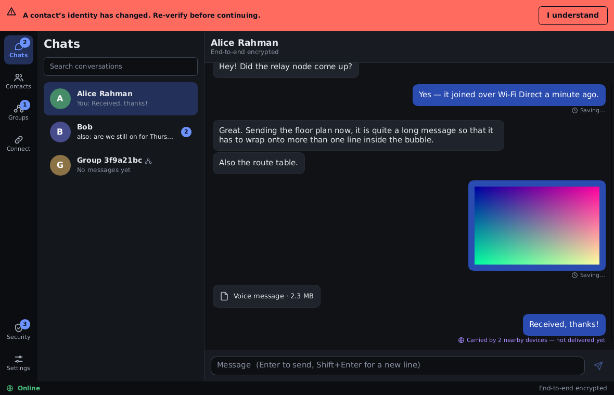
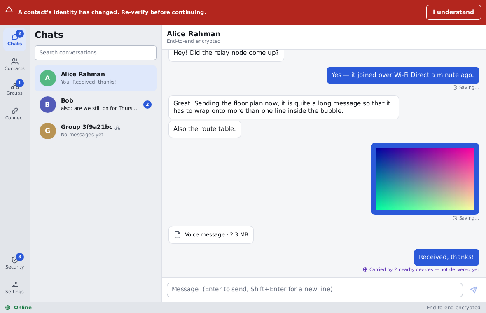
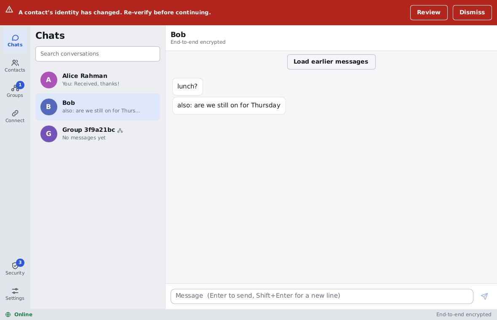
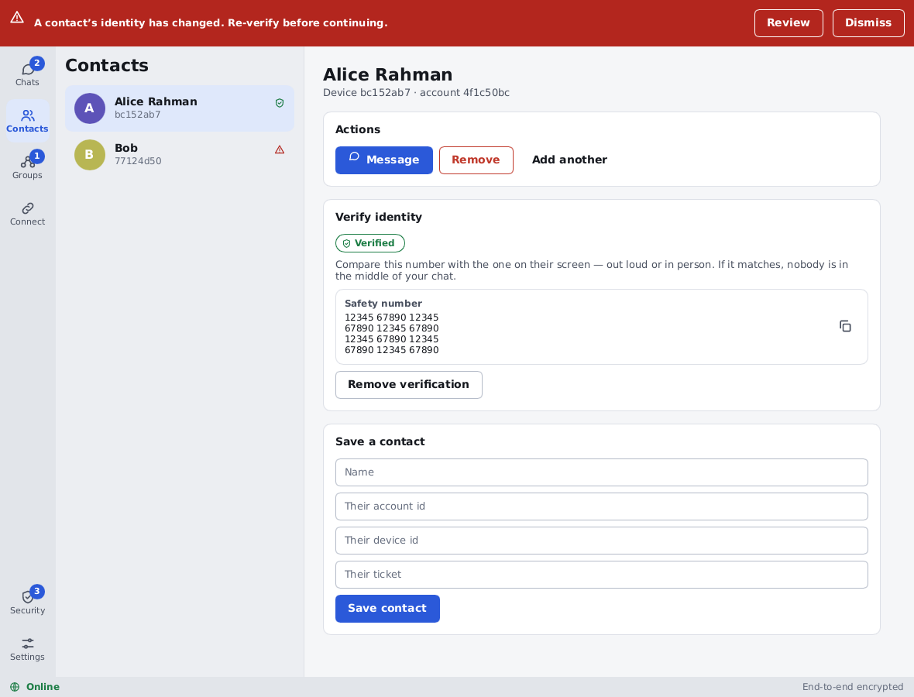
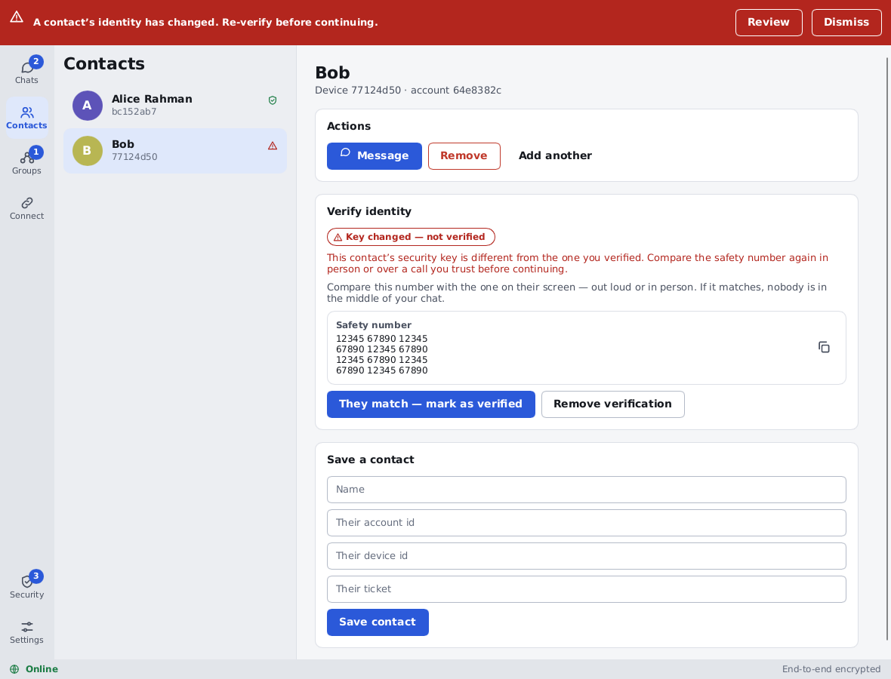
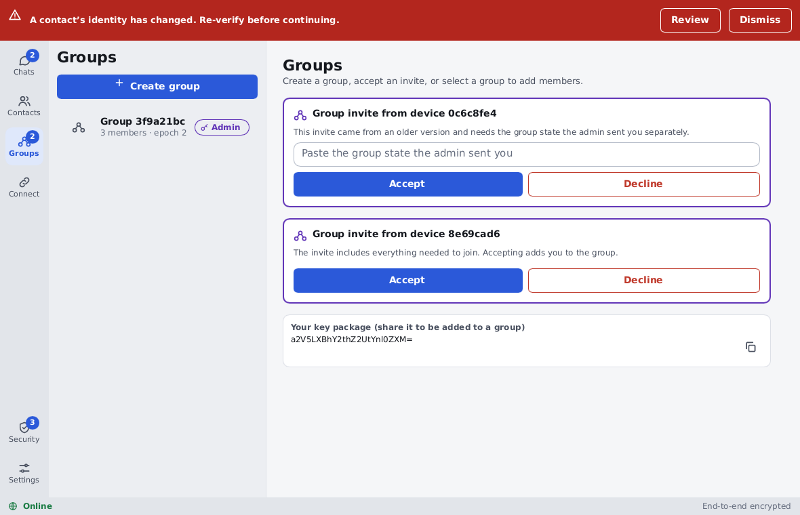
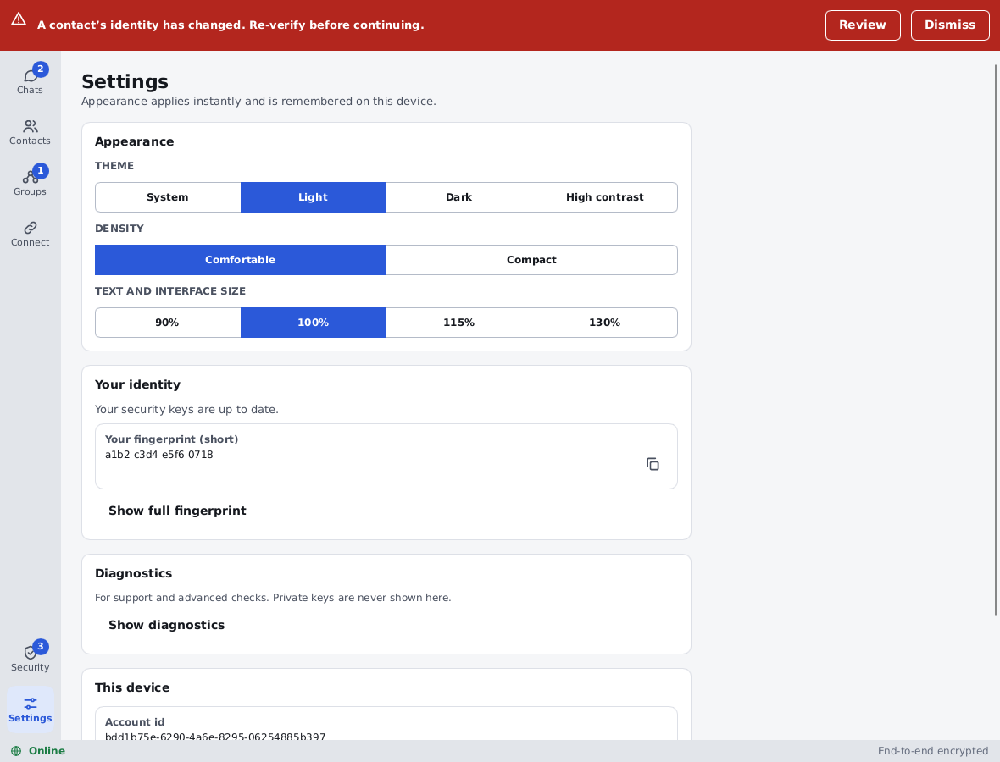

# SIAR Desktop UI Reference & Mockup Gallery

This directory contains the visual design references for the SIAR Desktop client (built with Dioxus/Slint). Each screenshot corresponds directly to specific UI/UX architecture specifications defined in [`docs/ui-gui-architecture.md`](file:///home/irshad/Projects/siar/docs/ui-gui-architecture.md) and [`ui-ux/`](file:///home/irshad/Projects/siar/ui-ux/).

---

## 1. Chat Interface (Dark Mode)
**File**: [`chat-dark.png`](file:///home/irshad/Projects/siar/docs/screenshots/chat-dark.png)

- **Architecture Specs**:
  - [`docs/ui-gui-architecture.md`](file:///home/irshad/Projects/siar/docs/ui-gui-architecture.md) (Desktop 3-Pane Shell: Navigation Rail 64px, Conversation List 320px, Timeline Pane)
  - [`ui-ux/ui-ux-04-conversation-list-inbox-architecture.md`](file:///home/irshad/Projects/siar/ui-ux/ui-ux-04-conversation-list-inbox-architecture.md)
  - [`ui-ux/ui-ux-05-conversation-message-timeline-architecture.md`](file:///home/irshad/Projects/siar/ui-ux/ui-ux-05-conversation-message-timeline-architecture.md)
  - [`ui-ux/ui-ux-06-message-composer-attachments-voice-notes-drafts-architecture.md`](file:///home/irshad/Projects/siar/ui-ux/ui-ux-06-message-composer-attachments-voice-notes-drafts-architecture.md)
- **Features Highlighted**:
  - High-priority security warning banner across the window header.
  - Left rail with unread counter badges (Chats: 2, Groups: 1, Security: 3) and status footer (`Online`).
  - Multimedia attachments (Voice message player, encrypted image preview).
  - Delay-Tolerant Networking (DTN) delivery captions (*"Carried by 2 nearby devices — not delivered yet"*).

---

## 2. Chat Interface (Light Mode)
**File**: [`chat-light.png`](file:///home/irshad/Projects/siar/docs/screenshots/chat-light.png)

- **Architecture Specs**:
  - [`ui-ux/ui-ux-22-design-system-tokens-typography-icons-motion-architecture.md`](file:///home/irshad/Projects/siar/ui-ux/ui-ux-22-design-system-tokens-typography-icons-motion-architecture.md) (Design system tokens, light theme palette, contrast ratios)
- **Features Highlighted**:
  - Light mode styling with cohesive border radii, neutral background tokens, and accessible text contrast.

---

## 3. Timeline Pagination & History Virtualization
**File**: [`chat-load-earlier.png`](file:///home/irshad/Projects/siar/docs/screenshots/chat-load-earlier.png)

- **Architecture Specs**:
  - [`ui-ux/ui-ux-26-performance-virtualization-large-data-ui-architecture.md`](file:///home/irshad/Projects/siar/ui-ux/ui-ux-26-performance-virtualization-large-data-ui-architecture.md)
  - [`ui-ux/ui-ux-05-conversation-message-timeline-architecture.md`](file:///home/irshad/Projects/siar/ui-ux/ui-ux-05-conversation-message-timeline-architecture.md)
- **Features Highlighted**:
  - Bounded window rendering with discrete chunk pagination via the `"Load earlier messages"` action.
  - Safe memory discipline preventing unbounded DOM tree allocation for long conversation logs.

---

## 4. Contact Verification (Verified State)
**File**: [`contact-verified.png`](file:///home/irshad/Projects/siar/docs/screenshots/contact-verified.png)

- **Architecture Specs**:
  - [`ui-ux/ui-ux-08-contacts-requests-verification-identity-architecture.md`](file:///home/irshad/Projects/siar/ui-ux/ui-ux-08-contacts-requests-verification-identity-architecture.md)
  - [`ui-ux/ui-ux-15-security-center-devices-keys-recovery-architecture.md`](file:///home/irshad/Projects/siar/ui-ux/ui-ux-15-security-center-devices-keys-recovery-architecture.md)
- **Features Highlighted**:
  - Green shield verified badge for authenticated peer cryptographic identities.
  - 60-digit Short Authentication String (SAS) numeric safety number blocks with copy utility.
  - Add/save contact form supporting Account ID, Device ID, and ticket tokens.

---

## 5. Contact Security Warning (Key Changed)
**File**: [`contact-key-changed.png`](file:///home/irshad/Projects/siar/docs/screenshots/contact-key-changed.png)

- **Architecture Specs**:
  - [`ui-ux/ui-ux-08-contacts-requests-verification-identity-architecture.md`](file:///home/irshad/Projects/siar/ui-ux/ui-ux-08-contacts-requests-verification-identity-architecture.md)
  - [`sys-arch/28-production-security-e2ee-key-management-privacy-architecture.md`](file:///home/irshad/Projects/siar/sys-arch/28-production-security-e2ee-key-management-privacy-architecture.md)
- **Features Highlighted**:
  - Red warning status (`Key changed — not verified`) triggering re-verification requirements upon unexpected key rotation or MITM attempt.
  - Action buttons: *"They match — mark as verified"* and *"Remove verification"*.

---

## 6. Groups & MLS Group Invitations
**File**: [`groups-invites.png`](file:///home/irshad/Projects/siar/docs/screenshots/groups-invites.png)

- **Architecture Specs**:
  - [`ui-ux/ui-ux-09-groups-membership-roles-architecture.md`](file:///home/irshad/Projects/siar/ui-ux/ui-ux-09-groups-membership-roles-architecture.md)
  - [`sys-arch/04-offline-event-log-architecture.md`](file:///home/irshad/Projects/siar/sys-arch/04-offline-event-log-architecture.md)
- **Features Highlighted**:
  - Group invitation cards indicating the inviter's device ID.
  - Out-of-band group state fallback entry field for offline/mesh epoch convergence.
  - User's base64 KeyPackage export card for joining new MLS groups.

---

## 7. Settings & Identity Verification
**File**: [`settings-identity.png`](file:///home/irshad/Projects/siar/docs/screenshots/settings-identity.png)

- **Architecture Specs**:
  - [`ui-ux/ui-ux-18-settings-privacy-notifications-data-controls-architecture.md`](file:///home/irshad/Projects/siar/ui-ux/ui-ux-18-settings-privacy-notifications-data-controls-architecture.md)
  - [`ui-ux/ui-ux-22-design-system-tokens-typography-icons-motion-architecture.md`](file:///home/irshad/Projects/siar/ui-ux/ui-ux-22-design-system-tokens-typography-icons-motion-architecture.md)
- **Features Highlighted**:
  - Appearance controls: Theme (System, Light, Dark, High contrast), Density (Comfortable, Compact), Text size scaling (90% to 130%).
  - Cryptographic Identity display: Short fingerprint representation (`a1b2 c3d4 e5f6 0718`) and full fingerprint trigger.
  - Diagnostic access and local device metadata (Account ID UUID).
