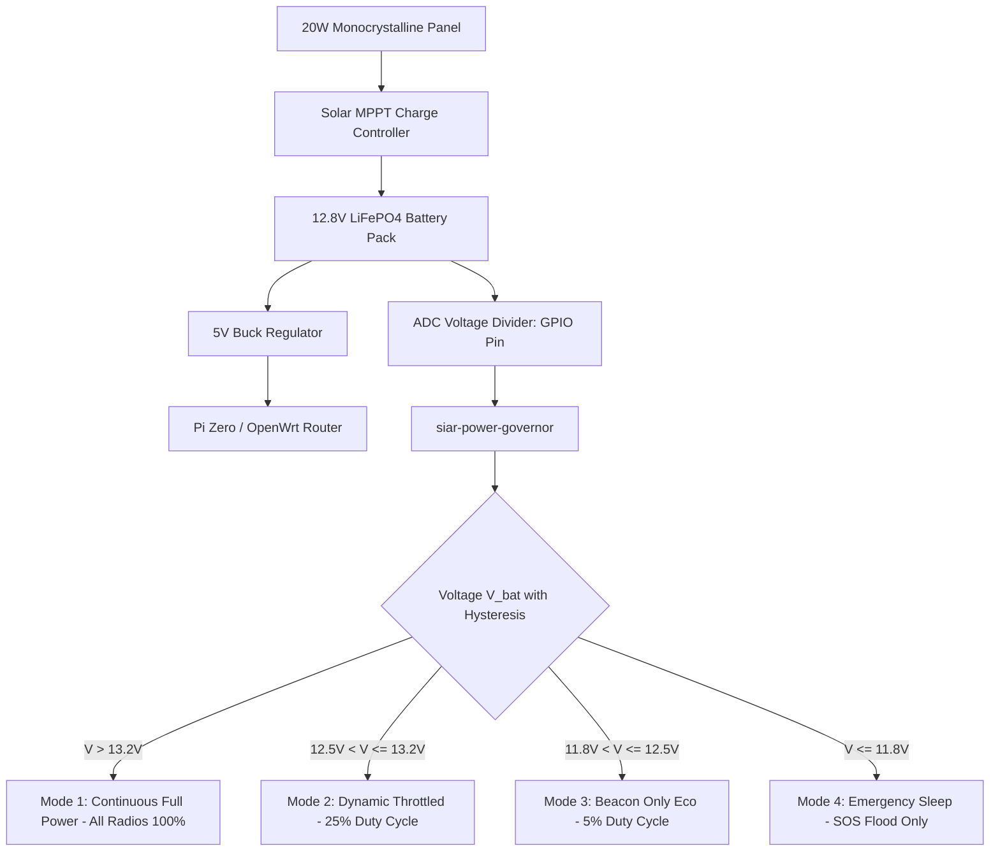

# 19 — Headless Daemons & Embedded Nodes

> **Corresponding Specifications:** [`sys-arch/16-daemon-headless-runtime-architecture.md`](../sys-arch/16-daemon-headless-runtime-architecture.md), [`sys-arch/20-embedded-linux-node-architecture.md`](../sys-arch/20-embedded-linux-node-architecture.md)  
> **Key Applications:** [`apps/emergency-node`](../apps/emergency-node), [`apps/cli`](../apps/cli)  
> **Complements:** [`SIAR_SYSTEM_ARCHITECTURE_DESIGN_RATIONALE.md`](../SIAR_SYSTEM_ARCHITECTURE_DESIGN_RATIONALE.md) (§2.6, §2.19), [Wiki Chapter 07](07-Battery-Aware-Scheduling-and-Emergency-Mesh.md), [Wiki Chapter 23](23-Off-Grid-Survival-and-Field-Operations-Guide.md)

---

## 1. Architectural Philosophy: The Sovereign Unattended Repeater

In tactical operations, disaster relief zones, and wilderness search-and-rescue, continuous communication relies heavily on autonomous, unattended relay towers, solar-powered repeaters mounted on high ridges, and vehicle-mounted gateways. These nodes operate without monitors, keyboards, or human operators, frequently facing:
1. **Hostile Environmental Conditions**: Freezing cold, extreme desert heat, and erratic solar charging cycles causing recurrent brownouts.
2. **Flash Memory Wear**: Cheap micro-SD cards and raw SPI-NAND flash on embedded Single Board Computers (Raspberry Pi, Banana Pi, ESP32 gateways) suffer catastrophic wear and corrupted filesystems if subjected to constant synchronous disk writes during brownouts.
3. **Severe Hardware Resource Limits**: Commercial-off-the-shelf (COTS) Wi-Fi routers (OpenWrt) often possess only $64\text{–}128\text{ MB}$ of total RAM and slow $580\text{ MHz}$ MIPS CPUs with small L1/L2 caches.
4. **Physical Capture Risks**: Remote repeaters deployed on hillsides are vulnerable to physical theft and hardware probing (UART, JTAG) by adversaries.

SIAR provides **`apps/emergency-node`**—a hardened, pure-Rust headless daemon designed to run unattended for multi-year missions on minimal power budgets:

```
+------------------------------------------------------------------------------------+
|                         Embedded Node Architecture                                 |
+------------------------------------------------------------------------------------+
|                                                                                    |
| [Hardware: Raspberry Pi Zero 2 W / OpenWrt MIPS / RISC-V SBC]                      |
|   ├── Read-Only Root Filesystem (SquashFS / OverlayFS on tmpfs)                     |
|   ├── Hardware Watchdog Timer (/dev/watchdog with ioctl pinging)                   |
|   └── Hardware Secure Element / Optiga Trust M / ATECC608A (Optional)              |
|                                                                                    |
| [SIAR Emergency Node Runtime (apps/emergency-node)]                                |
|   ├── Solar Power Governor (ADC Voltage Telemetry & Peukert's Math)                |
|   ├── Pure-Rust Stoolap DB (Zero C-compiler dependency, in-memory WAL on tmpfs)    |
|   ├── Multi-Interface Packet Forwarder (BLE GATT + Wi-Fi 802.11s Mesh + Ethernet)  |
|   ├── Low-Memory Deficit Queuing (Drop-tail backpressure, 32MB max heap)           |
|   └── Unix Domain Socket IPC (/run/siar/siar.sock - JSON-RPC 2.0 async framing)     |
+------------------------------------------------------------------------------------+
```

---

## 2. Threat Model & Physical Hardening

Embedded nodes in the wild operate in zero-trust environments where physical security cannot be guaranteed:

| Threat Vector | Adversary Profile | Impact | SIAR Embedded Daemon Mitigation |
| :--- | :--- | :--- | :--- |
| **Physical Node Theft on Ridge** | Hostile patrol steals unattended solar repeater | Firmware extraction, secret compromise | Node stores zero long-term private conversation databases; acts strictly as an oblivious store-and-forward relay. Root keys stored in volatile RAM; wiped on power loss. |
| **Brownout Flash Corruption** | Cloud cover or freezing temp starves solar battery | Corrupted filesystem blocks | Rootfs mounted strictly Read-Only (`ro` SquashFS); local ephemeral caches reside in memory-backed `tmpfs`. Atomic write barriers for state updates. |
| **Hardware Probing (UART/JTAG)** | Interceptor attaches logic analyzer to PCB test pads | Shell escape, bus sniffing | Embedded bootloader disables serial console login (`console=null`); JTAG fuses permanently blown during provisioning; tamper sensor triggers active memory scrub. |
| **Buffer Exhaustion (OOM)** | Malicious mesh flood overwhelms 64 MB router RAM | Kernel OOM killer terminates daemon | Hard bounded ring buffers; bundle storage spills to non-volatile quota or drops non-urgent frames via deficit round-robin drop-tail policies. |
| **Software Deadlock / Panic** | Kernel thread hangs in unhandled Wi-Fi driver state | Permanent communication outage | Hardware watchdog (`/dev/watchdog`) automatically triggers physical system reset if daemon heartbeat stops for $>30\text{ seconds}$. |
| **RF Jamming / Thermal Runaway**| High ambient temp ($>55^\circ\text{C}$) or RF jammer | CPU throttle, radio lockup | Adaptive duty cycling throttles TX power; temperature sensor (`/sys/class/thermal`) shifts node to passive listen-only cooldown mode. |

---

## 3. Solar Energy Harvesting & Power State Machine

Autonomous repeaters monitor battery chemistry (typically LiFePO4 4S, $12.8\text{V}$ nominal, or 18650 Li-ion 3S, $11.1\text{V}$ nominal) via Analog-to-Digital Converter (ADC) pins on GPIO lines:



### Mathematical Energy Budget & Peukert Formulation

The net energy stored in the battery over time interval $[0, T]$ is governed by:

$$E_{\text{batt}}(T) = E_0 + \int_0^T \left( P_{\text{solar}}(t) \cdot \eta_{\text{mppt}} - P_{\text{load}}(t) \right) dt$$

Where:
- $P_{\text{solar}}(t) = G(t) \cdot A_{\text{panel}} \cdot \eta_{\text{pv}}$ is solar power harvested under solar irradiance $G(t) \text{ [W/m}^2\text{]}$.
- $\eta_{\text{mppt}} \approx 0.94$ is MPPT conversion efficiency.
- $P_{\text{load}}(t) = P_{\text{cpu}}(t) + P_{\text{ble}}(t) + P_{\text{wifi}}(t) + P_{\text{lora}}(t)$ is the instantaneous power consumption.

Under high discharge currents, the effective battery capacity $C_{\text{eff}}$ decreases according to **Peukert's Law**:

$$C_p = I^k \cdot t \implies t = \frac{C_p}{I^k}$$

Where $k \approx 1.05$ for LiFePO4 (exceptionally flat discharge curve) and $k \approx 1.25$ for standard Li-ion chemistry.

To prevent erratic oscillations (state flapping) between power modes around threshold boundaries, the governor applies **voltage hysteresis** $\Delta V_{\text{hyst}} = 0.2\text{ V}$:

$$\text{Transition to Higher Mode} \iff V_{\text{bat}} > V_{\text{thresh}} + \Delta V_{\text{hyst}}$$
$$\text{Transition to Lower Mode} \iff V_{\text{bat}} < V_{\text{thresh}}$$

$$\text{PowerProfile}(V_{\text{bat}}) = \begin{cases} 
\text{ContinuousFull} & V_{\text{bat}} \ge 13.2\text{ V} \\
\text{DynamicThrottled} & 12.5\text{ V} \le V_{\text{bat}} < 13.2\text{ V} \\
\text{BeaconOnlyEco} & 11.8\text{ V} \le V_{\text{bat}} < 12.5\text{ V} \\
\text{EmergencySleep} & V_{\text{bat}} < 11.8\text{ V} 
\end{cases}$$

---

## 4. Headless Daemon Runtime & Binary IPC Architecture (`siar-daemon`)

SIAR's headless daemon ([`apps/daemon`](../apps/daemon)) is powered by [`crates/siar-runtime`](../crates/siar-runtime) and acts as the sole custodian of active databases, crypto keys, and network transports:

### 4.1. Binary IPC Protocol (`comm-ipc/1`)
Clients (`apps/cli` and `apps/desktop`) communicate with `siar-daemon` over local IPC:
- **Unix**: Unix Domain Socket (`/run/siar/siar.sock` or `~/.local/share/siar/daemon.sock`).
- **Windows**: Named pipes (`\\.\pipe\siar-daemon`) via the cross-platform `interprocess` crate.
- **Framing & Serialization**: Length-delimited Postcard/serde binary frames with strict invariant re-validation.
- **Command Idempotency**: Every mutating operation carries a `CommandId` evaluated against an in-memory command ledger, preventing duplicate executions upon client reconnections or retries.

### 4.2. Daemon Control Plane (`siar-daemon ctl`)
Operators and management scripts control the running daemon via `ctl` subcommands:
```bash
# Check daemon health and subsystem statuses
siar-daemon ctl status

# Output lossless machine-readable state in RON format
siar-daemon ctl --ron status

# Toggle maintenance and read-only modes
siar-daemon ctl maintenance on
siar-daemon ctl maintenance off

# Trigger hot snapshot backup or staged restore
siar-daemon ctl backup /var/backups/siar
siar-daemon ctl restore /var/backups/siar/snapshot.tar.gz

# Inspect live audit events
siar-daemon ctl audit
```

---

## 5. Supervised Role Launcher & Emergency Relays (`apps/daemon/src/roles.rs`)

`siar-daemon` provisions and manages node capabilities according to its designated `NodeRole`:

| Node Role | Features Enabled | Process Execution Model |
| :--- | :--- | :--- |
| **`PersonalDevice`** | Messaging, Identity, Stoolap DB, MLS | Single process hosting `siar-app-core`. |
| **`RelayGateway`** | DTN, Iroh Relay, SOS Broadcasting | Runs `siar-emergency-node` as a supervised child process. |
| **`DtnNode`** | Store-Carry-Forward, Bundle Sync | Supervised child relay with bounded storage quotas. |
| **`OrganizationNode`** | Dual Messaging + Emergency Relay | Runs chat core alongside supervised child relay. |
| **`StorageNode`** | Distributed Blob Manifests | Dedicated high-capacity chunk store. |

### Process Supervision Invariants
- **Strict Binary Path Isolation**: Child binaries (`siar-emergency-node`) are discovered strictly beside the daemon's own executable; `PATH` lookups are disallowed to prevent binary planting attacks.
- **Lifecycle Guarantees**: Started with `kill_on_drop`. Unexpected exits trigger bounded restart policies (5 restarts / 60 seconds with exponential backoff). Shutdown dispatches graceful SIGTERM with a 10-second escalation grace period.

---

## 6. Remote Administration over Iroh QUIC (`crates/siar-admin`)

Headless field nodes deployed on mountaintops or remote facilities are managed securely over authenticated Iroh QUIC connections (`comm-admin/1`):

### 6.1. Role-Based Access Control (RBAC)
Operations enforce an exhaustive 4-tier hierarchy:
$$\text{Viewer} < \text{Operator} < \text{SecurityAdmin} < \text{Owner}$$

- **Viewer**: Health, metrics, link diagnostics, battery power status, provisioning state.
- **Operator**: Maintenance mode toggling, read-only mode, hot snapshot backups.
- **SecurityAdmin**: Durable audit log inspection and security policy configuration.
- **Owner**: Disaster restore, remote graceful shutdown.

### 6.2. Administrative Security Invariants
- **No Remote Shell**: There is zero command execution, shell pass-through, or message content inspection by design.
- **Strict Operator Allowlist**: Connecting QUIC endpoints authenticate via Ed25519 public keys listed in local daemon configuration. Unlisted keys are disconnected before parsing any wire bytes.
- **Per-Operator Rate Limiting**: Token-bucket rate limiting prevents brute-force denial of service.

---

## 7. Durable Hash-Chained Audit Logging (`siar-runtime::audit_file`)

Every administrative and security-critical action is appended to `<data>/audit/audit.log` (mode `0600`):

### 7.1. Mathematical BLAKE3 Hash Chaining
Each log line forms an authenticated chain link:
$$\text{Chain}_0 = \text{BLAKE3}(\text{Genesis})$$
$$\text{Chain}_i = \text{BLAKE3}(\text{Chain}_{i-1} \parallel \text{LogBody}_i)$$

- Single-byte tampering, deleted lines, or reordered entries invalidate all subsequent hash links.
- **Tamper Quarantine**: If the daemon detects hash chain corruption on startup, it moves the corrupted evidence to `audit.corrupt-<ms>/` intact, emits a visible alert, and initializes a fresh chain starting with `audit:chain-restarted`.
- **Offline Verifier**: Operators verify log integrity on air-gapped forensic machines using:
  ```bash
  siar-daemon audit-verify /var/lib/siar/audit
  ```

---

## 8. Headless Provisioning & FROST Enrolment

Unattended nodes boot in an unprovisioned state running only a local `BootstrapListener` until provisioned:
- **Challenge-Response Provisioning**: The node generates an ephemeral QR challenge. The operator signs a `ProvisionPayload` specifying node roles, admin public keys, and network parameters using an authorized Ed25519 key or a 2-of-3 threshold **FROST** signature.
- **Exit 75 Restart**: Upon successful signature verification, the daemon writes the provisioned state atomically to disk (mode `0600`) and exits with **code 75**, prompting Systemd unit managers to restart into its active operational role.

---

## 9. Linux Service Deployment (Systemd & OpenWrt Procd)

### 1. Systemd Service Unit (`/etc/systemd/system/siar-node.service`)

```ini
[Unit]
Description=SIAR Headless Emergency Mesh Node
After=network.target bluetooth.target
Requires=bluetooth.target

[Service]
Type=notify
User=siar
Group=siar
ExecStart=/usr/local/bin/siar-emergency-node --config /etc/siar/node.toml
Restart=always
RestartSec=5s
MemoryMax=32M
MemoryHigh=28M
CPUQuota=50%
ProtectSystem=strict
ProtectHome=true
PrivateTmp=true
ProtectKernelTunables=true
ProtectControlGroups=true
ReadWritePaths=/var/lib/siar /run/siar
WatchdogSec=30s

[Install]
WantedBy=multi-user.target
```

### 2. OpenWrt Procd Init Script (`/etc/init.d/siar`)

```sh
#!/bin/sh /etc/rc.common
START=95
STOP=10
USE_PROCD=1

start_service() {
    procd_open_instance
    procd_set_param command /usr/bin/siar-emergency-node --config /etc/siar/openwrt.toml
    procd_set_param respawn 3600 5 0
    procd_set_param limits core="0"
    procd_set_param nice -10
    procd_set_param file /etc/siar/openwrt.toml
    procd_close_instance
}

service_triggers() {
    procd_add_reload_trigger "siar"
}
```

---

## 10. Production Rust Implementation: Hardware Watchdog & Power Governor

The following production-grade Rust implementation drives the unattended embedded daemon lifecycle, managing `/dev/watchdog` hardware pings, thermal monitoring, and battery telemetry:

```rust
use std::fs::{File, OpenOptions};
use std::io::{self, Read, Write};
use std::os::unix::fs::OpenOptionsExt;
use std::os::unix::io::{AsRawFd, RawFd};
use std::path::Path;
use std::time::{Duration, Instant};

/// Linux Watchdog ioctl magic constants (linux/watchdog.h)
const WDIOC_KEEPALIVE: libc::c_ulong = 0x80045705;

#[derive(Debug, Clone, Copy, PartialEq, Eq)]
pub enum PowerProfile {
    ContinuousFull,
    DynamicThrottled { duty_cycle_pct: u8 },
    BeaconOnlyEco { duty_cycle_pct: u8 },
    EmergencySleep { wake_interval_sec: u32 },
}

pub struct HardwareWatchdog {
    file: Option<File>,
    timeout_secs: u32,
}

impl HardwareWatchdog {
    pub fn open<P: AsRef<Path>>(device_path: P, timeout_secs: u32) -> io::Result<Self> {
        let file = OpenOptions::new()
            .write(true)
            .custom_flags(libc::O_NONBLOCK)
            .open(device_path)?;
        Ok(Self {
            file: Some(file),
            timeout_secs,
        })
    }

    /// Ping hardware watchdog using libc ioctl to prevent hardware system reset
    pub fn ping(&mut self) -> io::Result<()> {
        if let Some(ref mut f) = self.file {
            let fd: RawFd = f.as_raw_fd();
            let ret = unsafe { libc::ioctl(fd, WDIOC_KEEPALIVE, 0) };
            if ret < 0 {
                return Err(io::Error::last_os_error());
            }
        }
        Ok(())
    }

    /// Gracefully disarm the watchdog by writing 'V' before exit
    pub fn disarm(mut self) -> io::Result<()> {
        if let Some(mut f) = self.file.take() {
            f.write_all(b"V")?;
            f.flush()?;
        }
        Ok(())
    }
}

pub struct SolarPowerGovernor {
    pub current_voltage: f32,
    pub battery_soc_percent: u8,
    pub active_profile: PowerProfile,
    hysteresis_v: f32,
    last_transition: Instant,
}

impl SolarPowerGovernor {
    pub fn new() -> Self {
        Self {
            current_voltage: 13.0,
            battery_soc_percent: 85,
            active_profile: PowerProfile::ContinuousFull,
            hysteresis_v: 0.20,
            last_transition: Instant::now(),
        }
    }

    /// Evaluates voltage with hysteresis to prevent oscillation between operating modes
    pub fn evaluate_state(&mut self, measured_v: f32) -> PowerProfile {
        self.current_voltage = measured_v;
        
        let new_profile = match self.active_profile {
            PowerProfile::ContinuousFull => {
                if measured_v < 13.0 {
                    PowerProfile::DynamicThrottled { duty_cycle_pct: 25 }
                } else {
                    PowerProfile::ContinuousFull
                }
            }
            PowerProfile::DynamicThrottled { .. } => {
                if measured_v >= (13.2 + self.hysteresis_v) {
                    PowerProfile::ContinuousFull
                } else if measured_v < 12.3 {
                    PowerProfile::BeaconOnlyEco { duty_cycle_pct: 5 }
                } else {
                    self.active_profile
                }
            }
            PowerProfile::BeaconOnlyEco { .. } => {
                if measured_v >= (12.5 + self.hysteresis_v) {
                    PowerProfile::DynamicThrottled { duty_cycle_pct: 25 }
                } else if measured_v < 11.8 {
                    PowerProfile::EmergencySleep { wake_interval_sec: 300 }
                } else {
                    self.active_profile
                }
            }
            PowerProfile::EmergencySleep { .. } => {
                if measured_v >= (12.0 + self.hysteresis_v) {
                    PowerProfile::BeaconOnlyEco { duty_cycle_pct: 5 }
                } else {
                    self.active_profile
                }
            }
        };

        if new_profile != self.active_profile {
            self.active_profile = new_profile;
            self.last_transition = Instant::now();
        }

        self.active_profile
    }

    /// Read SBC CPU core thermal telemetry from Linux sysfs
    pub fn read_core_temperature() -> io::Result<f32> {
        let mut content = String::new();
        File::open("/sys/class/thermal/thermal_zone0/temp")?.read_to_string(&mut content)?;
        let millidegrees: f32 = content
            .trim()
            .parse()
            .map_err(|e| io::Error::new(io::ErrorKind::InvalidData, e))?;
        Ok(millidegrees / 1000.0)
    }
}
```

---

## 11. Command-Line Interface (`apps/cli` — `siar`)

The `siar` CLI acts as a client connected to the local `siar-daemon` IPC socket, supporting scriptable administration, headless messaging, and field diagnostics:

```bash
# Daemon management & auto-spawning
$ siar --spawn status          # Spawns background daemon if not already running
$ siar identity               # Displays local AccountId and Root Public Key
$ siar ticket                 # Generates/prints local transport ticket for pairing
$ siar key-package            # Fetches/generates MLS KeyPackage for group invites

# Direct messaging & file transfers
$ siar pair <ticket>          # Pairs with a peer ticket and establishes conversation
$ siar conversations          # Lists all active 1:1 and group conversations
$ siar send <conv-id> "Message over mesh"
$ siar send-file <conv-id> /path/to/intel.pdf
$ siar listen                 # Streams incoming messages and delivery ACKs

# Anonymous relay mailboxes
$ siar send-anon <relay-ticket> <dest-pubkey> "Secret via relay"
$ siar check-mailbox-anon <relay-ticket> <dest-pubkey>

# Multi-device linking
$ siar link-offer             # Generates 80-bit code and prints ticket
$ siar link-join <ticket> <code>  # Submits join request from fresh device
$ siar link-pending           # Lists join requests waiting for approval
$ siar link-approve <device-id> # Approves device and signs certificate
$ siar devices                # Lists all linked devices and status

# Group management
$ siar group-create "Alpha Team"
$ siar group-add <group-id> <key-package>
$ siar group-send <group-id> "Situation report"
```

---

## 12. Cross-Compilation & Target Triples Matrix

SIAR daemons compile to static standalone binaries using `musl-libc` with zero shared library dependencies:

| Architecture | Target Triple | Target Device | Binary Size (Stripped) | Memory Footprint |
| :--- | :--- | :--- | :--- | :--- |
| **ARMv6 (32-bit)** | `arm-unknown-linux-musleabihf` | Raspberry Pi Zero / Zero W | $4.8\text{ MB}$ | $14\text{ MB}$ RSS |
| **ARMv7 (32-bit)** | `armv7-unknown-linux-musleabihf` | Raspberry Pi 2 / Orange Pi Zero | $5.1\text{ MB}$ | $16\text{ MB}$ RSS |
| **AArch64 (64-bit)** | `aarch64-unknown-linux-musl` | Pi Zero 2 W / Pi 4 / Rock64 | $6.2\text{ MB}$ | $18\text{ MB}$ RSS |
| **MIPS32 (Big Endian)** | `mips-unknown-linux-musl` | GL.iNet AR750 / Atheros AR9331 | $4.2\text{ MB}$ | $12\text{ MB}$ RSS |
| **MIPS32 (Little Endian)** | `mipsel-unknown-linux-musl` | MediaTek MT7628 / MT7621 Routers | $4.3\text{ MB}$ | $12\text{ MB}$ RSS |
| **RISC-V (64-bit)** | `riscv64gc-unknown-linux-musl` | Milk-V Duo / StarFive VisionFive 2 | $5.6\text{ MB}$ | $16\text{ MB}$ RSS |
